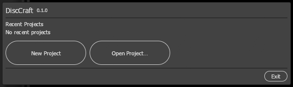
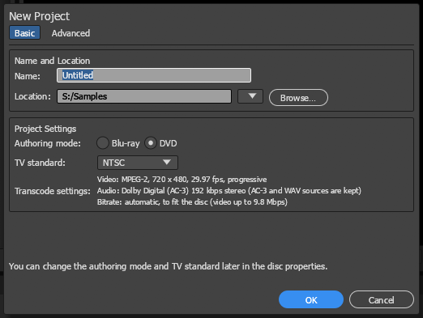

# 2. Getting Started

[Contents](README.md) · Previous: [1. About DiscCraft](01-about.md#1-about-disccraft) · Next: [3. Making Your First DVD](03-tutorial.md#3-making-your-first-dvd)

> **In this chapter**
>
> - Launch DiscCraft and create a new project
> - Save the project
> - Learn where settings are stored

## 2.1 Welcome Screen

When you launch the application, the welcome screen opens.

- **Recent Projects**: Files you have opened before (up to 10). Click a row to open it. Right-click and choose **Remove
  from List** to remove it from the list (the file is not deleted). Missing files appear grayed out and cannot be
  opened.
- **New Project**: Opens the New Project dialog
- **Open Project…**: Select a `.dcproj` file
- **Exit**: Quit the application

After closing the welcome screen, you can do the same things with **File ▸ New ▸ Project** (Ctrl+N) and **File ▸ Open
Project…** (Ctrl+O).

## 2.2 New Project

The **New Project** dialog has two tabs: **Basic** and **Advanced**.

| Tab | Items |
|---|---|
| Basic | Name, Location, Authoring mode (DVD / Blu-ray), TV standard (NTSC / PAL), Blu-ray video format (Blu-ray only), Transcode settings summary |
| Advanced | Aspect ratio (4:3 / 16:9), Disc capacity (DVD5 / DVD9, BD25 / BD50 / BD100 / BD128) |

- If you leave Location empty, you will be asked for a location when saving.
- The default TV standard can be changed in [Preferences](18-preferences.md#18-preferences).
- New Blu-ray projects are HD (NTSC is 1920 x 1080 at 23.976 fps, PAL is H.264 1080i at 25 fps. Both match the New
  Project dialog in Encore). Files that match the format are placed on the disc as is; files that do not match are
  converted (by default, average 12 Mbps H.264, and average 25 Mbps MPEG-2 for 1080i. If there is room on the disc,
  these are raised to use available space—H.264 up to 25 Mbps, MPEG-2 up to 32 Mbps—and lowered if they do not fit). If
  you set the Blu-ray video format to **SD (MPEG-2)**, HD assets are downscaled and converted to SD.
- Pressing **OK** creates `<Location>/<Name>.dcproj` immediately and starts editing.

Items that can be changed later: Authoring mode, Blu-ray video format, aspect ratio, and capacity via **File ▸ Project
Settings…**; disc name and capacity via **Disc Info** in the **Build** panel; general disc settings (including Blu-ray
video size SD (MPEG-2) / HD (H.264), and Blu-ray codecs **Automatic (MPEG-2 for SD and 1080i)**, **H.264 (every
format)**, and **MPEG-2 (every format)**) via the **Disc** panel.

## 2.3 Saving

- Choose **File ▸ Save** (Ctrl+S). The project is also saved first when building.
- Choose **File ▸ Save As…** (Shift+Ctrl+S)
- If you try to close, reopen, or exit the application with unsaved changes, a confirmation dialog appears.

The project (`.dcproj`) is a JSON text file. Assets are not copied; they are referenced by path. If you move assets to
another location, they become "Offline," so use **Replace Asset…** to specify the new location. A `<Project>.menus`
folder may appear next to the project (this is where PSD files go when editing menus in PhotoCraft or similar tools).

## 2.4 Where Settings Are Stored

Workspace layout, display language, recent projects, and table column widths are saved in a settings file.

| Location | Contents |
|---|---|
| Windows: `%APPDATA%\disccraft\workspace.json` Other: `~/.config/disccraft/workspace.json` | Workspace, panel layout, display language, recent projects, default TV standard |
| `library.json` in the same folder | Your own menus, buttons, backgrounds, text items, layer sets, and replacement layers added to the Library |
