# 3. Making Your First DVD

[Contents](README.md) · Previous: [2. Getting Started](02-getting-started.md#2-getting-started) · Next: [4. The Screen](04-screen.md#4-the-screen)

> **In this chapter**
>
> - Create a complete DVD with menus from scratch using video, photos, music, and subtitles

In this chapter, you will create one DVD with menus from three videos, four photos, one music track, and one subtitle
file. By following the steps in order, you will touch on every major workflow in DiscCraft (project, assets, timelines,
chapters, subtitles, slideshows, menus, navigation, checks, preview, build) once each. Detailed explanations for each
step are found in their respective chapters.

The assets and project shown in the screens of this chapter use synthetic samples created for DiscCraft practice (videos
with gradients and test patterns, chord sounds, and subtitles). You can achieve the same results with your own videos
and photos.

| Asset | Content | Usage in this chapter |
|---|---|---|
| Opening.mp4 | 12-second title video | Plays first when the disc is inserted |
| Journey.mp4 | 45-second video, scene changes every 15 seconds | Main movie. Three chapters |
| Making Of.mp4 | 20-second video | Bonus feature |
| Photo 1–4.png | Photos | Slideshow |
| Music.wav | 30-second music | Audio for the slideshow |
| Journey subtitles.srt | 6-line subtitle file | Subtitles for the main movie |

The flow of the finished disc is as follows.

1. When you insert the disc, the opening plays, and when it ends, it goes to the Main Menu.
2. The Main Menu has four buttons: **Play Movie**, **Chapters**, **Photos**, and **Making Of**.
3. **Chapters** leads to a menu for selecting chapters in the main movie.
4. When the main movie, photos, or Making Of ends, it returns to the Main Menu.

> **Tip**
>
> During work, save occasionally with **File ▸ Save** (Ctrl+S). If you make a mistake, you can undo it with **Edit ▸
> Undo** (Ctrl+Z).

## 3.1 Creating a Project

1. Launch DiscCraft and press **New Project** on the welcome screen.

   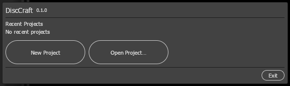

2. Enter the disc name in **Name** (here, "My First DVD") and select the folder to save in using **Location**.
3. Set the Authoring mode to **DVD**, and the TV standard to the one of the TVs the disc is for: **NTSC** in North
   America and Japan, **PAL** in most of Europe. For widescreen (16:9) videos, set the Aspect ratio to **16:9** on the
   **Advanced** tab (you can also change this later in the **Disc** panel).

   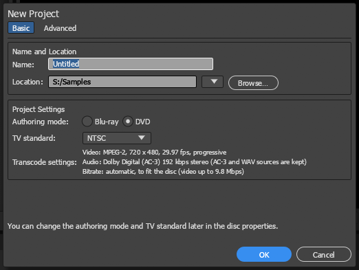

4. Press **OK**.

**Result**: `My First DVD.dcproj` is created in the selected location, and the screen shows an empty project.

## 3.2 Importing Assets

1. Choose **File ▸ Import ▸ Asset…** (Ctrl+I).
2. Select all asset files and press **Open**. You can also drag and drop from Explorer into the window.

**Result**: The imported assets appear in the **Project** panel. Assets are not copied; they are used in their original
location, so do not move them until the build is complete.

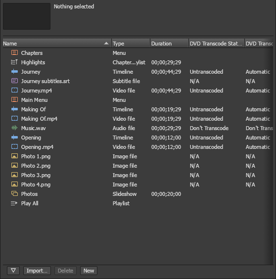

## 3.3 Creating Timelines

A timeline becomes one video title on the disc. Create one for each video.

1. Select "Opening.mp4" in the Project panel.
2. Choose **File ▸ New ▸ Timeline** (Ctrl+T).
3. Do the same for "Journey.mp4" and "Making Of.mp4".

**Result**: Three timelines are added to the Project panel, and the selected timeline opens in the Timeline panel at the
bottom.

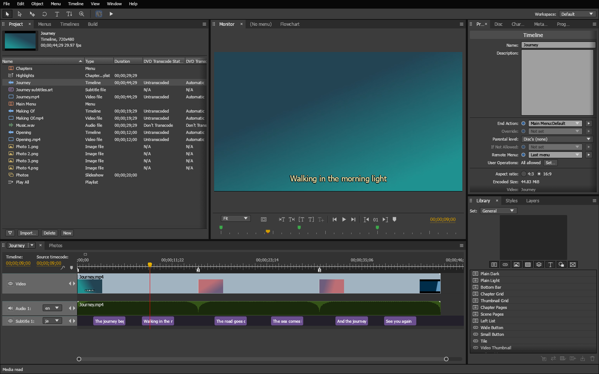

## 3.4 Adding Chapters

Adding chapters at scene changes in the main movie allows you to jump using the "Next" and "Previous" buttons on the
remote, and also enables creating a chapter menu.

1. Open the timeline for "Journey".
2. Place the Playhead at 15 seconds and choose **Timeline ▸ Add Chapter Point** (`*` on the numeric keypad).
3. Do the same at 30 seconds. Chapter 1 at the beginning exists from the start.
4. Select each chapter one by one and assign names ("Setting Out", "The Road", "Arrival") in the Properties. These names
   become the button text in the chapter menu.

**Result**: Three chapter markers appear above the timeline.

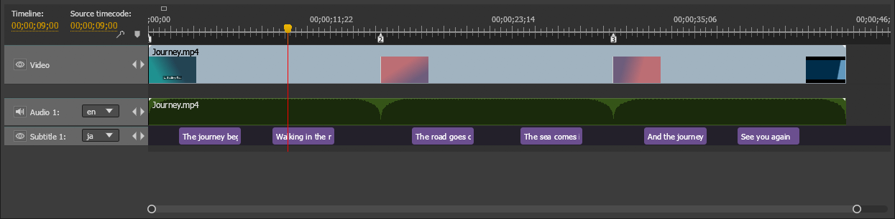

## 3.5 Adding Subtitles

1. With the "Journey" timeline still selected, choose **Timeline ▸ Import Subtitles ▸ Text Script…**.
2. Select "Journey subtitles.srt".

**Result**: A Subtitle Track is added to the timeline, and subtitles appear when you play it in the Monitor.

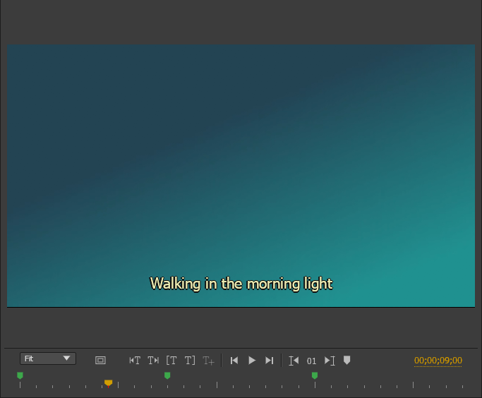

## 3.6 Creating a Slideshow

1. Choose **File ▸ Import ▸ Slideshow…** (Shift+Ctrl+G) and select the four photos.
2. In the Slideshow Viewer, select "Music.wav" from the list under **Add audio…**.
3. Set the slide length in the Properties.

**Result**: Four slides appear in the Slideshow Viewer with music attached.

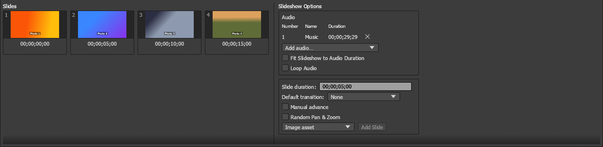

## 3.7 Creating the Main Menu

1. In the **Library** panel, select **Plain Dark** and press **New Menu** at the bottom. A menu with four buttons is
   created.
2. Click a button to select it and change the text in **Button text** in the Properties ("Play Movie", "Chapters",
   "Photos", "Making Of"). You can also access this field by selecting a button and choosing **Edit ▸ Rename…**.

   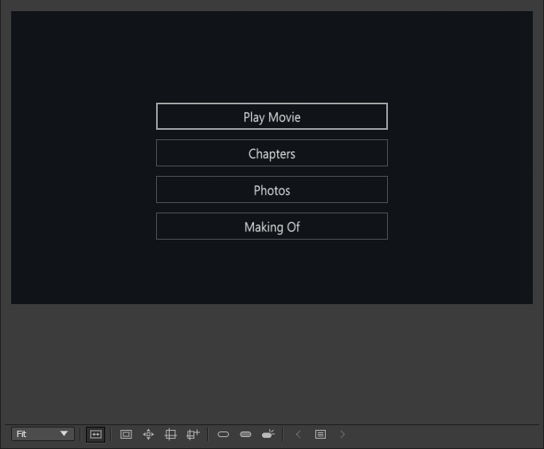

3. Select a button and choose the destination in **Link** in the Properties. You can also drag timelines or slideshows
   from the Project panel onto the buttons (for other methods, see
   [17.7](17-advanced.md#177-five-ways-to-link-buttons)).

   | Button | Link |
   |---|---|
   | Play Movie | Journey |
   | Chapters | Chapter menu (create in 3.8 next, then link) |
   | Photos | Photos (slideshow) |
   | Making Of | Making Of |

**Result**: The text on the four buttons changes, and each has a destination linked to it.

## 3.8 Creating the Chapter Menu

1. Select the timeline for "Journey".
2. Choose **Menu ▸ Create Chapter Index**.
3. Return to the Main Menu and set the link for the **Chapters** button to the newly created menu.

**Result**: A menu with buttons for each chapter is created, and the buttons are linked to their respective chapters.

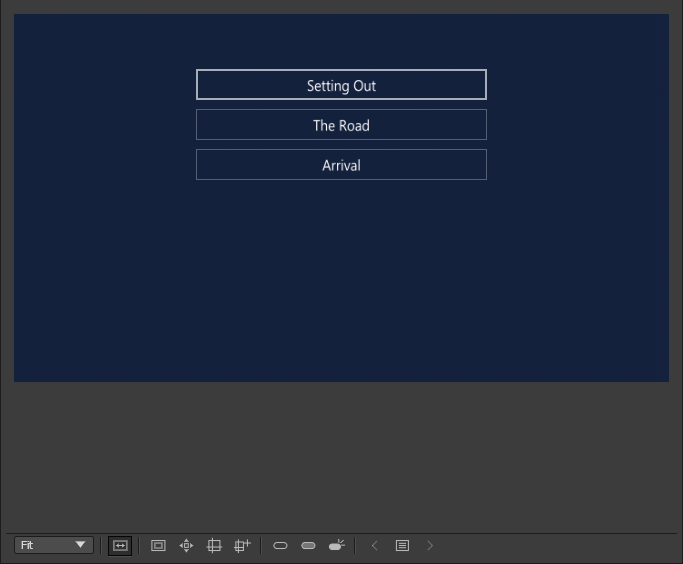

## 3.9 Defining the Disc Flow

1. Right-click the "Opening" timeline in the Project panel and choose **Set as First Play**. This plays first when the
   disc is inserted.
2. Select each timeline and slideshow, and set the **End action** in the Properties to "Main Menu". When playback ends,
   it returns to the Main Menu.
3. Set the End action for the chapter menu to "Main Menu" as well. This returns to the main menu if no buttons are
   pressed for a while.

**Result**: You can verify the connections across the entire disc in a diagram in the **Flowchart** panel.

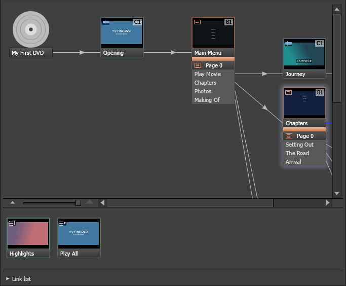

## 3.10 Checking

1. Choose **File ▸ Check Project…** (Shift+Ctrl+L) and press **Start**.
2. Fix any issues listed (buttons without links, items without End actions, etc.). Circle icons indicate errors, and
   triangle icons indicate advisories.
3. Press **Start** again.

**Result**: If there are no errors, you can build the disc.

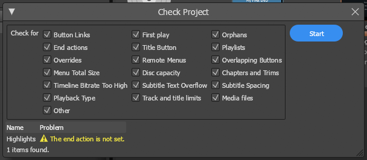

## 3.11 Previewing

1. Choose **File ▸ Preview** (Alt+Ctrl+Space).
2. Move between buttons using the on-screen directional keys (or keyboard arrow keys), and confirm with the center
   circle (or Enter).

**Result**: You can test the behavior as if it were the finished disc before building.

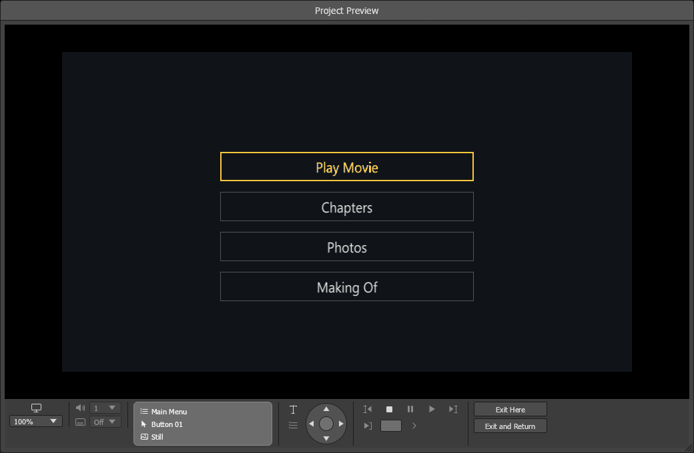

## 3.12 Building

1. Open the Build panel with **Window ▸ Build** (F2).
2. Set the Format to **DVD** and the Output to **DVD Image** (ISO).
3. Specify the **Destination** and press **Build**. Before building, the project is saved and checked.

   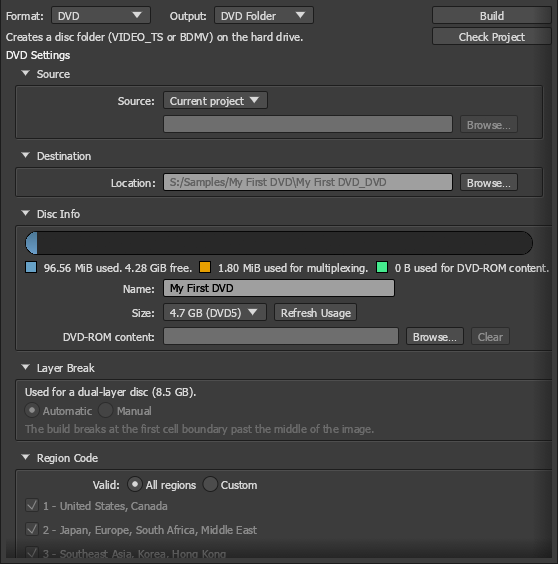

**Result**: Progress appears in the center of the window, and once video conversion is complete, a disc image (`.iso`)
is created.

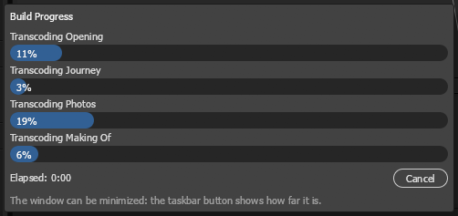

You can write the created image to a physical disc by changing the Output in the Build panel to **DVD Disc**, or write
it to a disc using other software ([Chapter 14](14-build.md#14-building)). If you have printable discs, you can also
create a label ([Chapter 15](15-labels.md#15-making-a-disc-label)).

> **Tip**
>
> You have now completed the basic workflow. Next, proceed to the chapter for the feature you want to use.
>
> - Names and roles of screen parts: [4. The Screen](04-screen.md#4-the-screen)
> - Change menu design: [9. Making Menus](09-menus.md#9-making-menus)
> - When things don't work as expected: [23. Troubleshooting](23-troubleshooting.md#23-troubleshooting)
