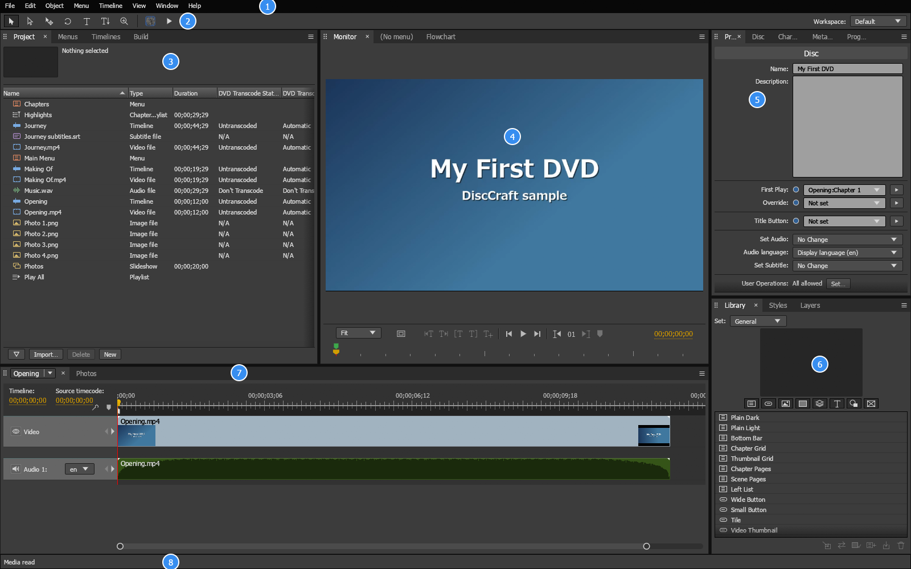
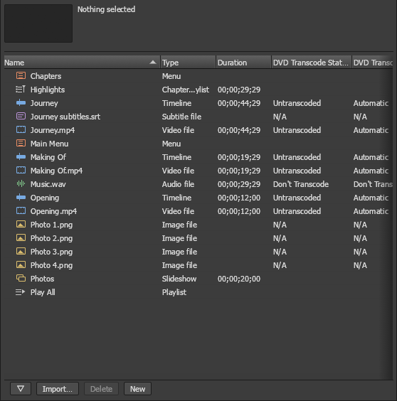
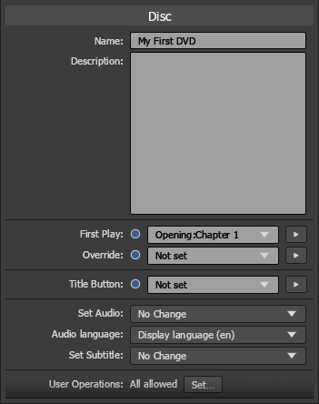
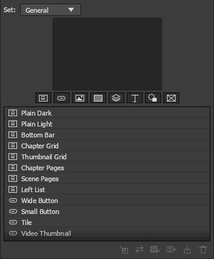

# 4. The Screen

[Contents](README.md) · Previous: [3. Making Your First DVD](03-tutorial.md#3-making-your-first-dvd) · Next: [5. Importing Assets](05-assets.md#5-importing-assets)

> **In this chapter**
>
> - Learn the names and roles of each part of the screen (menu bar, toolbar, panels)
> - Change the panel layout and save it as a workspace

Below the menu bar is the toolbar. At the very bottom is the status bar. The space between them is filled by panels
(docked tab groups). The status bar shows the result of the previous operation and the progress during a build (a
DiscCraft-only feature not found in Encore).

## 4.1 Menu Bar

There are 8 menus: **File / Edit / Object / Menu / Timeline / View / Window / Help**. Items and shortcuts follow
Encore's defaults by default. Commonly used items:

- **File ▸ New ▸** (Project / Menu / Timeline / Slideshow / Playlist / Chapter Playlist)
- **File ▸ Import ▸** (Asset… / Menu… / Pop-up Menu… / Menu Page… / Timeline… / Slideshow…)
- **File ▸ Preview / Check Project… / Build ▸ Folder… / Image…**
- **Edit ▸ Preferences…**, **Edit ▸ History ▸** (rewind multiple operations from the list of undoable actions)
- **Object ▸** (Convert to Button / Convert to Replacement Layer / Convert to Object, Create Subpicture, Specify Link…,
  Drop Shadow…, Flip, Rotate, Arrange, Align, Distribute)
- **Menu ▸** (New Menu, Create Chapter Index, Replace Menu…, Add New Page, Edit Color Set…, Set User Operations…, Save
  Menu as File…, Save Menu as Template…, Set End Action…)
- **Timeline ▸** (New Timeline / New Slideshow / New Chapter Playlist, add and remove tracks, import and export
  subtitles, add chapter points)
- **View ▸** (Zoom, Subpicture 3 states, Safe Areas, Button Routing, Guides, Chapter Name)
- **Window ▸** (Workspace, show/hide panels)
- **Help ▸** (Join the ArtCraft Discord… / ArtCraft Website / DiscCraft on GitHub / Report an Issue… / DiscCraft Help…
  (F1) / Reveal Log Files… / System Compatibility Report… / Check for Updates… / About DiscCraft). **DiscCraft Help…**
  opens this manual.

## 4.2 Toolbar

Menu editing tools are on the left, and workspace selection is on the far right.

| Tool | Key |
|---|---|
| Selection Tool | V |
| Direct Select Tool | A |
| Move Tool | M |
| Rotate Tool | R |
| Text Tool | T |
| Vertical Text Tool | Y |
| Zoom Tool | Z |

To the right of these are the **Edit Menu in PhotoCraft** (Shift+Ctrl+M) and **Preview** (Alt+Ctrl+Space) buttons. The
selected tool has a pressed-in appearance. Tools under the mouse cursor are outlined, and their icons turn gold.

## 4.3 Panels

By default, panels are arranged as follows.

| Location | Tabs |
|---|---|
| Left | Project / Menu / Timeline / Build |
| Center | Monitor / Menu Viewer / Flowchart |
| Top Right | Properties / Disc / Text / Metadata / Progress |
| Bottom Right | Library / Layers |
| Bottom | Timeline Viewer / Slideshow Viewer |

- **Project**: A list of all items (assets, timelines, menus, slideshows, playlists, chapter playlists, folders).
  Columns can be sorted, shown/hidden, and resized. Right-click options include Open / Rename… / Set as First Play /
  Replace Asset… / Show in Explorer / Delete, etc.
- **Menu**: A list of menus and a list of buttons for the selected menu. Right-clicking a menu offers Set as First Play
  / Copy / Clear / Rename… / Edit Menu in PhotoCraft / Open / Preview from Here. Right-clicking a button offers Clear /
  Open in Menu Viewer / Open Link / Preview from Here (from the menu containing that button).
- **Timeline**: A list of timelines and, below it, the chapters of the selected timeline (number, name, timeline,
  chapter in, poster). Click to select a chapter; double-click to open it in the Timeline Viewer. Right-clicking a
  timeline offers Set as First Play / Copy / Clear / Rename… / Open / Preview from Here. Right-clicking a chapter offers
  Clear / Open / Preview from Here (the title starting from that chapter). The first chapter cannot be deleted.
- **Build**: [Build Panel](14-build.md#14-building)
- **Monitor**: Playback of the built disc and preview of timelines.

  > **Details**
  >
  > - The buttons on the bottom control bar follow Encore's layout: Zoom and Safe Area buttons on the left; in the
  >   middle, five subtitle buttons | Previous Frame / Play/Stop / Next Frame | Previous Chapter / Current Chapter
  >   Number / Next Chapter / Add Chapter Point; on the right, playback speed (0.5× to 8×. J slows down, L speeds up, K
  >   stops. Useful for finding where to place chapter points. Up to 2× plays audio without pitch change; faster than
  >   that mutes audio) and **Open Build Output**; at the far right, the current time in orange.
  > - When the Monitor is narrow, speed, Open Build Output, and subtitle buttons hide in that order.
  > - Below the bar is a scrubber with chapter flags.
  > - Home / End moves the playhead to the start / end.
  > - Poster frames are set in the Timeline menu.
- **Menu Viewer**: The canvas for menus. Tab names match the open menu's name.

  > **Details**
  >
  > - The bottom bar has icon buttons (names appear on hover): Magnification, **Correct menu pixels to the TV screen**,
  >   **Show / Hide Safe Areas**, **Set button routing**, **Show Guides**, **New Guide**, **Standard** / **Selected** /
  >   **Activated** subpictures, Previous / Next page and markers for pages in between (page number in tooltip).
  > - Active buttons appear pressed-in (initially only the first one).
  > - Subpicture buttons are individual. Pressing one overlays that state's subpicture on all menu buttons; pressing
  >   again removes it.
  > - Add buttons via **Menu ▸ Add Button**.
- **Flowchart**: A diagram of items and links. Nodes can be moved by dragging.
- **Properties**: The sheet for the selected item. If nothing is selected, it shows disc settings.
- **Disc**: Disc name, description, aspect ratio, audio / subtitles, user operations.
- **Layers**: Menu layers (eye and lock icons, `(+)` button sets, `(=1)` to `(=3)` highlights, T for text, % for shapes,
  background is fixed).
- **Library**: DiscCraft-specific presets (menus / buttons / images / backgrounds / layer sets / shapes / replacement
  layers) and your own items (including text items). Below the preview are icon buttons for each type. Clicking one
  shows only that type (clicking the currently sole visible type again shows all). Ctrl+Click adds or removes a type
  from the view. The list is outlined, with type icons before names (type name in tooltip on row hover). To the right
  below are icon buttons: **Place**, **Replace**, **Set Background**, **New Menu**, **Add Item**, **Delete Item** (names
  in tooltips; unusable items for the selection are dimmed).
- **Timeline Viewer**: A timeline (waveform) shaped like FilmCraft, with rulers and track headers in Encore's style. Top
  left shows **Timeline:** and **Source:**, with orange timecodes below (Source indicates where the playhead position is
  within the clip file).

  > **Details**
  >
  > - Clips display filenames including extensions (e.g., 00001.m2ts). Below them are thumbnails for the clip start and
  >   each chapter point, arranged up to the next thumbnail (for clips fading in from black, the first visible frame is
  >   shown).
  > - Thumbnails are generated in the background. While playing in the Monitor, generation waits (to keep playback
  >   smooth). Generated thumbnails are cached, so they appear immediately when reopening the project.
  > - Chapter points are numbered flags (starting from 1) in the band below the ruler ticks.
  > - Headers show: Video eye icon, Audio Track speaker icon (track heard in Monitor), Subtitle Track eye icon (track
  >   shown in Monitor), name to the right, and **◂ ▸** at the far right (**Previous Clip** / **Next Clip**): The
  >   playhead moves to the start of the previous/next clip on that track and selects it.
  > - From the last clip, **▸** moves to its end.
  > - Arrows with no destination (◂ at the timeline start) appear dimmed.
  > - Header rows are a lighter gray than the timeline.
  > - Orange timecodes (here and in Monitor) are Encore-style hot text: Drag horizontally to move the playhead one frame
  >   per pixel; click to type a timecode (Enter to go there, Esc to cancel).
- **Slideshow Viewer**: List and reorder slides, set scaling and transitions.

## 4.4 Rearranging Panels and Workspaces

Tabs can be dragged to reorder, move to other groups, split, or float. Close them with middle-click or ×. Reopening from
the **Window** menu restores their previous location. Layouts are automatically saved per workspace.

The **≡** at the right end of each group's tab strip opens the Panel Menu: **Undock Panel**, **Undock Frame** (for the
whole group), **Close Panel**, **Close Frame**, **Maximize Frame** (the group fills the window; click again, now showing
**Restore Frame Size**, to restore other groups). Flowchart and Library have their own items below them.

**Window ▸ Workspace** lists four built-in workspaces and any you have saved.

| Name | Frontmost Elements |
|---|---|
| Default | Encore's default layout (all groups) |
| Menu | Menu list, Menu Viewer, Layers |
| Navigation | Flowchart |
| Build | Build Panel and Disc |

**New Workspace…** saves the current layout with a name (max 32 workspaces, names up to 64 characters). **Delete
Workspace** and **Reset "Name"** are also here. You can also switch via the **Workspace** combo box at the right end of
the toolbar.
