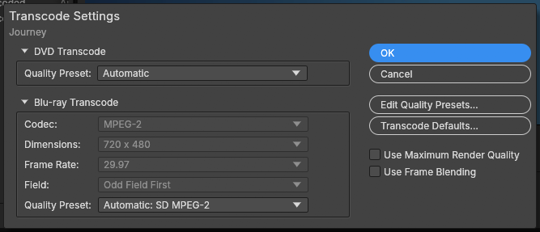
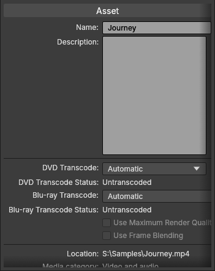

# 5. Importing Assets

[Contents](README.md) · Previous: [4. The Screen](04-screen.md#4-the-screen) · Next: [6. Making Timelines](06-timelines.md#6-making-timelines)

> **In this chapter**
>
> - Import video, audio, images, and subtitles
> - Learn which files can be read and which are converted
> - Set conversion options for each asset

## 5.1 How to Import

- **File ▸ Import ▸ Asset…** (Ctrl+I)
- Drag and drop files into the window (dropping a folder extracts the media files inside it; up to 500 items at once)
- **File ▸ Import ▸ Timeline…** (Shift+Ctrl+T): Creates an asset and a timeline for each selected video file
- **File ▸ Import ▸ Slideshow…** (Shift+Ctrl+G): Creates one slideshow with the selected images as slides
- **File ▸ Import ▸ Blu-ray…**: Creates timelines from Blu-ray playlists (for example, when converting a Blu-ray to DVD
  or rebuilding menus). Select a disc drive, a folder containing `BDMV`, or a mounted disc image to see a list of
  playlists. The longest main playlist is selected by default.

  > **Details**
  >
  > - Clips are cut to the played range and arranged in order, with chapter points and audio tracks for each audio
  >   format (LPCM, AC-3). Languages match those on the disc. DTS and Dolby TrueHD are not imported; their names appear
  >   in the status bar.
  > - Subtitles (PG) are imported as subtitle tracks in Blu-ray projects. They are extracted in the background after the
  >   timeline is created and while you continue working (this can take a few minutes for discs in a drive). They are
  >   not yet imported for DVD projects.
  > - Encrypted discs cannot be read. Clips open in the background, so it may take about a minute for the picture to
  >   appear.
  > - **Make the disc's menu a menu too** (on by default): Uses the first menu displayed by the disc as a draft for the
  >   project's motion menu. Video and audio are limited to the first 30 seconds. Buttons that play something are placed
  >   in the same position, highlighted with the disc's highlight shape, and linked to that chapter. Buttons that only
  >   change settings (subtitles, commentary, pages) are not placed. The disc starts from that menu, and titles return
  >   to the menu. Adjust buttons manually or with an AI agent (MCP).
  > - SD discs that put MPEG-2 directly onto a DVD may have chapters that do not start at closed GOPs. This appears in
  >   the project check (that video will be transcoded).
- **File ▸ Import ▸ Menu… / Pop-up Menu… / Menu Page…** (Shift+Ctrl+I / Shift+Ctrl+K / Shift+Ctrl+U): Converts layered
  PSD files (or PhotoCraft `.pcraft` files) into menus. Only the menu appears in the Project panel (the PSD is part of
  the menu, not listed as an asset; deleting the menu deletes the PSD). Projects from previous versions that listed such
  PSDs as assets will convert to this format when opened.

### Large Files

You can continue working immediately after importing large videos spanning several hours (tens of GB in mkv or mp4).
While opening in the background, "Reading media…" appears in the status bar. Once open, length, dimensions, thumbnails,
and size estimates are filled in.

> **Details**
>
> - Length, dimensions, and thumbnails for files opened once are remembered, so you do not have to wait when reopening
>   that project (as long as the file location, size, and modification date remain the same).
> - For mkv (H.264), length, dimensions, and frame rate are read from the beginning of the file, so size estimates
>   appear immediately.
> - Monitor and menu images, and timeline clip images, remain empty until opening is complete. Monitor images decode in
>   the background, so they appear as soon as they are ready, even while dragging the playhead.

### Interlaced Video

Interlaced video from camcorders or recorders (1080i, 576i / 480i; MPEG-2 or H.264) can also be read. If it matches the
frame rate of the DVD, the two fields are kept separate when placed on the DVD, preserving the smooth motion of the
original.

> **Details**
>
> - H.264 can be decoded as field pictures or MBAFF frames, and images appear in thumbnails and the monitor.
> - Video with the same frame rate (NTSC: 1080i 59.94 or 480i; PAL: 1080i 50 or 576i) is scaled field by field and
>   recorded as interlaced in the original field order. Encoding predicts the two fields separately for moving parts
>   (even with **Use Maximum Render Quality**, such video is scaled using standard methods).
> - The same applies when converting to Blu-ray interlaced formats (1080i 59.94 / 50 and SD). Video where the bottom
>   field comes first remains as bottom-field-first.
> - 1080i Blu-ray can accept video directly without conversion if conditions are met (see "H.264 for Direct Inclusion in
>   HD Blu-ray" below).
> - Film (23.976) and video with other frame rates are scaled as frames.

### Video That Cannot Decode Pictures

Video that cannot decode pictures, such as MPEG-4 Part 2 (DivX / Xvid), can still be imported. During timeline playback,
audio plays, and the monitor shows a black screen with the reason, allowing you to place chapter points while listening
to the audio. However, for discs requiring conversion, the project check flags an error: "The picture cannot be decoded,
so the video cannot be converted for this disc." (This is known before starting the build).

### Transport Streams (AVCHD, Recorder Recordings)

Interlaced H.264 in `.m2ts` / `.mts` / `.ts` files can also be imported. Length, dimensions, and frame rate are read
from file timestamps and headers, and Dolby Digital audio goes directly onto the disc.

> **Details**
>
> - Audio (Dolby Digital, LPCM, AAC, MPEG audio) is extracted from the file and placed in the media cache when first
>   needed. It plays in the monitor, and waveforms are displayed. Audio other than Dolby Digital is converted during the
>   build.
> - Pictures appear as described above and can be converted; chapter thumbnails are also generated.

### H.264 for Direct Inclusion in HD Blu-ray

H.264 in `.m2ts` / `.ts` / `.mkv` / `.mp4` / `.m4v` / `.mov` files goes onto the disc without re-encoding if it meets
all the following conditions (preserving picture quality and speeding up builds).

- Matches the Blu-ray video settings in the disc properties for size, frame rate, and scanning (1080i 59.94 / 50
  requires interlaced 1920×1080 at 29.97 / 25 fps; 1080p 23.976 / 24 and 720p require progressive). For 1080-line
  formats, camcorder (HDV / AVCHD) 1440×1080 also matches.
- High or Main profile, up to Level 4.1, 4:2:0 chroma subsampling at 8 bits, and an average bitrate of 40 Mbps or less
- The disc's colors (the 16–235 range, and BT.709 for HD; full-range video, or HD marked as BT.601, is converted)
  for the entire file.
- Starts with a keyframe (IDR).
- For 1080i, the timeline contains only that single clip.

Such clips go onto the disc directly even if trimmed. In points snap to the nearest IDR picture, and out points snap to
the nearest keypicture (or end of file), and the file's own audio is cut to the same range. For files with B-pictures
before keypictures (open GOP), the clip ends a few frames earlier.

### HD MPEG-2 for Direct Inclusion in HD Blu-ray

MPEG-2 from HDV camcorders (1440×1080i) or broadcast recordings (1920×1080i, 1440×1080i, 1280×720p) also goes onto the
disc without re-encoding if conditions are met.

- Files: Transport stream (`.m2ts` / `.mts` / `.m2t` / `.ts`), program stream (`.mpg` / `.vob`), elementary stream
  (`.m2v`; read directly from the file, with only a small index in the cache).
- Matches the disc's Blu-ray video settings for size, frame rate, and scanning.
- Main profile at High or High-1440 level, 40 Mbps or less (whether frame pictures or broadcast recordings made of two
  field pictures per frame).

> **Details**
>
> - Trimming works in GOP units (timeline trims snap to GOPs). For recordings starting mid-GOP, B-pictures before the
>   first I-picture (about two) are dropped.
> - On 1080i discs, 1920 x 1080 clips go onto the disc directly even when placed alongside other clips in the title.
> - HDV 1440 x 1080 clips go onto the disc directly if they outnumber the 1920 x 1080 direct-inclusion clips in the
>   title. That title is created at 1440 x 1080 (displayed as 16:9), and gaps with other clips are encoded at that size
>   (4:3 clips have black bars on the sides). Otherwise, HDV clips are encoded at 1920.

For matching files, the conversion status in the Project panel becomes **Don't Transcode**, and the size estimate uses
the file size. Audio handling remains as before (anything other than AC-3 and WAV is converted to Dolby Digital).
Non-matching files are transcoded. The reason appears when hovering over the asset's **Blu-ray Transcode Status** in the
Properties panel (e.g., "H.264 level is 5.1 (Blu-ray supports up to 4.1)", "Not H.264" for HEVC, differences in
size/frame rate/scanning, or average bitrate over 40 Mbps).

## 5.2 Supported Files

An asset's type comes from the first bytes of its file: a file with a wrong extension or none (an MP4 named `.dat`, for
example) is imported as what it is when its format is one DiscCraft reads (the video, audio and image formats below).
When the contents do not tell (subtitles, Craft documents, raw AC-3 or DTS streams, a file that is not found), the
extension decides.

| Type | Extensions |
|---|---|
| Video | mp4, mov, m4v, avi, mkv, webm, mxf, m2v, m1v, mpg, mpeg, vob, m2ts, mts, m2t, ts, dv, dif, ogv, 3gp, 3g2 |
| Audio | wav, ac3, eac3, ec3, dts, mp3, aac, m4a, mka, mp2, ogg, oga, opus, flac, aif, aiff |
| Image | png, jpg, jpeg, bmp, tif, tiff, psd, psb, pcraft, svg |
| Subtitle | srt, vtt, txt, ass, ssa, scc, mcc, stl, ttml, dfxp, smi, sami, idx (VobSub), sup (PGS) |
| Menu Design | psd, pcraft |
| Craft Documents | `.scraft` (SoundCraft session → audio), `.ecproj` (EffectCraft project → video), `.fcproj` (FilmCraft sequence → timeline) |

### Audio

WAV files at 16-bit / 48 kHz go in directly as LPCM; others (such as 44.1 kHz) are converted before inclusion.

> **Details**
>
> - DVD: 24-bit and 96 kHz WAV files also go in directly as LPCM (96 kHz / 24-bit is limited to stereo. This uses 4.6
>   Mbps, reducing the video bitrate accordingly. If combined with direct-inclusion video exceeds the limit, the project
>   check notifies you). 20-bit WAV files are included as 24-bit.
> - Blu-ray: WAV files at 16, 20, or 24 bits and 48, 96, or 192 kHz go in directly as LPCM up to 8 channels / 27.648
>   Mbps (24-bit / 192 kHz is limited to 5.1). Speaker placements include mono, stereo, front left/right plus center or
>   surround (one rear center, or rear/side left/right), 5.1, 7.0, and 7.1. Placements a Blu-ray has no layout for, such
>   as 2.1, 3.1 and 4.1, go on the 5.1 layout (missing speakers silent, a single surround in both surrounds 3 dB down),
>   and 6.1 (also 7 channels without specified placement) on the 7.1 layout (the back center in both back speakers 3 dB
>   down). Larger audio reduces the peak video bitrate (stream limit is 48 Mbps).
> - On PAL DVDs, 48 kHz MPEG-1 Layer II (`.mp2`, `.mpa`) also goes in directly. On NTSC DVDs and Blu-rays, it is
>   converted (NTSC players may not support MPEG audio).

When a video file contains multiple audio streams (such as a bilingual MKV), the timeline created from that file gets an
audio track for each stream (up to 8). See [6.4](06-timelines.md#64-tracks) for how to choose which stream each track
uses. If the file specifies stream languages (MKV Language, MP4 / MOV per-track language, TS / M2TS language
descriptors), the tracks adopt those languages and are included on the disc with them. For files where all streams are
English or no language is specified, they are treated as default values and no language tag is applied (tracks use the
disc's language).

### Camcorder DV

DV is read using DiscCraft's own decoder. Supported formats include AVI captured to a PC (Type 1 / 2), raw `.dv` /
`.dif`, QuickTime (`.mov`; exported from iMovie or Final Cut), and Matroska (`.mkv`).

> **Details**
>
> - Supported formats: NTSC (4:1:1), PAL (4:2:0), DVCPRO PAL (4:1:1), DVCPRO50 (4:2:2, 50 Mb/s). Aspect ratios 4:3 and
>   16:9. DVCPRO HD is not supported.
> - For discs, conversion preserves the field order (bottom-field-first).
> - Audio: Type 2 AVI uses its PCM stream. Audio within DV frames (Type 1 AVI, raw DV files) reads 16-bit (48, 44.1, 32
>   kHz) and 12-bit / 32 kHz. The second 12-bit audio channel (for dubbing), if recorded, becomes the file's second
>   audio stream. For DVCPRO50, CH3 / CH4 is the second stream.

### Other Files

- MPEG-1 / MPEG-2 video inside AVI files (written by capture cards or conversion software) is read along with the AVI
  audio and converted for the disc.
- SVG is drawn at the display size, so it does not blur.
- Subtitle text supports UTF-8 / UTF-16 / Shift_JIS.
- If an EffectCraft project (`.ecproj`) has multiple compositions, choose the one to use in the asset's **Composition**
  property (if none is chosen, the composition open in EffectCraft is used). Importing the same file again allows using
  different compositions for each asset.
- DTS files (`.dts`) go directly onto DVD and Blu-ray audio tracks without decoding (48 kHz, up to 1509.75 kbps). They
  do not play in the monitor or preview.

## 5.3 About Assets

### List and Conversion

- The Project panel rows show dimensions, frame rate, length, and whether conversion is needed.
- Assets that do not match standards are automatically converted during the build. Audio becomes Dolby Digital (AC-3) at
  192 kbps; video bitrate is determined by capacity (default up to 9.8 Mbps).
- MPEG-2 video already compatible with DVD is not transcoded. For HD Blu-ray, DVD-specific conversions do not run.

> **Details**
>
> - Direct-use MPEG-2: Elementary stream (`.m2v`), program stream with combined video and audio (`.mpg` / `.vob`; AC-3
>   audio also goes in directly), and video at 704×480, 352×480, or 352×240 (PAL: 576 / 288 lines).
> - The **Field Type** in video properties uses the same terms as Encore: **No Fields (Progressive Scan)**, **Odd Field
>   First**, **Even Field First** (read from MPEG-2 and H.264 headers; for H.264, from the first picture's header.
>   Interlaced H.264 in MP4 and MKV is reported as Odd Field First).

### Editing and Replacing

- **Edit ▸ Edit Original** (Ctrl+E): Opens the asset in the application that created it (images in PhotoCraft, audio in
  SoundCraft, video in FilmCraft or EffectCraft). It reloads automatically upon saving.
- Right-click in the Project panel and choose **Replace Asset…**: Specify the location for offline assets. **Show in
  Explorer** is also available.
- Assets in use cannot be deleted. Removing them from items resets links to those items to unset.

### Pre-converting

Use **Transcode Now** (right-click or **File ▸ Transcode**) to complete conversion for an asset before the build.
Conversion runs in the background, allowing you to continue editing. When finished, the conversion status becomes
**Transcoded**, and the build uses that conversion.

> **Details**
>
> - Conversions are placed in the output location specified in the Build panel. They cannot be selected for assets that
>   do not need conversion or those with undecodable pictures.
> - **Revert to Original**: Discards completed conversions and returns status to **Untranscoded** (recreated by the next
>   build or Transcode Now).
> - **File ▸ Transcode ▸ Transcode All**: Pre-completes all conversions required for the project's build.
> - **File ▸ Render ▸ Project / Motion Menu / Slideshow**: Pre-creates images for each in the build cache. Changing the
>   project requires recreating motion menus. HD Blu-ray motion menus are created at that HD size.
> - **File ▸ Locate Transcoded File ▸ DVD… / Blu-ray…** (also available via right-click on video): Links files converted
>   by other software to the video. Select the video (MPEG-2 like `.m2v` for DVD) and then audio (`.ac3`, `.wav`, etc.;
>   cancel if none). Builds of that type use these files instead of the original assets, so the originals are not
>   needed. Use **Revert to Original** to unlink. Linked files are found again even if the project is moved.

**Window ▸ Progress** (F10) shows what is being transcoded and its progress, a list of files still to be transcoded, and
media loading in the background. Use **Stop** to halt conversion. Completed conversions remain; partial ones are
recreated next time.

> **Details**
>
> - Stopping occurs at the next picture boundary. Audio conversion stops at segment boundaries.
> - Builds can finish between other steps: during title multiplexing (next VOBU for DVD, next unit for Blu-ray), between
>   ROM content files, and before or during image writing (partial images are deleted).

### Transcode Settings

Right-click a video and choose **Transcode Settings…** to define how that video is converted. The dialog shows **DVD
Transcode** and **Blu-ray Transcode** quality presets on the left, **OK** / **Cancel** buttons and two picture creation
checkboxes on the right. You can also select these in the **DVD Transcode** / **Blu-ray Transcode** fields in the
Properties panel.

> **Details**
>
> - For HD Blu-ray, you can choose the format for this video's title using **Codec**, **Dimensions**, and **Frame
>   Rate**, which may differ from the project format (e.g., 720p59.94 video on a 1080p23.976 disc). Any format can use
>   either MPEG-2 or H.264. **Fields** are determined by the format, and the quality preset list updates for that format
>   and codec.
> - **Use Project Settings**: Returns to the project's format, codec, and automatic rate. Videos that go directly into
>   the selected format show **Don't Transcode**. For SD Blu-ray, all titles use the project format, so this is grayed
>   out (format is chosen in Project Settings opened via **Transcode Defaults…** on the right).
> - **Use Maximum Render Quality**: Resizes using filters. When shrinking, it averages covered pixels to prevent
>   flickering of thin lines or fine patterns. When enlarging, it interpolates between pixel centers. This takes longer.
> - **Use Frame Blending**: When the disc frame rate differs from the video (e.g., 24 fps video on a 29.97 DVD), blends
>   pictures falling between two frames based on proximity to each.
> - Both checkboxes are initially unchecked; changing them requires recreating the conversion. They appear grayed out in
>   the Properties panel.
> - The **Blu-ray Transcode** list in the Properties panel shows all options (Blu-ray presets for both codecs, DVD
>   presets, SD items, **Automatic: <Format>** for each format/codec, and finally **Automatic**). Items not creatable in
>   the project are grayed out with a reason.

### Quality Presets

Quality presets define video bitrate, rate control method, and audio settings together. The default is **Automatic**
(the build sets rates to fit titles on the disc). Videos with a selected preset use that rate; other videos share the
remainder.

| Rate Control | Description |
|---|---|
| VBR, 1 Pass | Average bitrate equals the target, fluctuating up to the maximum. |
| VBR, 2 Pass | First analyzes the entire video, then converts allocating more bits to complex scenes. Takes twice as long. |
| CBR, 1 Pass | Constant bitrate (maximum equals target). |

DVD audio is **Dolby Digital** (stereo at 192 kbit/s) or **PCM** (stereo at 48 kHz / 16-bit; uses 1.536 Mbit/s, reducing
the rate available for video in that title).

> **Details**
>
> - DVD presets (from Encore): For NTSC: **NTSC DV 23.976 High quality 4Mb VBR 2 Pass**, **7Mb VBR 2 Pass**, **8Mb CBR 1
>   Pass**, **NTSC DV 23.976 Low quality 4Mb CBR 1 Pass**, **NTSC DV High quality 4Mb VBR 2 Pass**, **7Mb VBR 2 Pass**,
>   **8Mb CBR 1 Pass**, **NTSC DV Low quality 4Mb CBR 1 Pass**, **NTSC Progressive High quality 7Mb VBR 2 Pass**. For
>   PAL: the same items excluding 23.976 variants. Followed by your presets and **Automatic**.
> - 23.976 presets apply film treatment: Video becomes progressive at 23.976 fps, displayed with 3:2 pull-down (the disc
>   plays at 29.97, reducing picture count to 4/5ths and increasing bits per picture).
> - High / Low quality refers to the encoder's motion search effort (Encore quality levels 5 and 2). Low is faster; at
>   the same bitrate, pictures are slightly coarser.
> - Converted MPEG-2 video (DVD and 1080i HD Blu-ray) is encoded with I B B P … GOPs.
> - Blu-ray presets (from Encore for the project format): **High Quality** (25 Mbit/s, max 30), **Long Form** (9 Mbit/s;
>   progressive formats use 8, max 11), **Maximum Quality** (35 Mbit/s; max is 35 for H.264 and 40 for MPEG-2). Followed
>   by **Automatic: <Format>**. MPEG-2 Long Form uses slightly less motion search effort (quality 3).
> - Videos going directly onto the disc show **Don't Transcode**. You can still select a preset for them; doing so
>   triggers re-conversion. Changing presets requires recreating completed conversions.
> - **File ▸ Transcode ▸ Edit Quality Presets…** allows saving up to 32 custom presets (usable in any project): Name,
>   video bitrate, **DVD** or **Blu-ray**, rate control, audio (DVD), quality (1–5), and for Blu-ray, also the
>   **Maximum** rate.

### Pixel Shape

Right-click in the Project panel and choose **Interpret Footage…** to set the pixel shape for a video. Use this when a
file incorrectly reports (or omits) pixel aspect ratio, causing pictures to look stretched or squashed vertically or
horizontally.

> **Details**
>
> - **Use Asset Pixel Aspect Ratio** (default) follows the file's report. **Set Pixel Aspect Ratio** offers: Square
>   Pixels (1.0), D1/DV NTSC (0.9091), D1/DV NTSC Widescreen 16:9 (1.2121), D1/DV PAL (1.0940), D1/DV PAL Widescreen
>   16:9 (1.4587), Anamorphic 2:1 (2.0), HD Anamorphic 1080 (1.333), DVCPRO HD (1.5).
> - Thumbnails, monitor, and conversions all follow the selected shape; completed conversions are recreated. New
>   timelines created from this video become 16:9 or 4:3 based on the selected shape.
> - Videos going directly onto the disc (MPEG-2 for DVD) are not transcoded but enter with the timeline's declared shape
>   (using a copy in the build cache with only header bits changed).
> - For still images, **Ignore alpha channel** is also available (draws colors as-is without using transparency; useful
>   for broken alpha channels). If nothing is selected, still images at DVD frame sizes (720×480, 720×486, 720×576) use
>   SD pixels; other sizes use Square Pixels.

### Metadata

**Window ▸ Metadata** lets you view and edit XMP metadata for the selected asset's file (or its video if it is a
timeline). Leaving an input field or pressing Enter writes that item immediately (clearing it deletes the item).

> **Details**
>
> - At the top are a search field (filters items containing text in name or value), the selected file's name, and
>   **Reload**. Below are 12 categories (Dublin Core, Basic, Rights Management, Media Management, Basic Job Ticket,
>   Paged-Text, Dynamic Media, Adobe PDF, Photoshop, and three EXIF groups). Expanding a category lists all standard
>   items for it, even if empty.
> - Items editable in Encore have input fields (lists like Creator or Subject are separated by ;. Rating is a dropdown;
>   Marked is a checkbox). Others show values only; structural items open with ▸.
> - Write destination: If a sidecar exists (`Name.xmp` or `Name.ext.xmp` next to the media), it writes there. PNG, JPEG,
>   and MP4 write inside the file (MP4 appends at the end, so video data is not moved). Others (MOV, MPEG, PSD, etc.)
>   create a new sidecar.
> - Commands are `asset.getMetadata` and `asset.setMetadata` (items use forms like `dc:title`).

### Markers, Copy, and Duplicate

- **Edit ▸ Update Markers from Source (Replace All Markers)** (Ctrl+F): Replaces chapter points in the Viewer's timeline
  with chapters embedded in that video file (MKV, MP4).
- Right-click in the Project panel or use the **Edit** menu to **Copy** / **Paste** (Ctrl+C / Ctrl+V) or **Duplicate**
  (Ctrl+D) menus (per page), timelines, slideshows, playlists, and chapter playlists. Duplicates get numbered names like
  "Name 2" and are placed in the same folder. Links to other items remain unchanged; links to itself point to the
  duplicate.
