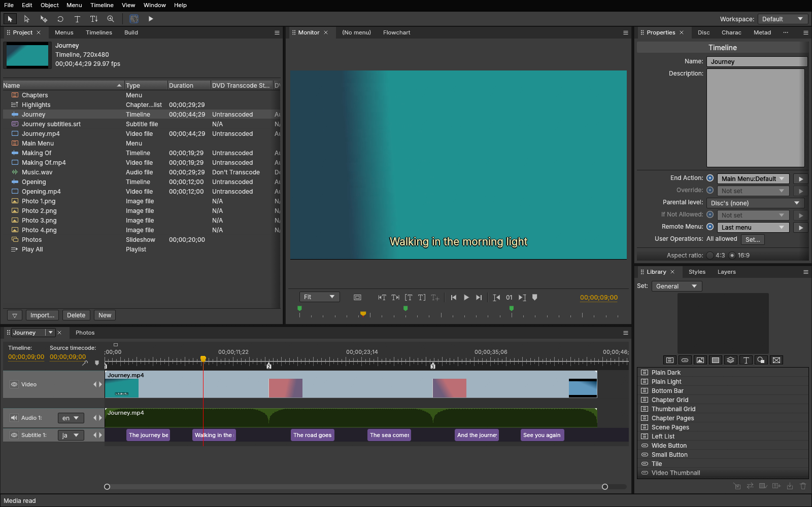
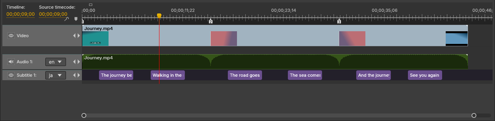
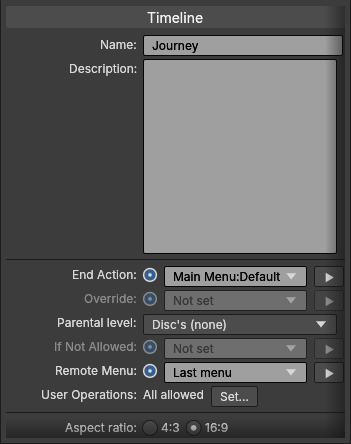
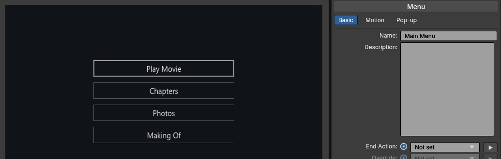

# 6. Making Timelines

[Contents](README.md) · Previous: [5. Importing Assets](05-assets.md#5-importing-assets) · Next: [7. Making Slideshows](07-slideshows.md#7-making-slideshows)

> **In this chapter**
>
> - Create a title (timeline) from video
> - Join clips and set chapters
> - Add audio and subtitle tracks, and define the end action

## 6.1 Creation

Select a video asset and choose **File ▸ New ▸ Timeline** (Ctrl+T), or **Timeline ▸ New Timeline**. If no video is
selected, choose one from the list in the **New Timeline** submenu. A DiscCraft timeline must always start with one
video.

For works edited in FilmCraft, you can use **Timeline ▸ New Timeline from FilmCraft Sequence…**. You can also add
sequence markers as chapter points to the open timeline using **Timeline ▸ Import FilmCraft Markers…**.

## 6.2 Multiple Video Clips

Dragging another video into the Timeline Viewer places it immediately after the previous clip, creating a chapter at the
junction (up to 99 clips per title).

> **Details**
>
> - The audio for each clip is placed alongside it: on the Audio Track for that clip's audio (the previous clip's audio
>   is cut at the junction), or in a new Audio 1 track if the timeline has no audio tracks.
> - For multi-clip titles without audio tracks, the audio from each clip plays during preview and on the disc.
> - Clips and their adjacent audio are linked. Trimming, moving, or deleting a clip affects its audio similarly, and the
>   audio of subsequent clips moves with them.
> - Drag the edges of a clip to trim it.
> - For MPEG-2 files that go directly onto the disc, cut points snap to the start of a Group of Pictures (GOP).

- MPEG-2 clips that do not require conversion can be passed through as trimmed.
- Clips requiring conversion (such as H.264) can also be joined and built. On DVD (and SD Blu-ray), cuts occur exactly
  at the trimmed frame positions (conversion starts a GOP there). If you adjust the trim, the file is reconverted during
  the next build.
- On HD Blu-ray, H.264 files recorded directly ([5.1](05-assets.md#51-how-to-import)) are trimmed at keyframes. Other
  clips are encoded to H.264 and joined at IDR frames, so they are trimmed exactly at the specified frame.
- The first clip can also be deleted (the second clip becomes the new first).
- Dragging a clip body left or right moves it. Gaps created between clips play as black on the disc (Monitor playback
  skips gaps). Clips cannot overlap with adjacent ones.
- Right-clicking a clip: **Clear Video Clip** removes the clip and leaves the space empty (subsequent clips and their
  chapters do not move). **Ripple Delete** removes the clip and shifts subsequent clips to fill the gap. You cannot
  delete the only clip in a title.
- Clicking a clip (video or audio) selects it, indicated by a white border. Pressing **Edit ▸ Clear** (Delete) removes
  the selected clip (for video, this is the same as Clear Video Clip; for audio, it removes the clip from the track, or
  deletes the entire track if it was the only clip). **Edit ▸ Ripple Delete** (Shift+Delete) removes the selected video
  clip and shifts subsequent clips. If nothing is selected, it affects the clip under the playhead. Clicking an empty
  area or a chapter point deselects everything.
- For Program Stream clips (`.mpg` / `.vob`), chapters and trims also snap to GOP boundaries.

Dropping audio and subtitle assets into the Timeline Viewer places them in the first Audio Track / Subtitle Track.

## 6.3 Chapter Points

- Choose **Timeline ▸ Add Chapter Point** (`*` on the numeric keypad) at the playhead position.
- You can also move chapter points by dragging the flags below the ruler in the Timeline Viewer.
- Use **Add Chapter Points at Interval…** (default 5 min) to add them in bulk.
- If an MKV or MP4 file contains chapters, they become chapter points when creating a timeline from that file (names are
  also imported). To import later, use **Timeline ▸ Import Chapters from Source**.
- Select a flag and press **Edit ▸ Clear** (Delete) to remove that chapter.
- Links to chapters from buttons, end actions, items in Chapter Playlists, and parental level chapters remain pointing
  to the same chapter even if you add, move, or delete preceding chapter points. If the chapter itself is deleted, links
  become unset (the project check reports them), and items in Chapter Playlists are removed.
- Name chapters in Properties (if empty, they display as "Chapter N"). Use **View ▸ Show Chapter Names** (Ctrl+8) to
  display names on the timeline.
- Set a poster frame using **Timeline ▸ Set Poster Frame** (Shift + `*` on the numeric keypad), which captures the image
  at the playhead position.

DVD supports up to 99 chapters per title. For menus linking buttons to chapters for scene selection, see
[Scene Selection Menus with Images](17-advanced.md#171-scene-selection-menus-with-images).

## 6.4 Tracks

**Timeline ▸ Add Audio Track… / Add Subtitle Track…** adds one track at a time from the bottom. **Delete Audio Track /
Delete Subtitle Track** removes tracks starting from the bottom. In the **Disc** panel (same as Properties when nothing
is selected), set the default audio track to hear and subtitle to display. In the Monitor, use the speaker button in the
header to select the track to hear.

When a track's file contains multiple audio streams (e.g., different languages in MKV, second stereo pair from a
camcorder), select the stream used by the track via right-click on the track ▸ **Sound Stream** ▸ **Stream 1**, **Stream
2**, etc. The disc and Monitor use this stream. Timelines created from such files initially have separate tracks for
each stream. Tracks using streams other than the first display **(Stream 2)** after the clip name.

Audio clips on a track can be moved left or right to adjust their start position (in frames). The beginning of the track
becomes silent by the amount moved. For Dolby Digital (AC-3) files, silence is prepended in the same format without
re-encoding. WAV files have silence added and remain PCM. Other audio formats have silence added and are converted to
Dolby Digital.

> **Details**
>
> - DTS tracks cannot be moved (this causes build errors; return them to the start).
> - Dragging the left or right edge of a clip trims it (in frames).
> - Remaining audio stays at its original position, so trimming the start moves the clip's beginning with it.
> - Dragging edges outward restores the file to its full length from start to end.
> - Trimmed Dolby Digital files are cut only at frame boundaries (32 ms) without re-encoding. Trimmed WAV files remain
>   PCM. Other audio is cut and converted to Dolby Digital.
> - DTS tracks cannot be trimmed.
> - Monitor and Preview also play the trimmed range.
> - You can place multiple clips on one track (up to 99): Right-click the track at the desired start position and choose
>   **Add Audio Clip Here ▸** from a project audio file, or drag an audio file from the Project panel to the track row
>   (a line indicates the clip's start position; dropping outside the track row creates a new track).
> - Each clip displays the waveform of its respective file.
> - Clips cannot overlap: Overlapping additions are rejected, dragged clips stop at adjacent clips, and edges do not
>   cross adjacent clips.
> - **Clear Audio Clip** (right-click a clip on a multi-clip track) removes one clip.
> - On the disc, the track becomes a single stream: Each clip's file range is placed at its position, with silence in
>   between.
> - If all clips are WAV, the result is PCM.
> - If all clips are Dolby Digital with identical format (bitrate and channels), they are joined frame-by-frame without
>   re-encoding (positions are in 32 ms units).
> - Other combinations are decoded and remade into Dolby Digital (DTS files cannot be part of a multi-clip track).
> - Monitor and Preview also play clips at their respective positions.

The limits are 8 audio tracks and 32 subtitle tracks.

## 6.5 End Action, Override, Remote Menu

The Timeline sheet in Properties has three link fields.

| Field | Meaning |
|---|---|
| End Action | Destination after playing to the end (Menu, another Timeline, Slideshow, Playlist, Do Nothing) |
| Override | Destination after the End Action target finishes (e.g., Warning → Main Movie → Extras Menu flow) |
| Remote Menu | Menu displayed by the remote control's Menu button (Pop-up Menu on Blu-ray) |

There are five ways to set links ([Five Ways to Link Buttons](17-advanced.md#177-five-ways-to-link-buttons)). The three
fastest methods:

- Drag the circle (pick whip) on the left of the field to an item in the Project panel, a box in the Flowchart, a
  chapter marker in the Timeline panel (that chapter), or a button in the Menu Viewer (that button). While you drag,
  a gold line runs from the circle to the pointer; a destination a drop links to is marked gold, and the line turns
  red where it cannot link (Esc cancels). Hold it near the edge of a list or the Flowchart to scroll.
- Choose **Object ▸ Specify Link…** (Ctrl+L) to select from a dialog.
- Drag from node to node in the Flowchart.

