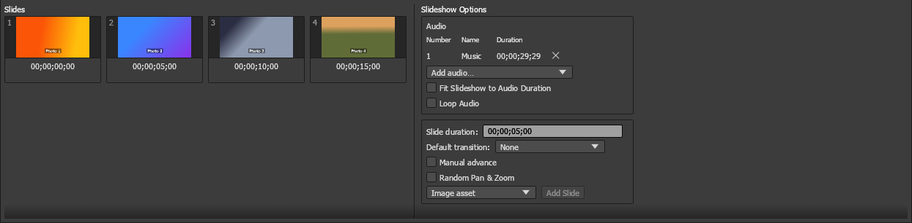
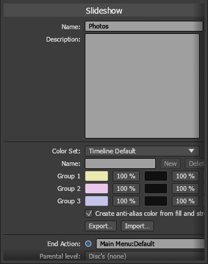

# 7. Making Slideshows

[Contents](README.md) · Previous: [6. Making Timelines](06-timelines.md#6-making-timelines) · Next: [8. Playlists and Chapter Playlists](08-playlists.md#8-playlists-and-chapter-playlists)

> **In this chapter**
>
> - Create a slideshow from photos
> - Set slide duration, transitions, and audio

Create an empty slideshow with **File ▸ New ▸ Slideshow…** (Ctrl+G), then drag images into the Slideshow Viewer. You can
also create one by selecting multiple images and choosing **File ▸ Import ▸ Slideshow…** (Shift+Ctrl+G) (the name is
taken from the first image, and the slide duration defaults to 6 s).

| Setting | Description |
|---|---|
| Slide Duration | Default 6 s. Enter using timecode (00;00;06;00 for NTSC) |
| Scale | Fit / Crop / No Scaling |
| Transition | None / Cross Dissolve / Dip to Black / Wipe. Length is 0.1–10 s (default 2 s). Can be overridden per slide |
| Manual advance | When on, each slide stays up until advanced via the remote control. The same checkbox in the sheet when a slide is selected stops only that slide |
| Pan & Zoom | Turning on **Pan & Zoom** in the slide's Properties makes the picture move slowly while the slide is up (Pan: None / Pan Left / Pan Right / Pan Up / Pan Down, Zoom: Zoom In / Zoom Out / None). The slideshow's **Random Pan & Zoom** adds motion to all slides that do not have their own settings |
| Create Subtitle | Turns each slide's name and description into subtitles (use **Include Next** to include the next slide's name as well). You can choose Highlight (Group), Stroke, and Align for each slide; colors are determined by the slideshow's Color Set |

Reorder slides by dragging them, and delete them with **Edit ▸ Clear** (Delete). Adding audio allows you to match the
length. Write the slide's name and description in Properties (if set as subtitles, they also become chapter names on the
disc).

