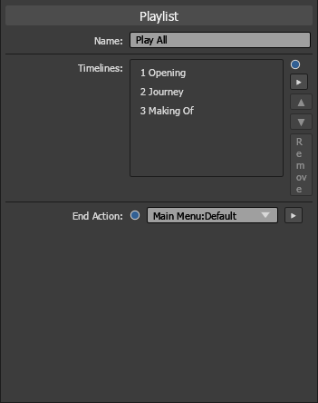
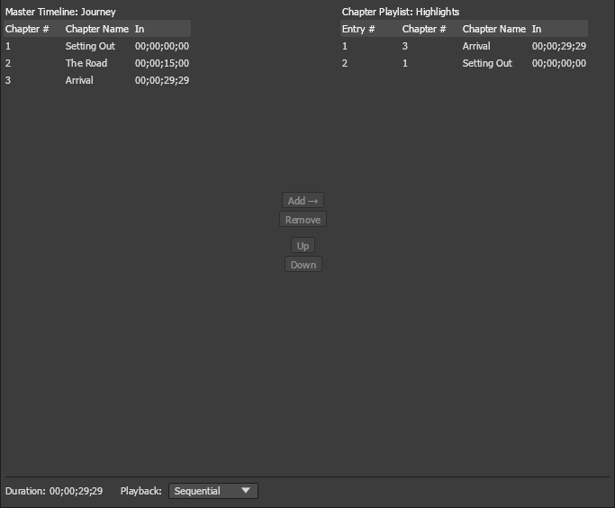
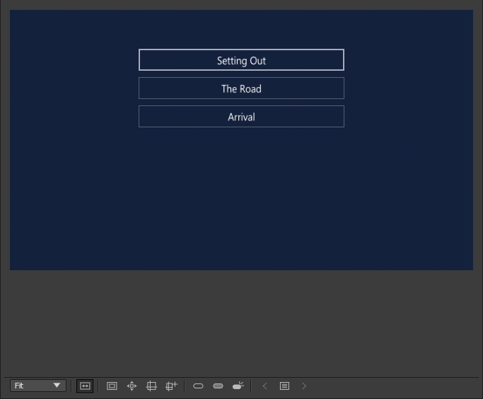

# 8. Playlists and Chapter Playlists

[Contents](README.md) · Previous: [7. Making Slideshows](07-slideshows.md#7-making-slideshows) · Next: [9. Making Menus](09-menus.md#9-making-menus)

> **In this chapter**
>
> - Play several titles in sequence (Playlist)
> - Play chapters in any order you like (Chapter Playlist)
> - Create a menu for selecting chapters

## 8.1 Playlist

Choose **File ▸ New ▸ Playlist…**, give it a name, and drag items (timelines, slideshows) into the Properties panel. You
can move items up or down, delete them, or double-click to open them. Buttons in menus can link to playlists.

## 8.2 Chapter Playlist

Select a timeline and choose **Timeline ▸ New Chapter Playlist**. This creates a list of the chapters from the selected
timeline in the order they will play (allowing you to watch extras in any order).

- You can choose **Sequential / Random / Shuffle** (Random and Shuffle are also supported on Blu-ray)
- Select chapters in the left table of the Chapter Playlist viewer (chapters from the master timeline) and click **Add
  →** (double-clicking adds one). Use **Shift+Click** to select a range, or **Ctrl+Click** to add or remove items one by
  one. Press **Ctrl+A** over the table to select all. Items are added in chapter number order, and Undo reverts the
  entire action at once. Select items in the right table and click **Remove** (double-clicking also removes them). Use
  **Up / Down** to reorder.
- You can change the link target of an item or include chapters from a different timeline.
- You can preview in the Chapter Playlist viewer.

## 8.3 Chapter Index

**Menu ▸ Create Chapter Index** creates a menu with buttons arranged for each chapter.

- If the menu open in the viewer already has chapter buttons, assign the remaining chapters following the linked buttons
  (in this case, at least one chapter button must be linked to a timeline, or you cannot create it).
- Otherwise, create a menu with buttons arranged for each chapter of the selected timeline (DiscCraft specific).
- **Create Multi-Page Chapter Index** splits the content into pages of 6 buttons and adds **Previous / Next** buttons.
- The Library presets **Chapter Page** (text buttons) and **Scene Page** (video thumbnail buttons) are templates for
  multi-page chapter indexes with six chapter buttons and **Previous / Main Menu / Next** buttons (DiscCraft specific).
  Create a new menu, link the first chapter button to a timeline, and use **Create Multi-Page Chapter Index** to
  generate the pages. The layout scales to fit the disc screen, so it works for both SD (4:3 / 16:9) and HD.
- If the menu open in the viewer has chapter buttons, **Create Multi-Page Chapter Index** uses that menu as the template
  for all pages. Fill the menu as described above. For any missing buttons, add more pages from the same menu (the menu
  itself is page 0, followed by page 1, page 2…), assigning the chapters that continue from the previous page. Buttons
  of type **Next** link to the next page, and buttons of type **Previous** link to the previous page. Remove unused
  items on each page: chapter buttons after the last chapter, **Next** on the last page, and **Previous** on the first
  page (keep any **Previous / Next** buttons that are already linked elsewhere, such as to the Main Menu).
- The maximum number of chapter buttons per page is 18.
