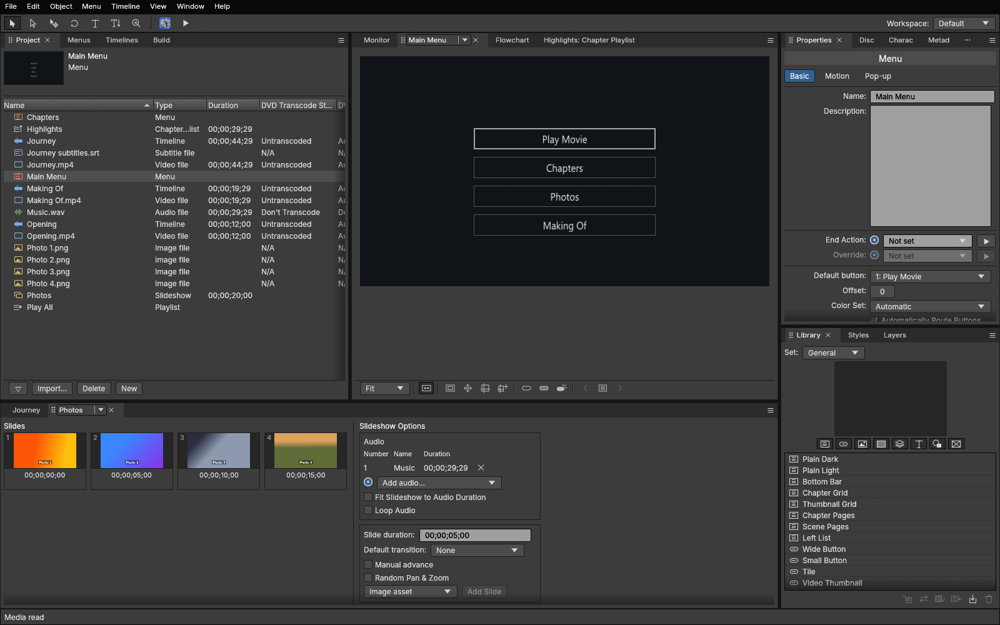
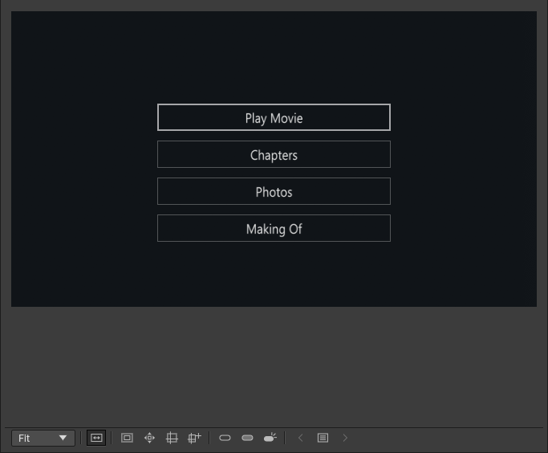
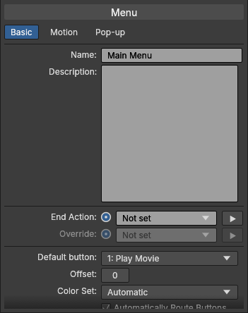
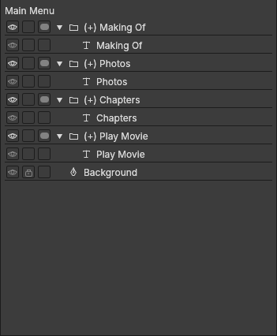

# 9. Making Menus

[Contents](README.md) · Previous: [8. Playlists and Chapter Playlists](08-playlists.md#8-playlists-and-chapter-playlists) · Next: [10. Building the Navigation](10-navigation.md#10-building-the-navigation)

> **In this chapter**
>
> - Create menus and place buttons, text, and shapes
> - Set highlight colors for buttons or create motion menus
> - Rebuild menus in PSD

## 9.1 How to Create Them

| Method | Result |
|---|---|
| **File ▸ New ▸ Menu** (Ctrl+M) | An empty menu with guides included |
| **File ▸ Import ▸ Menu…** (Shift+Ctrl+I) | Turns a PSD / `.pcraft` file into a menu. Groups starting with `(+)` become buttons |
| A preset in the **Library** for **New Menu** | Creates from a DiscCraft-specific template |
| **Menu ▸ Add New Page** | The next page of the open menu (same background and settings; see "Menu Pages" below) |

The first menu you create automatically becomes the **First Play** and the **Title Button**.

The layer names in PSD or PhotoCraft files exported by DiscCraft (Background, Highlight, Video Thumbnail, Text, Page),
and the names DiscCraft assigns within the project (buttons added without text, unnamed chapters, Previous / Next for
chapter indexes), are displayed in the display language.

PSD layer name conventions: Groups starting with `(+)` are buttons (including `(+#)` chapter, `(+>)` next page, and
`(+<)` previous page buttons from chapter indexes created by Encore; their types match accordingly). `(=1)` / `(=2)` /
`(=3)` are button highlights (subpictures), drawn in colors 1 / 2 / 3 of the menu's Color Set.

> **Details**
>
> - `(%)` is a Video Thumbnail button, `(^)` is Auto Activate
> - When the Color Set is **Automatic**, colors are taken from layers: The color of the first button layer (the last
>   opaque pixel of each layer) becomes Highlight Group 1; the next button with a different color becomes Group 2;
>   buttons with the same color join that group; others use Group 1
> - Colors without layers are 47% of a light color
> - The button area includes all layers in the Layer Set (including hidden ones), but only the button's own highlight
>   layer appears when selected
> - Sets without highlight layers (images converted to buttons) do not show highlights when selected (buttons created in
>   DiscCraft with no subpicture or text highlight display a frame instead)
> - Moving, resizing, flipping or rotating a button moves its Layer Set's picture with it (as in Encore). Layers above
>   the button sets in the PSD (such as a shade over the whole menu) stay on top of the buttons

Top-level groups whose names start with `(#)` become menu pages. Each such group creates a page (those lower down come
first; the name after `(#)` is irrelevant), and the buttons within that group are the buttons for that page.

> **Details**
>
> - Hidden page groups do not become pages
> - Only buttons within the group appear on the page; other layers in the group (images or text not in a button set) do
>   not appear, just as Encore does not show them in Blu-ray menus
> - Such images must be included in a button set, or placed outside the page group if they should appear on all pages
> - `(+)` groups outside page groups are buttons for the first page; non-button layers outside these appear on all pages
> - If there are no buttons outside page groups, the bottom-most page group is the first page (Encore creates an empty
>   first page there)
> - In Blu-ray, transitions between these pages do not stop the background

PSD layer styles (Stroke, Glow, Shadow, etc.) are included in the menu image as they appear in the PSD.

Turning on **Export Highlights in Rich Color** (in the **Basic** tab of the menu properties) displays these layers in
their original colors (gradients and blurred edges intact) in Blu-ray.

> **Details**
>
> - Buttons with only `(=1)` layers show that layer when Selected and Activated
> - Buttons with `(=2)` or `(=3)` layers show `(=1)` for Normal, `(=2)` for Selected, and `(=3)` for Activated (showing
>   nothing if that layer is missing)
> - The **Normal** / **Selected** / **Activated** buttons in the Menu Viewer display similarly
> - The Project Preview keeps the Color Set colors, like Encore's preview
> - DVD highlights keep the Color Set colors

### Menu Pages

Use **Menu ▸ Add New Page** to create the next page of the open menu (same background and settings). A page is a single
menu with empty content, so buttons are placed on that page. Pages are listed below the menu in the Menu panel as **Page
1**, **Page 2**, etc., and the current page appears in the Viewer tabs. You can also switch pages using the arrows below
the viewer.

> **Details**
>
> - In the Layers panel, layers for the first page appear above those for subsequent pages as `(#) Page n` groups (the
>   last page is at the top). Clicking a group displays that page; expanding it with the arrow shows its layers
> - For menus created from PSDs, PSD layers are listed as-is (names, nested groups, visibility eyes for hidden layers,
>   `(+)` marks for button sets). Initially, only the `(#)` group of the currently displayed page is expanded. Expanded
>   or collapsed groups remain so when switching pages
> - Clicking a button set or a layer within it selects that button; you can hide the button using the eye icon on the
>   set. Text, images, and buttons added in DiscCraft appear above PSD layers
> - In the Links list, select a page via Menu Name ▸ **Page n**
> - In Blu-ray, pages are combined into one menu, so switching pages only changes the buttons and page image; background
>   video and menu audio continue without stopping. This requires pages to have the same background, audio, length, and
>   loop settings as the first page (as created by **Add New Page**) and a maximum of 254 pages (the number of images
>   does not matter). Otherwise, each page is built as a separate menu, and switching pages restarts playback from the
>   beginning
> - Pop-up Menu pages appear together above the title ([Blu-ray](16-bluray.md#16-making-a-blu-ray-disc)). In DVD, each
>   page is always a separate menu

## 9.2 Buttons

- **Menu ▸ Add Button**, or select existing Text / Image / Shape and choose **Object ▸ Convert to Button** (Ctrl+B)
- Drag to move, use handles to resize, Shift-click for multiple selection
- **Object ▸ Align / Distribute / Arrange** (Bring Forward Ctrl+], Bring to Front Shift+Ctrl+], Send Backward Ctrl+[,
  Send to Back Shift+Ctrl+[). Turning on **Align Relative to Safe Area** uses the safe area frame as the reference
  instead of the canvas
- **Cut / Copy / Paste / Duplicate** (Ctrl+X / Ctrl+C / Ctrl+V / Ctrl+D), **Clear** (Delete)
- Maximum 36 buttons per menu. Set the **Default button** (the button highlighted first by remote arrow keys) via
  Properties or right-click
- For 16:9 DVD menus, if there are 18 or fewer buttons, highlights for 4:3 TVs viewing the menu in letterbox are
  included. With more than 18, highlights move on 16:9 TVs but do not align with buttons on 4:3 TVs, and the project
  check warns (Encore converts buttons exceeding 18 to objects)
- Buttons can overlap during editing, but **highlights must not overlap when building the disc** (overlaps show red
  frames, and the project check reports "Buttons overlap.")
- Use **Object ▸ Convert to Object** to revert a button to text
- Use **Object ▸ Convert to Replacement Layer** (Ctrl+J) to turn selected images or shapes into replacement layers
  (marked with **(!)** in the Layers panel). Dragging a still image from the Project panel onto it replaces the layer
  content (centered and sized to fit while maintaining shape; layer opacity, shadow, and rotation remain unchanged).
  Dropping elsewhere creates a new layer. Use **Convert to Object** to revert to a normal layer
- **Window ▸ Text** (F3) shows settings only for the selected text or button text (same rows as Properties). If nothing
  is selected, it shows settings for the next text you type: Size, Color, Font, Style, Formatting.

  > **Details**
  >
  > - Text created with the Text Tool uses these settings (removed by a single Undo, same as adding)
  > - **Reset** returns to default settings
  > - **Kerning** is either **Metrics** (font pairs) or a value from the list (−100 to 200) or entered manually (−1000
  >   to 1000, in 1/1000 em), adjusting spacing between all characters accordingly
  > - **Tighten** (0–100%) reduces space around Japanese characters by that percentage of the font's glyph-specific
  >   spacing (measured from outlines): Between kana and kanji, it affects the space after the previous character and
  >   before the next; for full-width punctuation, it affects the open side
  > - **Character Spacing** determines the width of full-width punctuation (、。「」（）etc.): **None**, **Half-width
  >   punctuation** (all), **Half-width punctuation at line ends** (only at line ends), or two full-width spaces (as per
  >   font)
  > - Vertical tightening relies on standard Japanese font spacing (about 10% of full-width)
  > - **Kinsoku Shori** (Line Breaking Rules) determines where paragraph text lines cannot break: **None**, **Strong
  >   kinsoku** (do not start lines with closing brackets, punctuation, small kana, or long vowels; do not end lines
  >   with opening brackets), **Weak kinsoku** (small kana and long vowels may appear at line starts)
  > - **Kinsoku Method** determines how characters that cannot start a line are handled: **Push In First** (default; if
  >   full-width punctuation fits within half its space, it stays on the previous line; periods/commas/closing brackets
  >   may slightly protrude from line end; if not, move one preceding character to the next line), **Push Out First**
  >   (move one preceding character to the next line; only push in if no break point exists), **Push Out Only** (always
  >   move one preceding character to the next line)
  > - Turning on **Hanging punctuation** allows full-width periods/commas (、。，．) that do not fit to hang outside the
  >   line end
  > - DiscCraft does not compress lines to make space, and hanging punctuation is counted in the alignment width
- **Paragraph Text**: Dragging with the Text Tool (Vertical Text Tool) instead of clicking creates text with a box width
  equal to the drag distance (height for vertical), wrapping lines within it.

  > **Details**
  >
  > - The same can be done via Properties **Wrap: At a width**, where you also set the width
  > - Lines break between spaces and Japanese characters according to Kinsoku Shori settings
  > - Manual line breaks are preserved
  > - The box is drawn at the fixed width regardless of content; alignment applies within it
  > - Dragging the white handle on the right edge (bottom for vertical) of a selected text box changes its width
  > - Width can also be changed in Properties
  > - Height can be added to the box by dragging the white handle at the bottom center (right center for vertical,
  >   allowing columns to expand) or setting **Box height** below it
  > - The box is drawn at that height; lines overflowing are not drawn (also on disc). For vertical text, the box is
  >   drawn at its width, columns start from the right edge, and columns exceeding the width are not drawn
  > - If lines overflow, Properties shows "Some of the text does not fit in the box," and a red + appears at the box
  >   corner (Encore's overset text)
  > - Increase the box height or shorten the text
- The fourth alignment button **≡** (**Justify last left**) stretches lines from edge to edge for each paragraph, except
  the last line. Japanese characters are spaced between glyphs; non-Japanese word lines are spaced by blanks. The last
  line and text without boxes are left-aligned. Vertical text similarly stretches columns to the box height (the last
  column starts from the top)
- **Window ▸ Styles** (Ctrl+F2) applies predefined appearances to text. Choose a set (built-in **General**, your own
  **User**), select text or a button in the Menu Viewer, and click **Apply** (or double-click the style).

  > **Details**
  >
  > - Styles combine font, size, color, character formatting, and Drop Shadow. For buttons, only character formatting
  >   and shadow change (button text size, color, and font remain those of the menu)
  > - **New** saves the appearance of selected text or button as a style in the User set; **Delete** removes it
  > - Use **Image** / **Text** / **Shape** buttons to choose which styles are listed
  > - Image and Shape styles use Layer Effects and Drop Shadow (DiscCraft-specific **No Effects**, **White Edge**,
  >   **Dark Edge**, **Soft Glow**, **Raised**, **Raised with Shadow**, **Gold**, **Inner Light**) applied to the
  >   selected image or shape
  > - **New** saves the effects of the selected item
- **Layer Effects** for images and shapes: Use **Layer Effects…** in Properties (showing the effect name next to it) to
  add and adjust **Stroke** (outer line), **Outer Glow** and **Inner Glow** (soft light around or inside edges),
  **Bevel** (raised edge lit from a specified angle), and **Color Overlay**. Verify immediately in the Menu Viewer.
  These are drawn as seen on disc menus and exported PSDs. Text Properties also have **Layer Effects…**, and button text
  effects are in the button's **Text** tab. Effects remain attached to text when converting to buttons (**Convert to
  Button**) and vice versa
- **Object ▸ Create Subpicture** (Alt+Ctrl+B) adds a custom subpicture to the selected button (shown as **(=1)
  Subpicture** in the Layers panel), highlighting it with Color Set color 1 instead of text or frames.

  > **Details**
  >
  > - Buttons from PSD-created menus take the shape of the button image (what the button's `(+)` Layer Set shows)
  > - Layer Sets are positioned by location; moved or resized buttons are found by name and stretched to fit the current
  >   button
  > - Other buttons (created in DiscCraft, without images) take the shape of their own text and Video Thumbnail, similar
  >   to how Encore creates `(=1)` layers for text buttons
  > - Buttons with neither remain unchanged
  > - Opening the menu in PhotoCraft (**Edit Menu in PhotoCraft**) includes the subpicture as a hidden `(=1)` layer in
  >   the button's Layer Set in the PSD
- **Edit ▸ Paste as Subpicture** (Shift+Ctrl+V) works for any button. Select an image or shape layer, **Copy** (or
  **Cut**), select one button, and paste.

  > **Details**
  >
  > - The layer's shape becomes the button's subpicture color 1 (shown as **(=1) Subpicture** in the Layers panel; added
  >   to any existing ones)
  > - The button highlights with that shape instead of text or frames
  > - Layer color and opacity are ignored; only the shape is used
  > - Layers extending beyond the button expand the button to include them (text and Video Thumbnail remain in place;
  >   parts outside the screen are unused)
  > - Highlights and remote navigation work on the expanded button
  > - Rotated buttons expand similarly while remaining rotated
  > - Removing the subpicture returns the button to a size fitting its content

Button properties:

| Item | Description |
|---|---|
| Link | Destination when pressed |
| Override | Destination after the linked item ends |
| Type | Normal / Chapter / Next / Previous |
| Auto Activate | Button with cursor is activated without pressing Enter |
| Audio / Subtitle | Sound/Subtitle switched to for that button |
| Routing | Where arrow keys move (Automatic / Manual) |
| Transition | Video played before the link destination when button is pressed (becomes a dedicated title on disc, including its audio) |

**View ▸ Show Button Routing** (Ctrl+7) displays a cross-shaped routing diagram. Default routing (up/down/left/right
movement, wrap-around, exclusion of "Next"/"Previous" buttons) and name synchronization are set in
[Preferences ▸ Menu](18-preferences.md#18-preferences) (saved with the project). To draw manually, uncheck
**Automatically Route Buttons** and drag arrows:
[Setting Routing and Numbers Manually](17-advanced.md#173-setting-routing-and-numbers-manually).

## 9.3 Text and Shapes

- Click with the **Text Tool** (T) or **Vertical Text Tool** (Y) to type. Set font, font style, size, leading, tracking,
  baseline, superscript/subscript, color, and anti-aliasing. **Leading** works like Encore: **Automatic** is 120% of
  size; numeric values (entered or chosen from **▾** 6–72) are pixel distances between baselines (column spacing for
  vertical text)
- **Formatting Some Characters**: Selecting characters in the **Text** field of Properties makes that row and the
  character row in the Text panel (F3) show and set values only for the selected characters (size, color, font, font
  style, bold, italic, underline, strikethrough, uppercase, tracking, baseline). Same as selecting text with the Text
  Tool in Encore and changing it in the Character panel. The **Text** row shows the selected characters; deselecting via
  **Whole text** applies settings to all characters. Paragraph settings like alignment and leading always apply to the
  whole text. Larger characters increase line height; paragraph text wraps at the set character width (columns by
  character length for vertical). Typed characters inherit the previous character's formatting
- Place **Images** and **Shapes** (Rectangle / Rounded Rectangle / Ellipse) from the **Library** using **Place**. You
  can also drag from the Library to the Menu Viewer: Buttons center on the drop position; images and shapes place their
  corner at the drop position (nudged inward if off-screen); backgrounds become the menu background. Manage stacking
  order and visibility/locks in the **Layers** panel (background cannot be moved)
- **Text Items**: Select text in the Menu Viewer and click **Add Item** in the Library to save characters, appearance,
  and box into the **User** set (name is the first line). Listed under **Text Items** view. Use **Place** to duplicate
  at original position; dragging to Menu Viewer places top-left at drop point
- **Layer Sets** and **Replacement Layers** (Encore library types with toggleable views): Layer Sets group multiple
  image/shape layers for placement (DiscCraft-specific **Title Band**, **Bottom Band**, **Thin Frame**, **Side Panel**);
  Replacement Layers are placeholders replaced by dropped still images (**Photo 4:3**, **Photo 16:9**, **Round Photo**;
  marked with **(!)** in Layers panel).

  > **Details**
  >
  > - **Place** puts them at drawn position (centered on HD screens) or top-left of drop position (kept within screen),
  >   in one step
  > - To keep your own, select image or shape in Menu Viewer and click **Add Item** (as Replacement Layer if applicable,
  >   else as Layer Set), or use Library panel menu (**≡**) **Add the Menu's Layers as a Layer Set** to group all image
  >   and shape layers of the open menu
  > - Images remember their files; other projects use that asset or import it if missing
- **Your Own Sets**: Use **New Set…** in the Library panel menu (**≡**) (name it; set becomes visible, **Add Item** goes
  there), **Delete Set** (items move to **User** set, not lost), **Rename Set…**. Sets are saved with items in
  `library.json`
- **File Items**: Use **Add Items from Files…** in the panel menu (Encore's Add Item…) to add PSD, PSB, .pcraft, and
  images (PNG, JPEG, BMP, GIF, TIFF) to the current set (files copied to `items/` in Library folder).

  > **Details**
  >
  > - Type determined by file content: PSD with button sets (`(+)`) and other layers is a Menu; PSD with one button set
  >   is a Button; PSD with one group is a Layer Set; PSD with one `(!)` layer is a Replacement Layer; other PSDs and
  >   images are Images (size/name irrelevant)
  > - Menus work like **File ▸ Import ▸ Menu…** for **New Menu** and **Replace** (`(#)` pages preserved); images placed
  >   as image layers
  > - Buttons overlay the button's position on the PSD image, with `(=1)`–`(=3)` layers becoming highlights
  > - Layer Sets place each internal layer as an image layer at its set position (Replacement Layers become one
  >   Replacement Layer)
  > - All retain PSD size (shrunk to fit screen if larger), placed at drop point or screen center
  > - Files copied to `<project>.menus/` when used, so project menus and images remain even if deleted from Library
- **Import Folder…** (DiscCraft only): Creates sets named after folders containing PSDs/images (or subfolders thereof)
  and adds file items (to existing set if name matches). Copies run in background with progress in status bar. Folders
  of menu/button PSDs can be bulk-added to Library
- **Object ▸ Drop Shadow…** (Shift+Ctrl+O), **Flip Horizontal / Flip Vertical** (Alt+Ctrl+H / Alt+Ctrl+V), **Rotate ▸**
  (180°, 90° CW/CCW). Use Rotate Tool (R) for free angles
- **Guides**: Enter position with **View ▸ New Guide…** (Shift+Alt+Ctrl+:), manage with **Show Guides** (Ctrl+:), **Snap
  to Guides** (Shift+Ctrl+:), **Lock Guides** (Alt+Ctrl+:), **Clear Guides**

## 9.4 Colors and Highlights

Set Normal / Selected / Activated colors (highlight frames, text, subpictures) via **Menu ▸ Edit Menu Color Set…**.

> **Details**
>
> - Use **Highlight Groups** to light multiple buttons together
> - Enter a **Name** and click **New** to save the set to the project; selectable from **Color Set** list in any menu
> - **Delete** removes selected set (imported menu colors remain)
> - **Export…** saves set to file (`.dcmenucolors`); **Import…** loads sets from file into dialog (for other
>   menus/projects)
> - Compare on canvas via **View ▸ Show Normal Subpicture / Show Selected Subpicture / Show Activated Subpicture**
>   (Ctrl+3 / Ctrl+4 / Ctrl+5)
> - Per-button group selection and transparent highlights are covered in
>   [Setting Highlight Colors Per Button](17-advanced.md#175-setting-highlight-colors-per-button)

## 9.5 Backgrounds and Motion Menus

Set in the menu sheet of Properties (**Basic / Motion / Pop-up**).

- Background is color / image / video asset (not timeline). Video makes it a Motion Menu. The Motion tab's Video and Audio can also be filled by dragging the circle on the left of the field (the pick whip) onto an asset in the Project panel (an asset of the right kind is marked gold; over anything else the line turns red). A button's transition Asset and the Basic tab's Background (a picture or a video) work the same way
- Adding video to PSD-created menus replaces the bottom PSD layer (background); other layers (buttons, text,
  decorations) remain on top. Setting Video to **None** in Motion tab restores PSD background. Editing in PhotoCraft or
  exporting uses PSD as-is; reloading keeps video. Multi-page menus apply video to all pages with same background
  (Encore pages are single-background menus)
- Loop count and loop points, Duration (max 254 seconds for menus)
- **End Action** (destination on timeout; also via Menu ▸ Set End Action…) and **Override**
- Set as Pop-up Menu in **Pop-up** sheet (applies to all pages of that menu), define background timeline / background
  frame (Blu-ray)

Use **Menu ▸ Create EffectCraft Composition…** to create an EffectCraft project from menu layers, rendering a movie for
the menu background (Motion Menu). Full details on loops, audio, and hidden layers are in
[Adding Sound and Motion to Motion Menus](17-advanced.md#176-adding-sound-and-motion-to-motion-menus).

## 9.6 Rebuilding in PSD

- **Edit ▸ Edit Menu in PhotoCraft** (Shift+Ctrl+M): Converts menu to layered PSD and opens in PhotoCraft (or default
  app if absent). For PSD-created menus without added text, opens the original PSD directly.

  > **Details**
  >
  > - Auto-reloads on save
  > - PSD stored in `<project>.menus/`
  > - On update, `(+)` groups are found by button name (renamed groups via Photoshop's retained Layer ID; for PSDs
  >   without IDs, overlapping groups; duplicated groups become new buttons); buttons reordered by PSD stacking
  > - Found buttons retain links and settings (including Default button and its links); new groups add buttons; missing
  >   groups delete buttons
  > - Menus from PSDs with `(#)` pages reload all pages
- **Menu ▸ Save Menu as File…**: Exports menu as PSD
- In the above two PSDs, text and button text become editable text layers. Retype in Photoshop's Text Tool; font, size,
  color, alignment, paragraph box, angle preserved; Drop Shadow as layer style. DiscCraft-drawn text shows until retyped
  (Photoshop composites text with gamma for text, making edges slightly brighter). Text with other Layer Effects
  (Stroke, Glow, Bevel, Overlay) exported as pixels
- Menus from PSDs or edited in image editors like PhotoCraft retain original PSD layers in the above two PSDs (not
  flattened to single image). DiscCraft additions stack on top; new button text goes into that button's `(+)` set; new
  buttons become new sets. In menus with `(#)` pages, additions go into that page's group. Even if original PSD size
  differs from disc screen (e.g., 1920x1080 PSD for PAL DVD project), PSD exported at its size and layers; DiscCraft
  additions scaled to match
- Menus with pages export all pages to one PSD regardless of starting page. First page at top level; subsequent pages in
  `(#) Page 1`, `(#) Page 2`… groups (with their button sets). On reload, each page follows its group; added `(#)`
  groups in editor become new pages. Text and shapes in paged menus are not written to PSD but remain in DiscCraft
  (top-level PSD images appear on all pages; non-button images inside `(#)` do not)
- **Menu ▸ Replace Menu…**: Replaces open menu with PSD design, preserving links by number
- **Menu ▸ Save Menu as Template…** (Ctrl+Alt+M): Saves to Library's **User** set

## 9.7 User Operations

Set operations allowed/disallowed via remote during playback in **Menu ▸ Set Menu User Operations…** and **File ▸ Set
Disc User Operations…** (DVD has 25 types of User Operations; Blu-ray uses UO Mask).
