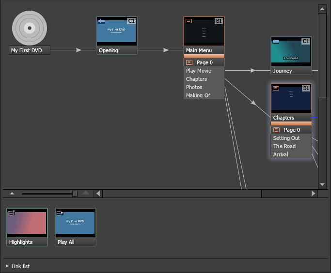

# 10. Building the Navigation

[Contents](README.md) · Previous: [9. Making Menus](09-menus.md#9-making-menus) · Next: [11. Subtitles](11-subtitles.md#11-subtitles)

> **In this chapter**
>
> - Decide what plays first when the disc is inserted
> - Connect destinations for buttons and after playback ends, and view the whole structure in the Flowchart panel

## 10.1 First Play and Title Button

The **First Play** is what runs first when you insert the disc, and the **Title Button** is where it goes when you press
the title button. These are set automatically when you create the first timeline or menu. To change them, right-click an
item in the Project panel or the Flowchart panel and choose **Set as First Play** (for the Title Button, specify it in
Properties).

## 10.2 Flowchart

**Window ▸ Flowchart** (F5). It has the same layout and appearance as Encore, spreading out like a tree to the right
from the disc.

- The disc is on the left. **First Play** points to the first item, links from each item go to the column on their
  right, arranged in button order. **One box per link**: a link to an item already shown (a second button to the same
  timeline, or a title returning to a menu) goes into a faint copy of that item, so lines do not fold back. Boxes are
  placed at the same height as the buttons or End Actions from which links originate; if there is no space, they go
  below the previous box.
- Boxes show an image of the item (for timelines, the poster frame of Chapter 1; for Chapter Playlists, the first item;
  for Playlists, the first item's image), enclosed in a colored border indicating the type, with a type icon in the
  top-left and **where links enter** in the top-right: **C** Chapter (the image is also that chapter's frame), **B**
  Button entering a menu (if the link does not specify a button, it is the Default button), **A** / **S** Audio Track
  and Subtitle selected by the link. Menus list buttons below, page by page (**Page 0**, **Page 1**...). Buttons display
  text; if there is no text, they show the name (buttons from menus imported from Blu-ray show the name of what plays).
- Link arrows are located about two-thirds along the line. Clicking a box selects that item; clicking a button row
  selects that button (the row dims and links turn blue). Double-clicking opens it in the viewer (for menus, it opens
  with the button receiving the link selected).
- Clicking a button row realigns the destination box to the same height as the row (previous boxes move up, following
  boxes move down); clicking a box brings the source link row to the same height. The clicked element does not move on
  screen. This arrangement remains until you click something else.
- Items unreachable from the disc (not linked from anywhere, or only from the Title Button) appear in the **Tray** at
  the bottom, sorted by type and then by name. Dragging to a timeline, slideshow, or playlist sets it as that item's End
  Action; dragging to the disc sets it as First Play.
- Use the slider between the Flowchart and the Tray to zoom from 100% (the size when opened) down to 10%. The small and
  large icons at the ends zoom out or in by 10% per click. Boxes moved manually also shrink with the rest, while the
  Tray size remains unchanged.
- With the **Move Tool**, you can drag boxes to move them. Use **Auto Layout** / **Auto Layout All** to return to the
  original arrangement.
- With other tools, dragging a box onto another box sets the End Action of the dragged item to that item (dropping a
  menu on a timeline sets it as the timeline's End Action; dropping on the disc sets it as First Play). Dropping a
  timeline onto a button row in a menu makes that button its End Action. Dropping an item from the Tray into empty space
  places it there with its links (using **Auto Layout** on that box returns it to the Tray). If linked from somewhere,
  it enters the tree next to that link.
- Dragging from a button row or the right edge of a box's name onto a menu, timeline, slideshow, or playlist (a faint
  copy is also acceptable) creates a link (the box being linked turns gold when dropped). The pick whip in the
  Properties panel can also be dropped onto boxes.
- Right-click options include Open / Specify Link / Rename / Set as First Play, etc.
- Hovering the pointer over a box shows the full name and the destination of any End Action hidden by lines (Stop, Last
  Menu).
- **View ▸ Show All Thumbnails** displays images in the boxes. Turning this off leaves only names in the boxes (images
  remain in the Tray). This option is also available in the Flowchart's right-click menu, along with **Auto Layout
  All**, **New**, **Import**, and **Preview**.

Reading the entire disc as pages (First Play, menus returning to higher levels, unlinked items) is described in
[Using the Flowchart as a Disc Map](17-advanced.md#178-using-the-flowchart-as-a-disc-map).

## 10.3 Types of Links

| Location | What is determined |
|---|---|
| Button | Link (destination when pressed), Override (destination after the linked item ends), Route (arrow key movement) |
| Timeline | End Action, Override, Remote Menu |
| Menu | End Action (destination on timeout), Override, Duration |
| Disc | Override (default destination for the disc) |
