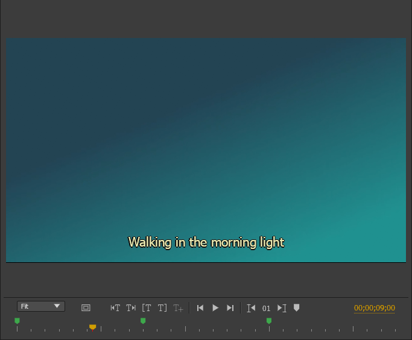

# 11. Subtitles

[Contents](README.md) · Previous: [10. Building the Navigation](10-navigation.md#10-building-the-navigation) · Next: [12. Checking the Project](12-check.md#12-checking-the-project)

> **In this chapter**
>
> - Import subtitle files
> - Edit subtitles and set their colors and positions

## 11.1 Import

- Choose **Timeline ▸ Import Subtitles ▸ Text Script…** (SRT / WebVTT / text with timecodes; UTF-8 / UTF-16 / Shift_JIS)
  to add one subtitle track to the selected timeline.
- You can import subtitles from images (JPG, GIF, PNG, TIF, BMP) using **Timeline ▸ Import Subtitles ▸ FAB Image Script…
  / Image Script…**.

  > **Details**
  >
  > - A FAB Image Script has one image per line (`File Start End Left Top Right Bottom`) and asks for the folder of the
  >   pictures.
  > - An Image Script uses `Display_Area (Left Top Right Bottom)` and `Directory <Folder>`, followed by lines of
  >   `Number Start End File`.
  > - Click the first image with **Map Colors** to choose the colors for **Background** (transparent), **Fill / Color
  >   1** (drawn with the group's fill), and **Outline / Color 2** (the group's stroke).
  > - Other colors become transparent, so images with three distinct colors and sharp edges look best.
  > - Selecting **Relative** shifts only the timecodes of all subtitles by a specified amount (use `-` at the beginning
  >   to shift earlier).
  > - Image subtitles appear in the timeline by their file names, and the text cannot be edited.
  > - Moving and trimming work the same as for other subtitles.
- Import a subtitle file as an asset, then drag it into the Timeline Viewer to create clips.
- **Subtitles in the Video** (MKV subtitle tracks): When you create a timeline from such a video, the internal subtitles
  become subtitle tracks (up to 32).

  > **Details**
  >
  > - Text subtitles (SRT, WebVTT, ASS / SSA) are extracted as `.srt`, and Blu-ray PGS as `.sup`. They are placed in the
  >   `<Project Name>.subtitles` folder next to the project (or a temporary folder if the project is not yet saved),
  >   becoming regular subtitle assets that can be edited.
  > - ASS decorations (character positioning, color specifications, shapes) are removed, leaving only the text.
  > - The language is taken from what is written in the file.
  > - PGS cannot be used on DVD, so it is not extracted for DVD projects.
  > - To add them later, choose **Timeline ▸ Import Subtitles ▸ Subtitles in the Video** (a DiscCraft-only item).
- You can also read text scripts exported by Encore (UTF-16 LE). You can export as SRT / Text Script using **Timeline ▸
  Export Subtitles ▸ Subtitle Track**.
- You can also create subtitles from slide names and descriptions using **Create Subtitle** in **File ▸ New ▸
  Slideshow**.

## 11.2 Editing

In the subtitle track of the Timeline Viewer, drag the ends of clips to trim them, and double-click to edit the text
(Enter / Shift+Enter for a new line, Esc to confirm). The minimum trim length is 0.4 seconds (13 frames for NTSC, 11
frames for PAL).

You can also create them using the subtitle buttons on the Monitor (**Previous Subtitle / Next Subtitle / Trim Subtitle
In Point to Here / Trim Subtitle Out Point to Here / Add Subtitle**). **Add Subtitle** places a clip of the default 2
seconds at the playhead position (it cannot be placed if there is less than 2 seconds until the next subtitle).

In the timeline, dragging a subtitle clip moves it along the track, and dragging the left or right end trims it.
Movement occurs in frame units, stopping at the beginning of adjacent clips, and clips cannot become shorter than 13
frames (clips originally shorter remain their length). The destination is shown with an outline, and Ctrl+Z undoes the
move. Turning on **Snap subtitle clips** (Preferences ▸ Timeline; default is Off) makes the moving end snap to the ends
of nearby subtitle clips, chapter points, or the playhead. When pressing on a chapter point line, the chapter moves as
before.

## 11.3 Appearance

When you select a subtitle clip, the **Subtitle Clip** sheet appears in Properties.

| Item | Description |
|---|---|
| Text / Duration / In Point / Out Point | Characters and times |
| Highlight | Groups 1–3 (color sets). Selecting **Track Settings** follows the track's group |
| Stroke | None / Thin / Medium / Thick / Extra Thick |
| Align | Vertical position (100 % is bottom) |
| Justify | Left / Center / Right (default is Center. Left and Right align to the title safe edges) |

Colors are determined by the **Color Set** in the Properties of the timeline (or slideshow for slide subtitles).

- Each of Groups 1–3 has fill, stroke, and anti-alias colors, each with its opacity (the default colors at first).
- Enabling **Create anti-alias color from fill and stroke** makes the anti-aliasing (the blending color at character
  edges) intermediate between the fill and stroke. Disabling it allows you to set it manually.
- Enter a **Name** and click **New** to save the current colors as a project Color Set. Saved sets can be selected from
  the **Color Set** list and deleted with **Remove** (timelines hold copies of the colors, so changing the set later
  does not affect them).
- You can exchange Color Sets with files (`.dccolors`) using **Export… / Import…**. Use **Reset to Default** to restore
  the original colors.

Subtitle text must fit within the title safe area (80 % of the frame). You can check the range with **View ▸ Show Safe
Areas** (Ctrl+6). Subtitles that do not fit are reported in [Project Check](12-check.md#12-checking-the-project).
