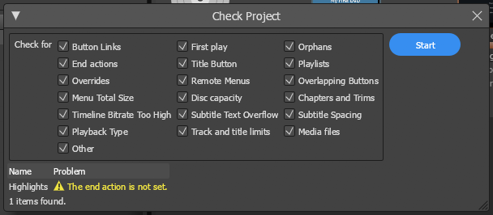

# 12. Checking the Project

[Contents](README.md) · Previous: [11. Subtitles](11-subtitles.md#11-subtitles) · Next: [13. Previewing](13-preview.md#13-previewing)

> **In this chapter**
>
> - Find missing links and capacity issues before building

Choose **File ▸ Check Project…** (Shift+Ctrl+L), click the **Check Project** button on the right side of the **Build**
panel, or press F4. In the check window, mark items under **Check for** and press **Start** to run the checks. Results
are listed per item in two columns: **Name** and **Problem**. If an item has multiple problems, they are collapsed into
"{n} errors". A circle with an × appears before errors, and a triangle with an ! appears before advisories, so you can
distinguish them by shape even if colors are hard to see. The colors themselves are chosen to be distinct for all types
of color vision. The check list and results in the Build panel, as well as layer break verification (a circle with a ✓
indicates a good location), use the same icons.

| Category | What is checked |
|---|---|
| Button Links | Buttons with no destination or unset links, buttons outside the frame, non-existent default buttons |
| First Play | Whether First Play is set |
| Orphans | Timelines and menus that cannot be reached from any item |
| End Action | Items with an unset End Action |
| Title Button | Whether the Title Button is a menu |
| Playlist | Empty playlists and slideshows, Chapter Playlists with no entries, slides with invalid Duration |
| Override | Override settings |
| Remote Menu | Whether the Remote Menu is a menu |
| Overlapping Buttons | Buttons with overlapping Highlights, menus with too many buttons |
| Menu Total Size | Menus without buttons, Duration, mixed 4:3 and 16:9 aspect ratios |
| Disc capacity | Whether capacity is exceeded, whether bitrate is too low |
| Chapters and Trims | More than 99 chapters, first chapter not at the beginning, incorrect order |
| Timeline Bitrate Too High | Timelines on DVD where the total of video and Audio tracks used as-is exceeds 9.8 Mbps |
| Subtitle Text Overflow | Subtitles where text does not fit within title safe margins (11 or more lines at standard NTSC size, or long lines that cannot wrap). Shows Subtitle Track and in/out times |
| Subtitle Spacing | On Blu-ray (HD or PAL), subtitles with a gap of less than 5 frames from the previous subtitle on the same track. Not checked for DVD |
| Playback Type | On DVD, Chapter Playlist entries set to **Random** or **Shuffle** with 65 or more items: DVD selects only from the first 64. (Encore plays random and shuffle Chapter Playlists in order on DVD. DiscCraft writes them as configured) |
| Track and title limits | Limits such as 8 Audio tracks, 32 Subtitle tracks, 99 titles on DVD |
| Media files | Offline, missing, or unsupported media formats |
| Other | Items not covered by the above categories |

The **Build** button always runs checks before building. If problems are found, a dialog appears with options to
**Show** (open the check window), **Ignore and Continue**, or **Undo**.
