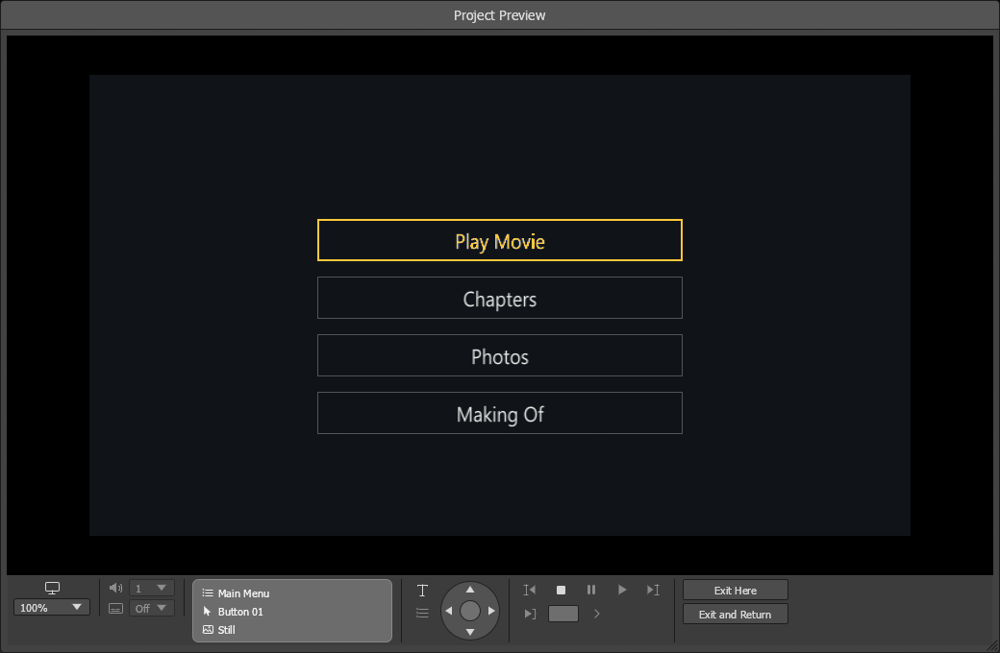
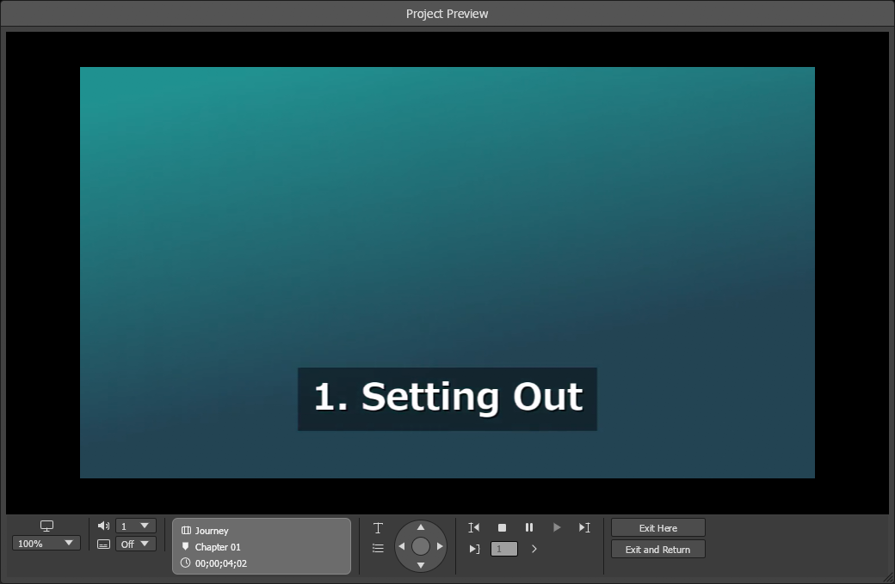

# 13. Previewing

[Contents](README.md) · Previous: [12. Checking the Project](12-check.md#12-checking-the-project) · Next: [14. Building](14-build.md#14-building)

> **In this chapter**
>
> - Try the disc without building it (Project Preview)
> - Play and check the built disc (Monitor)

## 13.1 Project Preview (Preview Without Building)

Choose **File ▸ Preview** (Alt+Ctrl+Space), or click the play button in the toolbar. This opens a window that plays your
current project using the built-in VM, without building it. Playback starts from First Play. If you choose **Preview
from Here** from the right-click menu on a menu or timeline, playback starts from there. You can also test menus with
overlapping buttons (the build process refuses to proceed until overlaps are fixed).

The control bar at the bottom contains the following items, from left to right.

| Part | Content |
|---|---|
| Magnification | Below the screen icons. It starts at **100%** (actual size, centered). Use **Fit** to match the window size |
| Audio / Subtitles | Next to the speaker and subtitle icons, select the track to play (only while playing a title) |
| Current Item | Three lines. For a menu: Menu Name / Selected Button / Still or Motion. For a title: Title Name / Chapter / Playback Time |
| Title / Menu | The T button is the remote control's Title Button. The list button is the Menu button (on Blu-ray, the Pop-up Menu appears below it) |
| Directional Keys | Use the up, down, left, and right of the round directional pad to move between buttons. The center circle is Enter |
| Playback | Previous Chapter / Stop / Pause / Play / Next Chapter. Below these are **Run the End Action** and a field for the chapter number (**Go to Chapter**) |
| Exit | **Exit Here** (opens the item you are viewing and exits) and **Exit and Return** (returns to before opening) |

- Closing the window with × is the same as choosing **Exit and Return**.
- Titles play with video and audio. When they finish, the End Action runs. Use the arrow keys and Enter for remote
  control functions, and Space to pause.
- A Chapter Playlist plays entries in order (each chapter on the timeline up to the next chapter point). A Slideshow
  displays slides for their specified lengths while playing audio clips.

  > **Details**
  >
  > - Chapter numbers follow what is displayed on screen, so Previous / Next Chapter moves from there.
  > - Slides set to "Manual advance" remain on screen until the next chapter (or Enter).
  > - While a slide remains, audio stops just as it does on disc. It resumes from where it stopped when the next chapter
  >   begins.
  > - Slides move with Pan & Zoom, just like on disc. "Scale to Crop" fills the entire screen.
  > - Transitions between slides (Cross Dissolve, Dip to Black, Wipe) span across cuts, just as they do in the build.
  > - If you turn on the subtitle stream, slides created with **Create Subtitle** display their name (and description)
  >   as subtitles, just like on disc.
  > - A Chapter Playlist set to **Shuffle** plays all items once each in a random order. **Random** selects a random
  >   item each time (up to 99 times here), playing them like a standard player.
- Rendered Motion Menus (**File ▸ Rendering ▸ Motion Menu**) play the background video and Motion Buttons, looping from
  the loop point, just like on disc. Before rendering, or after changing the project, it displays the unrendered menu
  (the first frame of the background). HD Blu-ray Motion Menus also play here after rendering (or after building a disc
  using the same cache).

## 13.2 Monitor (Playing Build Output)

Choose **Window ▸ Monitor** (F9). In the Monitor, use **Open Build Output** to read and play the `VIDEO_TS` / `BDMV`
folder from your exported directory. You can use the remote control's directional keys, Title / Menu, Chapters, and
Audio / Subtitles. If you have not built the project, it displays the video and audio of the selected timeline directly
(press Space to play with sound. Subtitles also appear in their Color Set colors). DTS tracks do not play.
