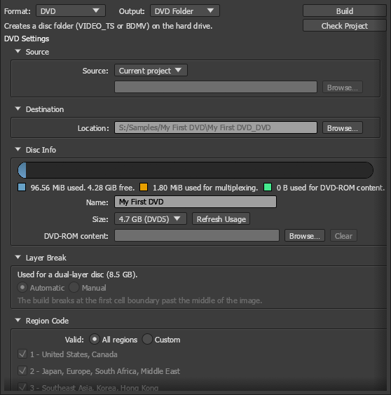
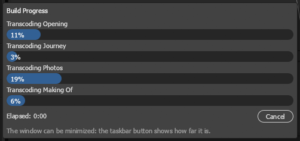

# 14. Building

[Contents](README.md) · Previous: [13. Previewing](13-preview.md#13-previewing) · Next: [15. Making a Disc Label](15-labels.md#15-making-a-disc-label)

> **In this chapter**
>
> - Create disc folders or images (ISO)
> - Write to a disc
> - Handle capacity and dual-layer discs (Layer Break)

## 14.1 Build Panel

Choose **Window ▸ Build** (F2), or **File ▸ Build ▸ Folder…** / **Image…**.

| Field | Description |
|---|---|
| Format / Output | DVD / Blu-ray, **Disc** (write to a recorder's disc), Folder (`VIDEO_TS` / `BDMV`), ISO Image, and for DVD also **DDP Image** (for pressing) |
| Build | Start the build. When pressed, it first saves the project and runs checks |
| Source | The current project. If the output is **DVD Disc** / **Blu-ray Disc**, you can also select a previously created **Disc image** (enter its file path in the field below the list or choose it via **Browse…**) |
| Destination | The location to export to. If empty, it creates files in the faint text location (next to the project) ([14.2](#142-destination)) |
| Disc Info | Usage bar, disc name, size, DVD-ROM / BD-ROM Content ([14.3](#143-disc-info)) |
| Layer Break | Only for DVD-9. Automatic / Manual. For manual, set it via the timeline and position (timecode / frames / seconds, **Playhead**) |
| Region Code | Only for DVD. All regions / Custom (1–8) and **Parental level** ([14.4](#144-region-and-parental-level)) |
| Project Check | Check results (the same rows as the Check Project window) |
| Result | Errors, number of titles / chapters / size, **Simulate** (run a VM after building to a folder) |

## 14.2 Destination

If empty, files are created in the location indicated by faint text: `<Project Name>_DVD` / `_BD` next to the project,
`<Project Name>.iso` for images, and `<Project Name>_DDP` for DDP images.

> **Details**
>
> - For folders and DDP images, if you specify an existing folder, they are created in a `<Disc Name>` folder inside it
>   (if that location already contains `VIDEO_TS` / `BDMV`, or `DDPID` for a DDP image, it rebuilds there)
> - You cannot specify a folder for images

## 14.3 Disc Info

The usage bar (calculated by **Refresh Usage**) shows the remaining space on the disc. The disc name also becomes the
ISO volume label. Select the size from the list; for the last option, **Custom**, enter the value in GiB in the adjacent
field.

> **Details**
>
> - Custom sizes range from 0.001 GiB up to 4.7 GB (4.38 GiB) for single-layer DVDs, and up to 128 GB (119.21 GiB) for
>   Blu-ray BDXL (1 GiB = 1,073,741,824 bytes). Larger DVDs are DVD9
> - Sizes are displayed in binary MiB and GiB (1 MiB = 1,048,576 bytes). Names like 4.7 GB for disc types use the
>   manufacturer's notation (billions of bytes)
> - Usage includes the overhead added by multiplexing video and audio (approx. 2%). This appears in orange on the bar
>   and as a separate item in the row (hover over the row to see the full breakdown)
> - For DVD9 with a manual Layer Break, rows appear for each layer. Layer 0 goes up to the break, with a maximum of
>   2,086,912 sectors (4,076 MiB); Layer 1 must be less than or equal to Layer 0. If it does not fit, the project check
>   warns
> - **DVD-ROM Content** / **BD-ROM Content**: Choose a folder via **Browse…** to include its files and folders in the
>   disc root, alongside `VIDEO_TS` / `BDMV` (e.g., manuals or photos for PC viewing). This reduces the capacity
>   available for video. Use **Clear** to remove it. A single file must be under 4 GB, and folders up to 7 levels deep

## 14.4 Region and Parental Level

For DVDs, you can set the playable region (Region Code) and the **Parental level** (None, or 1–8; 8 is the strictest).
Players with a parental level setting lower than this will prompt for a password before playback and stop if no password
is entered.

> **Details**
>
> - Password prompts occur at the start of the disc and when starting a title from the remote. Players without a level
>   set play as usual
> - Timelines, Slideshows, and Chapter Playlists can have their own level via **Parental level** in Properties (disc
>   level, None, or 1–8). Timelines can also specify what to play instead if the level cannot be raised (**When not
>   playing due to restriction**: another title or menu. If unset, it stops)
> - Chapters in a timeline can have alternative video for players with a lower level (DVD standard Parental Block.
>   **Parental Alternative** and **Below this Level** (2–8) in Chapter Properties. The command is
>   `timeline.setParentalChapter`). Titles become versions per level, and the player selects its own level (no password
>   prompt)
> - Project Preview shows the version matching the player's parental level set in Preferences ▸ Preview. Monitor shows
>   the original timeline
> - The same level is written for all countries. Unverified on physical players

## 14.5 Build Progress

During a build, the **Build Progress** dialog appears in the center of the window, and other parts are unresponsive
until the build finishes (including key operations and file drops).

> **Details**
>
> - Clips are converted sequentially, so one bar appears for each task, along with elapsed time (progress also appears
>   on the status bar and Progress panel)
> - Use **Cancel** to stop the build at the next picture
> - Completed conversions remain for the next build
> - The window can be minimized: On Windows, the taskbar button shows a moving bar during the build, a red bar on
>   failure, and flashes when the build finishes while the window is not in the foreground
> - If the build fails, the dialog explains why (use **Copy** to copy errors to the clipboard)
> - Errors also remain in "Result"

## 14.6 About Output

- Converted assets remain in `disccraft-cache` at the destination (skipping conversion from the second time on). Use the
  command line `--cache` to place them elsewhere and share them
- ISO is UDF + ISO 9660. On Windows, double-clicking in Explorer mounts it
- If you specify a Layer Break for a DVD-9 image, a record is saved in `<Name>.layerbreak.txt` at the same location. To
  match dual-layer discs, the break is placed at the start of a 16-sector block: if the break cell starts elsewhere,
  that title set is shifted back several sectors within the image (the build of the VIDEO_TS folder is not shifted). The
  Layer Break of the last built DVD-9 image is also recorded in the project and saved with it (including relative paths
  from the project file for image paths). Even after reopening the project, the Layer Break appears in the Build panel's
  field, and when writing that image to a dual-layer disc, it uses this record even if the adjacent file is missing
- **DDP Image** (DVD only) is delivered to pressing plants instead of master discs. The folder contains `MAIN.DAT` (disc
  image), `CONTROL.DAT` (disc control data: size and structure), and `DDPID` (what the two files are and where they go
  on the disc). These are the same files written by Encore CS6 from the same image. The `VIDEO_TS` folder is created
  alongside (`<Name>.files`). DDP images for dual-layer (DVD-9) discs are split into folders per layer: `Layer 1` (layer
  0 part of the image, `CONTROL.DAT`, `DDPID`) and `Layer 2` (the rest of the image and its `DDPID`)

## 14.7 Writing to a Disc

- If you set Output to **DVD Disc** / **Blu-ray Disc**, instead of Destination, fields appear for **Recorder** (a
  writable drive; use **Refresh** to search again), **Write Speed** (speeds available on the inserted disc; **Maximum**
  is the fastest), **Copies** (1–99), **Auto-erase rewritable discs** (erases DVD-RW etc. before writing, overwrites
  DVD+RW/BD-RE. If off, only blank discs are used), and **Verify the disc after writing** (on by default; DiscCraft
  specific: reads back the disc before ejection and compares sector by sector with the image). Below these, the type of
  inserted disc and free space appear.

  > **Details**
  >
  > - **Build** creates an image next to the project, writes it to the disc, closes it, verifies it, and then opens the
  >   tray
  > - If the disc differs from the image, it notifies you along with the differing first sector
  > - For subsequent discs, insert a blank one and press **Write**
  > - If writing fails, use **Try Again** to write the same image again
  > - The image is deleted when finished or if you **Cancel**
  > - During writing, the Build Progress dialog shows the current task (writing, closing disc, verifying), elapsed time,
  >   estimated remaining time based on pace so far, and **Stop** (write-once discs stopped midway cannot be used)
  > - The taskbar button shows the amount written and verified
  > - You cannot close the window while writing
  > - Uses Windows' writing feature (IMAPI2); PCs without a recorder show "Not found"
  > - Encore's **Run test before writing** is unavailable because IMAPI2 does not support test writes
  > - On the command line, `disccraft-cli recorders` lists recorders and inserted discs; `disccraft-cli burn <image>`
  >   (`--recorder E:`, `--speed 8`, `--erase`, `--no-verify`) burns and verifies an image;
  >   `disccraft-cli verify <image>` (`--recorder E:`) compares a written disc with the image
  > - Writing is not yet available on macOS and Linux
- DVD-9 images are written to blank **DVD+R DL** according to the Layer Break: before writing, it instructs the drive to
  end layer 0 at the image's Layer Break (`<Name>.layerbreak.txt` next to the image), and checks the disc's layer
  boundary after writing.

  > **Details**
  >
  > - Without instruction, the drive switches layers when layer 0 is full, which is usually not at a cell start
  > - It does not write to discs whose layer 0 is already set elsewhere (DVD-R DL, previously set DVD+R DL), and
  >   notifies you if the boundary shifts after writing
  > - `disccraft-cli recorders` shows layer 0 of dual-layer discs (sector count and whether it can still be set)
  > - For DVD+R DL, DiscCraft issues commands directly to the drive instead of using Windows' writing feature (which
  >   made layer 0 half the image on its own): it takes exclusive control of the drive, sets layer 0, specifies write
  >   speed, writes the image (waiting while the drive buffer is full; if the drive doesn't respond, it queries the next
  >   position and continues from there), flushes the buffer, closes the track, closes the disc for DVD players, and
  >   resets the drive speed to default (the speed set for writing also affects read speed; without resetting,
  >   verification cannot read faster than during writing, which was about half inside the layers)
  > - Timestamps for each step, speeds achieved, and drive responses are logged in `<Name>.burnlog.txt` next to the
  >   image
  > - The drive name, disc media ID (manufacturer code like `MKM-003-00`), messages from the drive while busy, and drive
  >   messages upon write failure are also recorded
  > - A DVD+R DL stopped midway reports as blank, but layer 0 remains set
  > - DiscCraft does not write to such discs (as they may be partially written) and indicates this in the disc row of
  >   the Build panel
- If you set Source to **Disc image**, **Build** writes that image directly: it does not build or check the project, and
  the image remains after writing. Previously verified images (including those burned once) can be written to disc
  unchanged. DVD-9 images are written using the Layer Break recorded in the project for that image's build, or if
  missing, the Layer Break in `<Name>.layerbreak.txt` next to it. If neither exists and the image is larger than
  single-layer, it will not write to a dual-layer disc (because the drive would switch layers anywhere)
- Labels printed on printable disc faces are created in [Chapter 15](15-labels.md#15-making-a-disc-label)
- For how to read remaining capacity and handle overflow, see
  [Monitoring Disc Size While Working](17-advanced.md#179-monitoring-disc-size-while-working)
