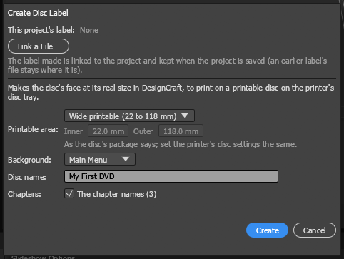

# 15. Making a Disc Label

[Contents](README.md) · Previous: [14. Building](14-build.md#14-building) · Next: [16. Making a Blu-ray Disc](16-bluray.md#16-making-a-blu-ray-disc)

> **In this chapter**
>
> - Create a label to print on printable discs and print it with a printer

Create a label for the face of a printable disc, which is printed directly using the printer's disc tray. This is a
feature unique to DiscCraft and not available in Encore. The label is created as a DesignCraft document (a layout app in
the Craft family), and text can be edited freely later. If DesignCraft is not installed, it creates a PSD file that can
be opened in PhotoCraft.

## 15.1 Create

Choose **File ▸ Create Disc Label…** to open the dialog.



| Item | Description |
|---|---|
| This Project's Label | The label linked to the project ([15.3](#153-linking-to-the-project)) |
| Printable Area | The area specified on the disc package. **Wide Printable** (inner diameter 22 mm to outer diameter 118 mm), **Standard** (inner diameter 43 mm to 118 mm), **Custom** (enter inner and outer diameters) |
| Background | A menu that selects an image to fill the ring. Uses only the background of the menu (for Motion Menus, the first frame). If **None (white)** is selected, only text is printed |
| Disc Name | The title placed in the upper half. Defaults to the disc name |
| Chapters | Whether to include a list of named chapters in the lower half |

Click **Create** to write `<ProjectName> Disc Label.designcraft` next to the project and open it in DesignCraft. If the
project has not been saved yet, it is written to the Craft folder in the home directory.

## 15.2 Label Contents

The page is a square of 120 mm, the same size as the disc.

- **Disc Face** (first layer): The printable ring is defined as a single path consisting of two circles (the inner
  circle is the hole), with the background image placed inside. Nothing outside the hole or the disc edge is printed.
  The image can be moved or replaced within the ring.
- **Disc Name**: Placed in the upper half, written horizontally without following the curve.
- **Chapters**: Placed in the lower half, using the largest font size that fits without cutting off items midway. If
  they do not fit, a message appears in the status bar.
- **Guides** (non-printing layer, locked): Disc edge, printable area, and hole.

The text uses the fonts DiscCraft applies to menus, specified in points, ensuring clarity at any printer resolution.
When the document is opened, the active layer is the **Disc Face** layer, so logos or track lists pasted later are
printed as is (they are not clipped by the ring, so place them inside the ring).

## 15.3 Linking to the Project

The created label is linked to the project and saved along with it when the project is saved. It also stores a relative
path from the project file, so the label can be found even if the folder is moved or copied together with the label.

- **File ▸ Open Disc Label**: Opens the linked label in DesignCraft (PSD files open in PhotoCraft).
- In the **This Project's Label** field at the top of the dialog, use **Open**, **Link a File…** (select a label created
  elsewhere), or **Unlink** (the file remains on disk).
- Labels created next to the project before the linking feature existed appear in this field (**Link This File**).
- Creating a new label links the new one; the previous file remains.

## 15.4 Print

Printing is done via DesignCraft's **File ▸ Print** (Ctrl+P), after placing the disc in the printer's tray.

1. In the printer settings, select "Disc Label" as the paper type (choose a type suitable for glossy discs if
   applicable) and set the feed source to the disc tray.
2. If the printer has disc-specific settings (inner/outer diameter), match them to the disc package specifications.
3. If the printer offers a print preview, verify that the label fits within the disc circle before printing.

Handling of disc tray printing varies by printer.

- **Printers with CD/DVD paper sizes**: Select that paper size, set scaling to 100% (no enlargement or reduction), and
  center the image.
- **Printers that print the disc tray as an A4 page** (some Epson models): The disc appears at a fixed location on the
  A4 page. Create an A4 page in DesignCraft and place the label at that location. Since DesignCraft's printing slightly
  scales the page to fit the printer's printable area, place the label larger by that amount. The position and scaling
  can be determined by viewing a grid-lined A4 page in the printer's print preview.

The printed surface takes time to dry. Leave it untouched for a while, let it dry flat, and then place it in a case or
drive.

## 15.5 If DesignCraft Is Not Available

If DesignCraft is not found, a PSD file for PhotoCraft (300 / 600 dpi) is created and opened in PhotoCraft. The image
and text groups have a ring layer mask, and guides become hidden layers. You can also specify the location of
DesignCraft using the environment variable `DISCCRAFT_DESIGNCRAFT` (app) or `DISCCRAFT_DESIGNCRAFT_CLI` (command line).

## 15.6 Create via Command Line

```text
disccraft-cli disc-label <Project> --out <Name>.designcraft
```

| Option | Description |
|---|---|
| `--out <Name>.psd` | Output as PSD instead of DesignCraft |
| `--inner 43`, `--outer 118` | Printable area (mm) |
| `--menu <Menu Name>` / `--menu none` | Menu to use as background / No background |
| `--title <Title>` | Title for the upper half |
| `--no-chapters` | Do not include the chapter list |
| `--dpi 600` | PSD resolution |
| `--link` | Link to the project and save the project |
