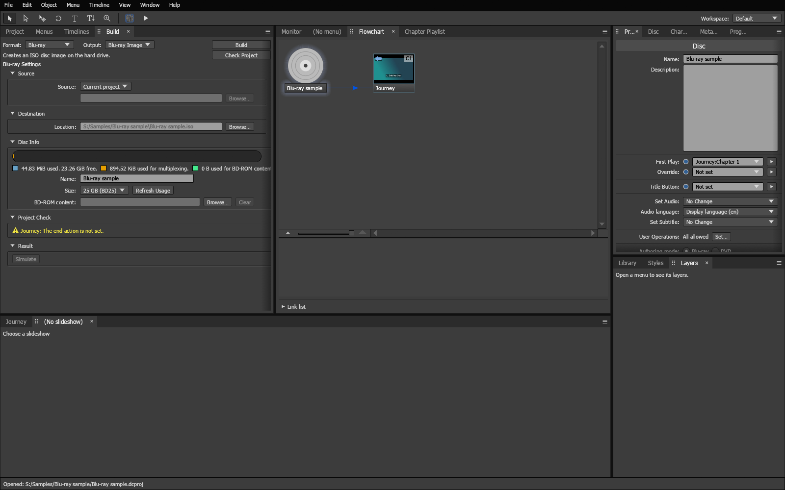
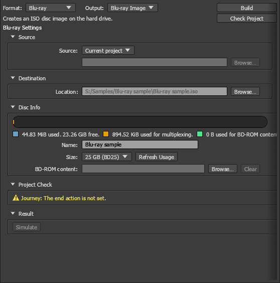

# 16. Making a Blu-ray Disc

[Contents](README.md) · Previous: [15. Making a Disc Label](15-labels.md#15-making-a-disc-label) · Next: [17. Advanced Techniques](17-advanced.md#17-advanced-techniques)

> **In this chapter**
>
> - Create a Blu-ray disc
> - Use features specific to Blu-ray (HD video, pop-up menus, etc.)

You can build the same project as a Blu-ray. Switch the authoring mode in **File ▸ Project Settings…** or the **Disc**
panel, and choose the video size SD (MPEG-2) / HD (H.264) in the **Disc** panel.

- Blu-ray video is either SD (720×480 / 720×576) or HD. For HD, 1080p (23.976 / 24) and 720p use H.264, while 1080i
  (59.94 / 50) uses MPEG-2.

  > **Details**
  >
  > - If you set the disc's **Blu-ray Codec** to **H.264 (every format)**, 1080i also uses H.264 (as interlaced frames,
  >   with the top field first. The bitrate follows H.264 standards).
  > - For SD, you can use MPEG-2 like DVD, or if you choose **H.264 (every format)**, it uses 720×480 / 720×576 H.264
  >   (as interlaced frames. Pixel shape matches the title's 4:3 / 16:9 aspect ratio. The bitrate is determined
  >   similarly to HD H.264. Menus remain MPEG-2).
  > - If you choose **MPEG-2 (every format)**, 1080p and 720p also use MPEG-2 (as progressive frames at that format's
  >   frame rate. The bitrate follows MPEG-2 standards).
  > - You can also select the codec for each video (**Transcode Settings…**. See [5.1](05-assets.md#51-how-to-import)).
  > - Some 1080 formats have a width of 1440 (1440x1080 at 59.94i / 50i / 23.976p / 24p). These are HDV or AVCHD sizes,
  >   where pixels are horizontally elongated for 4:3, making them appear as 16:9.
  > - Video is created at a width of 1440, while menus and subtitles remain at 1920×1080 as per Blu-ray specifications.
  > - Media shot at 29.97 fps or 25 fps becomes HD at the same speed if you choose 1080i 59.94 / 50 (Blu-ray specs do
  >   not include 1920×1080 at 29.97p / 25p, so each frame is split into two fields for 1080i).
  > - The bitrate for HD video is an average of 12 Mbps for H.264 and 25 Mbps for 1080i MPEG-2.
  > - If titles are too long to fit on the disc, the bitrate is automatically lowered until it fits (down to 3 Mbps for
  >   H.264 and 8 Mbps for MPEG-2. If it still does not fit, the build fails).
  > - The capacity meter and the project check also estimate based on this bitrate.
  > - `.m2ts` / `.mkv` / `.mp4` / `.mov` files containing H.264 that can be placed directly on Blu-ray are recorded
  >   without conversion (see [5.1](05-assets.md#51-how-to-import)).
- Blu-ray supports only HDMV (no BD-J), and menu creation is the same as for DVD.
- **Pop-up Menu** is a Blu-ray Remote Menu. Create it in the **Pop-up** tab of the menu, and set it as the **Remote
  Menu** on the timeline.

  > **Details**
  >
  > - It can be called up with the remote control during playback.
  > - Elements drawn by the menu (text, images, buttons as designed) appear over the video (the menu background does
  >   not).
  > - Pop-up menus created from PSD files show only button sets and buttons on pages marked `(#)`. Layers that are not
  >   buttons outside these areas (such as a white Background) do not appear.
  > - The Menu Viewer also displays only what appears on the disc, over a transparent (checkerboard) background if no
  >   background timeline is defined.
  > - Pop-up menus with pages (**Menu ▸ Add New Page**) display all pages together, starting from the first page.
  > - Buttons to other pages change the page while continuing title playback (up to 254 pages, and up to 254 buttons per
  >   page. If exceeded, those buttons behave as usual, leaving the title to go to that page's menu).
- HD (1080p, 720p) uses H.264, and clips are connected by IDR frames, so they appear exactly at the trimmed position
  (this also applies to clips converted for DVD. MPEG-2 files inserted directly cut at GOP boundaries).
- DTS files can be included on Blu-ray just as on DVD (the core only).
- Subtitles for HD or PAL Blu-rays must have a gap of at least 5 frames from the previous subtitle in the same track.
  The project check flags this (**Subtitle Spacing**).
- The build process is the same (**File ▸ Build ▸ Folder…** / **Image…**). The folder becomes `BDMV` instead of
  `VIDEO_TS`. Project Preview and Monitor play back the built Blu-ray, including pop-up menus.
