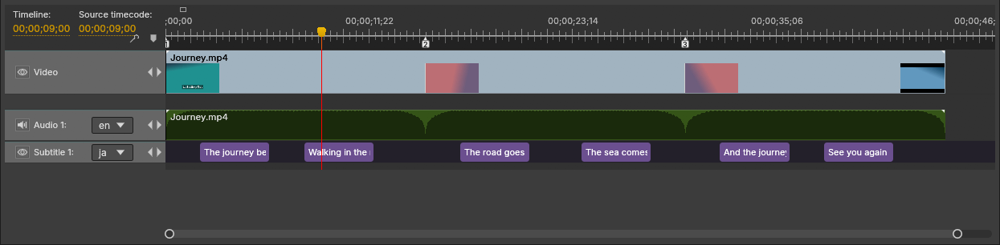
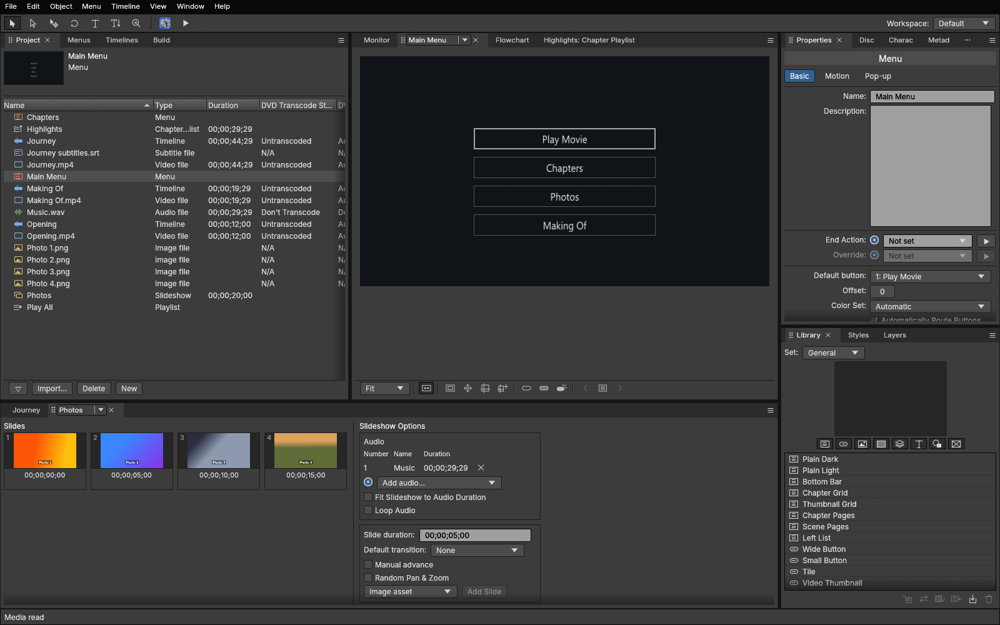
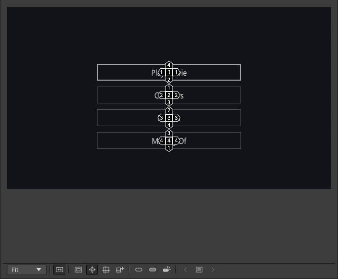
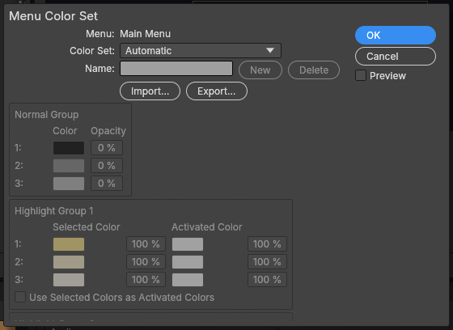
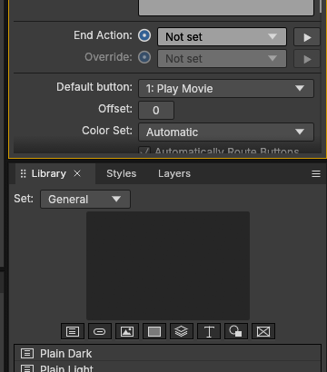
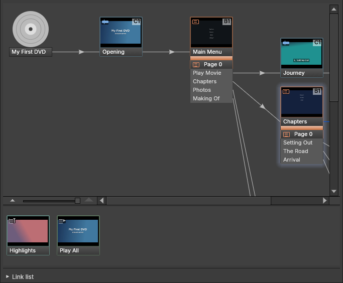

# 17. Advanced Techniques

[Contents](README.md) · Previous: [16. Making a Blu-ray Disc](16-bluray.md#16-making-a-blu-ray-disc) · Next: [18. Preferences](18-preferences.md#18-preferences)

> **In this chapter**
>
> - Create advanced menus, such as scene selection menus with images, hidden buttons, and manually drawn routing
> - Monitor disc size while working

The previous chapters followed the workflow order. This chapter covers the parts that make a disc feel "authored": scene
selection menus with images, menus built from the library, manual routing, hidden buttons, highlight colors per button,
motion menus with sound, and monitoring disc size while working. Each section is written so you can follow the steps,
with limits noted nearby.

## 17.1 Scene Selection Menus with Images

Chapter points are markers placed at the start of a scene. If linked to buttons, viewers can jump to the desired scene
without scrubbing, and navigate through chapters using the Next/Previous Chapter keys on the remote control.

1. Use **File ▸ Import ▸ Timeline…** (Shift+Ctrl+T) to create assets and timelines for each selected video in one go (no
   need to create them one by one). The first video becomes the **First Play**.
2. Double-click a timeline in the Project panel to open it in the Timeline Viewer, and keep the Monitor visible
   (**Window ▸ Monitor**, F9).
3. Place the playhead at a clear scene change and choose **Timeline ▸ Add Chapter Point** (`*` on the numeric keypad).
   Chapters are numbered sequentially, so adding one in between automatically renumbers the rest.
4. Name the chapters in Properties. Usually, the chapter name matches the name of the button that leads to it. Choose
   **View ▸ Show Chapter Names** (Ctrl+8) to display names on the timeline.
5. Repeat this until the end of the video. If scenes are evenly spaced, use **Add Chapter Points at Interval…** (default
   5 min).
6. For buttons, place an image that represents the scene better than just the first frame. Move the playhead to that
   frame and choose **Timeline ▸ Set Poster Frame**, or enter a timecode in the **Poster Frame** field of the chapter's
   properties. A flag with the same number as the chapter marks the poster frame, which you can drag to move. Leaving
   the field empty reverts to the chapter's own frame.
7. Create the menu. To arrange buttons for each chapter, use **Menu ▸ Create Chapter Index**. For image buttons, use the
   **Thumbnail Grid** preset from the library. Buttons linked to a chapter display that chapter's poster frame (or the
   chapter's own frame if none is set).

Things to know:

- Chapter 1 is always at the first frame of the timeline. It cannot be moved or deleted and comes with every new
  timeline. If the video starts with black (fade-in), the poster frame becomes the first position in 0.5-second
  increments where something becomes visible (for a fade of about 1 second, this is at 1.5 seconds).
- For MPEG-2 that goes directly onto the disc, chapter points can only be placed at the start of a Group of Pictures
  (GOP). If you place one where you want, DiscCraft snaps it to the nearest available GOP start, so points placed inside
  a GOP do not stay there. Trimming uses the same snapping.
- A still thumbnail without a poster frame displays the first bright (non-black) frame of the chapter. Even for scenes
  that fade in from black, the button will not remain empty.
- DVD allows 99 chapters per title. A single page of the Chapter Index can hold 18 chapter buttons (6 per page if using
  multiple pages).
- Enabling **Motion Buttons** makes thumbnail buttons play video instead of a single image. The motion starts at the
  beginning of the linked chapter (or its poster frame).

## 17.2 Building Menus from the Library

The library contains DiscCraft's own presets for menus, buttons, images, backgrounds, and shapes, as well as items you
have saved yourself. Menus created this way are just regular menus once finished; no trace remains of where they came
from.

1. In the **Library** panel, click the menu type toggle (first icon), select a set (**General**, or **User** for your
   own), choose a preset, and press **New Menu** (the button with a **+** icon at the bottom of the list). It opens in
   the Menu Viewer and appears in both the Project panel and the Menu panel.
2. Name it using **Alt+Ctrl+R** (choose a name you will recognize later, such as "Menu #1" or "Scene Selection").
3. Click the button type toggle (second icon), select a button, and press **Place** (the arrow entering the frame) for
   each instance you want in the menu. The buttons are placed on the canvas.
4. Move them to approximate positions using the **Selection Tool** (V). Select multiple items (Shift+click or marquee
   selection) and use **Object ▸ Distribute** and **Object ▸ Align** to fix spacing and alignment. Enabling **Align
   Relative to Safe Area** makes the safe area bounds, rather than the canvas, the reference.
5. To create heading text with the same formatting as a button: select the button, press **Ctrl+C**, then **Ctrl+V**,
   then choose **Object ▸ Convert to Object**. The button disappears, leaving only the text in the same place, size, and
   font, which you can edit using the **Text Tool** (T). You can copy and paste between menus this way to carry over the
   appearance.
6. Select the heading and choose **Object ▸ Drop Shadow…** (Shift+Ctrl+O). Check **Drop Shadow** and **Preview**, set
   the color, opacity, angle, distance, size, and spread, then click **OK**. The same dialog works for buttons, images,
   and shapes.
7. Create a back button too. Paste the text again, change it to "Main Menu", and press **Ctrl+B** (**Object ▸ Convert to
   Button**). This is the most straightforward way to create a button.
8. Link each button (see [17.7](#177-five-ways-to-link-buttons)), and set the menu's **End Action** and **Default
   button**.
9. If you want to keep the menu, save it as a template using **Menu ▸ Save Menu as Template…** (Ctrl+Alt+M) into the
   **User** set in the library for use in future projects.

You can change the background at any time. Select a background in the library and click **Place** or **Set Background**.
**Replace** swaps the design of the open menu with another preset, keeping links by number.

## 17.3 Setting Routing and Numbers Manually

Routing is the path the highlight follows when the viewer presses the arrow keys. DiscCraft draws a likely path
automatically (rules are in [Preferences ▸ Menu](18-preferences.md#18-preferences) and saved with the project, so
routing remains the same regardless of which computer builds it). Draw it manually when button arrangements are unusual,
when you do not want rows to wrap, or when you want to guide users along a path no one would guess.

Automatic routing follows the same rules as Adobe Encore CS6. Buttons aligned within 9 px of the left (top) edge or
center form columns (rows), moving up/down (left/right) within them and wrapping at the ends. If slightly offset buttons
exist (overlapping a row by 10–18 px), that entire row ceases to be treated as a row. The same applies when buttons
partially overlap each other, or when a button is 10–18 px away from a button in a row (such as the Bottom Band).
Buttons containing others within their bounds (such as bands behind item arrangements) do not join rows or columns but
move to the contained buttons. For directions with no row or column, it moves to the nearest button in that direction
(up/down within about 68° of straight, or less than 400 px horizontally); if none exists, it moves to a horizontal
button (prioritizing those at the same height, then closer gaps, then clockwise: right for up, left for down). Except
when excluding "Next" and "Previous", the top and left of the leftmost button become "Previous", and the bottom and
right of the rightmost button become "Next".

1. Click the menu background (not on a button or text) to show the menu sheet in Properties, and uncheck **Automatically
   Route Buttons** on the **Basic** tab.
2. Choose **View ▸ Show Button Routing** (Ctrl+7) to display a cross diagram for each button. The number in the center
   is the button's number; the numbers on the arrows indicate which button that arrow key leads to (0 means no
   destination).
3. Set the numbers first. The **Number** field on the button sheet reorders its position in the list. Since arrows point
   to numbers, assigning them left-to-right and top-to-bottom makes subsequent work easier. The menu's **Offset**
   determines where the remote control's number keys start counting from.
4. Drag the arrows of the cross diagram to the buttons you want to lead to (the button it will lead to is framed in
   gold). Releasing on an empty area of the canvas removes that route. Untouched directions remain automatic.
5. Hide the routing display and test it. Press **File ▸ Preview** (Alt+Ctrl+Space) and use the arrow keys.

## 17.4 Hidden Buttons and Easter Eggs

An easter egg is an item located where it cannot be found by chance. On a disc, this consists of buttons that are not
drawn (or only drawn when highlighted) and routes that no one would normally follow. There are two types, differing only
in which highlight is shown.

- One where the highlight appears when the cursor lands on it. Careful explorers can find it.
- One where even the highlight is transparent. You do not know if it was found until Enter is pressed.

Here is how to make one:

1. Create a menu (**File ▸ New ▸ Menu**, Ctrl+M, or a library preset). Place 2–3 normal buttons and one image (**Library
   ▸ Images ▸ Place**). Do not overlap them.
2. Select the image and press **Ctrl+B**. This becomes the hidden button. Add the link beforehand (timeline, playlist,
   slideshow). Buttons without links appear in the project check.
3. Click the background to uncheck **Automatically Route Buttons**, and draw the routes manually.
4. In the **Layers** panel, open the set of two buttons used for the path and click the eye icon to hide them. The text
   and graphics disappear, but they remain as buttons, so highlights and links still work.
5. Select those two buttons and set **Highlight** to **Group 2**. Keep visible buttons and image buttons in **Group 1**.
6. Choose **Menu ▸ Edit Menu Color Set…**, select **Menu Default**, check **Preview**, and set the opacity of Highlight
   Group 2 to 0% (Colors 1, 2, and 3, for both Selected and Activated states). The Group 2 buttons disappear completely.
7. In the same dialog, assign a noticeable color to Highlight Group 1 (bright green is a classic choice). This signals
   that the viewer has reached it. If you want it to remain dark even when found, set its opacity to 0 as well, keeping
   it transparent when selected.
8. Enable routing display and assign numbers. Visible buttons are 1; transparent buttons are 2 and 3; the hidden button
   is last. Then drag the arrows so that only the path to the hidden button has an unusual order (Left, Up, Left),
   ensuring all wrong keys return to Button 1.
9. Preview using arrow keys, not the mouse.

Advisory:

- Hidden buttons are still buttons. They take up space, their highlights must not overlap with others, and they count
  toward the limit of 36 buttons per menu.
- Keep them within bounds. Buttons outside the bounds appear in the project check and cannot be reached via remote
  control.
- A transparent button without a link is an error that never appears on screen. Run **Check Project…** (Shift+Ctrl+L)
  before building.
- To return viewers to the original menu after the easter egg, set the destination to a timeline with **End Action** as
  **Last menu**, or set the originating menu as the End Action.
- Another useful technique: buttons can be linked **to a specific button in a menu**. When that menu opens, that button
  is already highlighted.

## 17.5 Setting Highlight Colors Per Button

Menu highlights are subpictures, meaning images drawn on or near a button when the cursor is over it (Selected) and when
pressed (Activated). Menus have a color set (Normal Group and Highlight Groups 1–3). Each group has three colors, each
with Selected and Activated colors and opacities. Buttons choose which group to use.

1. Select the menu and change **Color Set** from **Automatic** to **Menu Default**. Automatic creates unique colors for
   each menu; this is fine for one menu but results in inconsistency if you have six.
2. Use **View ▸ Show Normal Subpicture / Show Selected Subpicture / Show Activated Subpicture** (Ctrl+3 / Ctrl+4 /
   Ctrl+5) to overlay each state on all buttons on the canvas (press again to hide).
3. Select a button (click inside the bounds, not on the cross diagram) and change **Highlight** to a different group.
   Buttons in the same group are highlighted together, making a row of "Chapter 1 / 2 / 3" look like a single unit.
4. Define colors using **Menu ▸ Edit Menu Color Set…**. Check **Preview** and move the dialog aside so you can see part
   of the button; changes to color or opacity update the menu instantly. Enabling **Use Selected Colors as Activated
   Colors** makes the pressed appearance identical to the hovered appearance.
5. Most discs use a single color scheme throughout. Changing **Menu Default** once updates all menus using it.

To carry colors to another project, save the menu as a template (Ctrl+Alt+M) and open it there. Menu color sets do not
have files. Subtitle color sets do (`.dccolors`, [11.3](11-subtitles.md#113-appearance)).

## 17.6 Adding Sound and Motion to Motion Menus

A menu becomes a motion menu the moment its background becomes video. There are three ways to create one, ordered by
effort.

**Placing Video Behind a Normal Menu**

1. Import the video as an asset (**File ▸ Import ▸ Asset…**, Ctrl+I). Place video behind the menu, not a timeline.
2. Select the menu and open the **Motion** tab on its sheet. Choose the video for **Background**. The first frame
   appears behind the buttons, and buttons and shapes remain intact. For menus created from PSDs, the video replaces the
   bottom-most layer of the PSD, with other layers remaining on top of the video.
3. Set **Loop** (seconds of video used for the menu), **Loop Count** (**None** to play once, a number, or **Infinite**),
   and **Loop Point** if you do not want it to start from the beginning.
4. Set **Duration** (maximum 254 seconds for menus) and the **End Action**, which is the destination when time runs out.
   Without an End Action, motion menus repeat, and still menus stop on the last frame.
5. **Audio** is sound that continues playing while the menu is displayed. Still menus repeat based on the audio length.

**Adding Motion with EffectCraft**

**Menu ▸ Create EffectCraft Composition…** exports the menu as a layered PSD, creates an EffectCraft project with the
disc's frame rate and pixel format, and queues and opens a render for `<Menu Name> Motion.mp4`. Move layers there (slide
in titles, slowly pan backgrounds), and DiscCraft reads the rendered movie and automatically sets it as the menu
background. Then:

- Hide moved layers in the **Layers** panel. On disc, the layers start empty and appear with the movie, preventing
  double drawing.
- Set **Loop Count** to **None**. The menu plays once when opened and stops on the last frame (does not repeat).
- After **File ▸ Render ▸ Motion Menu**, view it in Project Preview or after building (**Window ▸ Monitor**, F9, **Open
  Build Output**). Until rendering, and always in the Menu Viewer, motion menus display the first frame of the
  background.

**Moving Buttons**

Enabling **Motion Buttons** on the **Motion** tab makes thumbnail buttons in the menu play video. This consumes bitrate
and is the type of motion menu older players dislike most, so test on actual hardware players before mass production.
After **File ▸ Render ▸ Motion Menu**, button videos play in Project Preview. Buttons linked to slideshows remain stuck
on the first slide.

## 17.7 Five Ways to Link Buttons

| Method | How To | Best For |
|---|---|---|
| Drag from Project panel | Drop a timeline, slideshow, playlist, or chapter playlist onto the canvas to add a button there with name and link attached | While creating menus, when items are nearby |
| **Link** field | Select a button and choose the destination on its sheet. The button list shows timelines themselves and their chapters. The list is grouped under a heading for each kind and opens with the current destination in view. With many destinations a filter box appears at the top: type to narrow the list, and Enter takes the first destination (↓ moves into the list, where the arrow keys and Enter also choose; Esc closes). The ▶ on the right has Cut / Copy / Paste / Delete and a submenu for each menu and timeline (the current destination is shown selected), **Link Back to Here** (back to the field's own item: a button's own menu with that button, a timeline from its start), Return to Last Menu, **Resume** (a menu's buttons and end action only: from a menu brought up with the remote's Menu button during a title, back to where the title was; on a Blu-ray pop-up menu it closes the menu and playback goes on) and Stop | When setting destinations for multiple buttons sequentially |
| Pick whip | Drag the circle to the left of the field to an item in the Project panel, a box in the Flowchart, a chapter marker, or a menu button | When the destination is far down a long list |
| **Object ▸ Specify Link…** (Ctrl+L) | A dialog listing all items by type. For buttons, you can also set switching audio and subtitles | When viewing the whole project in one list, or setting tracks together |
| Flowchart | Drag from a button port to another node, or right-click a node and choose **Specify Link…** | While drawing navigation, when wanting to see destinations |

End Actions, Overrides, and Remote Menus can also be set using these same five methods. Two destinations are worth
remembering: **Stop** ends playback, and **Last menu** returns to the menu just viewed. The latter is what makes a "Play
All" button behave as viewers expect.

## 17.8 Using the Flowchart as a Disc Map

The Flowchart (**Window ▸ Flowchart**, F5) is where you read navigation rather than search for it. On the left is the
disc, and menus, timelines, slideshows, and playlists reachable from its **First Play** spread out to the right like a
tree of boxes, with links becoming lines entering their respective boxes one by one.

- Drag a box from the **Tray** at the bottom onto the disc to make it what plays first when the disc is inserted. Drop
  it on a timeline to make it what plays after that timeline.
- Drag from a button row to a menu, timeline, slideshow, or playlist to link them. Drawing from the right edge of a
  title's name sets the destination after that title ends. Links to items already in the tree enter their faint copies,
  so menus returning to higher-level menus read as loops, and chapters or buttons with links appear in the copies. Items
  in the Tray are orphans.
- Use **Auto Layout** / **Auto Layout All** to tidy box arrangements. Manually placed boxes stay where moved until you
  press **Auto Layout** for that box.
- Right-clicking a node offers **Open** / **Specify Link…** / **Rename…** / **Set as First Play** / **Preview from
  Here** (starts preview from that item).
- Use **View ▸ Show All Thumbnails** to display images in boxes. This is the fastest way to identify which menu is
  which.

Discs with broken playback are usually caused by missing End Actions or orphans. Both appear in the project check
([Chapter 12](12-check.md#12-checking-the-project)) and look like boxes without lines in the Flowchart.

## 17.9 Monitoring Disc Size While Working

Bit budgeting is deciding the video quality that fits on the disc. Disc capacity is fixed, and only the video bitrate
can be adjusted.

- The bar in **Disc Info** on the **Build** panel shows the current total (recalculate with **Refresh Usage**). For
  small projects, checking occasionally is sufficient.
- DVD counts everything together: video, audio, subtitles, and motion menu videos. The limit for a single title is 9.8
  Mbps; timelines using video directly that exceed this appear in the project check (**Timeline Bitrate Too High**).
- Converted video defaults to setting bitrate up to 9.8 Mbps based on disc capacity. Longer content results in lower
  bitrate, with effects first visible in fast motion and film grain.
- If it does not fit, there are only three traditional options: reduce content, lower the rate, or use a larger disc
  (DVD9, BD50…). DVD-9 adds a Layer Break, so placing it at a scene change is most natural. Set the timeline and
  timecode for **Layer Break** ([Chapter 14](14-build.md#14-building)).
- Count audio properly too. Conversion defaults to Dolby Digital 192 kbps, but Dolby Digital, WAV, and DTS pass through
  unchanged, so 1.5 Mbps WAV or DTS tracks reduce the video budget by that amount.
- Rough guide for DVD5: just under 1 hour at maximum rate, about 2 hours at a rate most people do not complain about.
  Putting 2 hours of high-motion footage on one disc makes quality degradation noticeable.

## 17.10 Not Yet Available

Listed here so you are not frustrated searching for them.

| In Encore | DiscCraft |
|---|---|
| Writing to discs on macOS and Linux | No (Windows can write to recorder discs). Writes folders, ISOs, and DDP Images for DVDs |
| Copy protection (CSS, AACS) | No. Only Region Code flags |
| BD-J menus | No. Blu-ray uses HDMV |
| GOP header marks on the scale and Alt+GOP stepping | No. For MPEG-2 passed through unchanged, chapter points and trims automatically snap to GOP starts (converted video can cut at any frame) |
