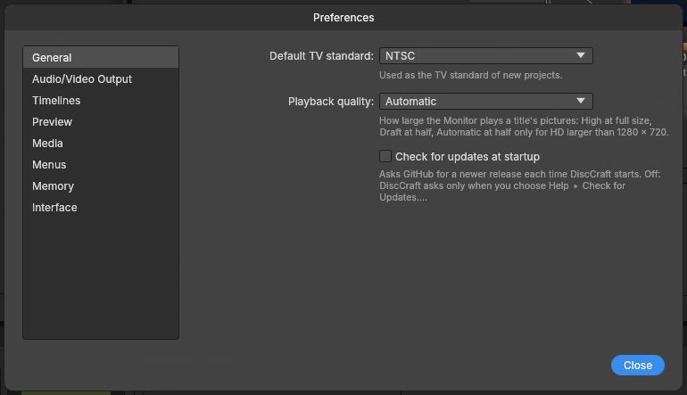
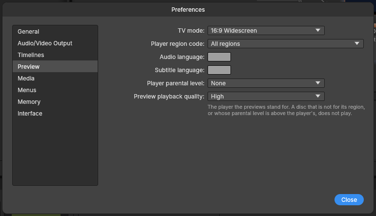
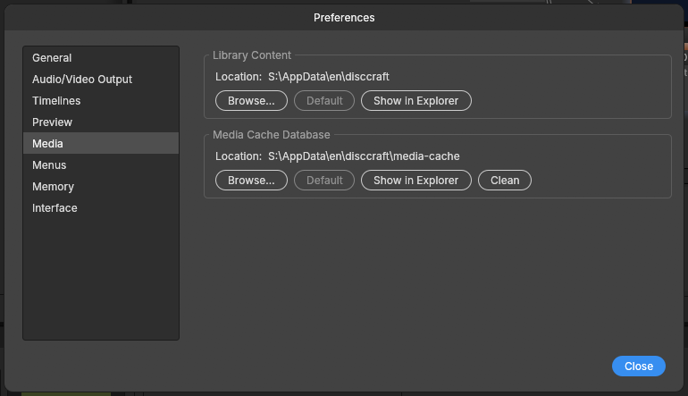
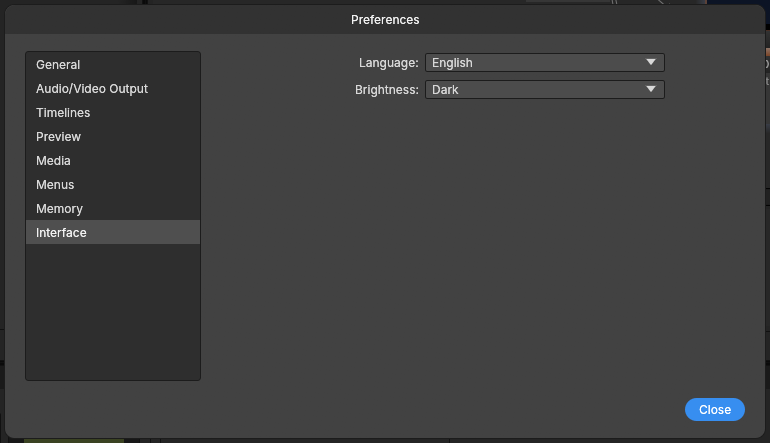

# 18. Preferences

[Contents](README.md) · Previous: [17. Advanced Techniques](17-advanced.md#17-advanced-techniques) · Next: [19. Keyboard Shortcuts](19-shortcuts.md#19-keyboard-shortcuts)

> **In this chapter**
>
> - Learn what you can decide on each page of the Preferences

Choose **Edit ▸ Preferences…** (Ctrl+K). Select a category in the list on the left to see its settings on the right.
Settings take effect when changed, and the window closes with **Close** (Esc, or clicking outside). Item labels are
aligned in a right-justified column, and descriptions appear in small text below the input fields.

Settings other than menus are saved to this computer's configuration (`config.toml`) and apply to all projects. Menu
settings are saved with the project.

## 18.1 General

- **Default TV Standard**: The default for new projects (NTSC / PAL).
- **Playback Quality** (High / Draft / Automatic): The image size when playing titles in the Monitor. High uses the
  disc's frame size, Draft uses half that size, and Automatic (default) halves only HD larger than 1280 × 720 (so
  1080-line titles play smoothly).
- **Check for Updates at Startup** (default off): Asks GitHub for a newer release each time DiscCraft starts. When off,
  DiscCraft asks only when you choose **Help ▸ Check for Updates…** ([23. Troubleshooting](23-troubleshooting.md#23-troubleshooting)).

## 18.2 Audio/Video Output

- **Audio Output Device**: The device that plays sound for the Monitor and Preview. Choose System default or one of the
  output devices (takes effect when playback starts next; if a selected device is missing, it falls back to the default
  device).
- **Video Output**: Displays the video from the title playing in the Monitor or Preview on another display in full
  screen, or in **A window of its own** (Off / A window of its own / Connected displays). Pressing Esc in that window
  turns it off.
- **Disable video output when in the background** (On by default): Hides the output windows while no DiscCraft window is
  in the foreground.

> **Details**
>
> - When displaying full screen on another display, DiscCraft windows remain above other windows and the taskbar of that
>   display while you work (except if the DiscCraft window is on the same display).
> - Menus are not displayed; only the title video is shown.

## 18.3 Timeline

- **Still Image Duration**: The length of slides in new Slideshows (default 6 s).
- **Subtitle Duration**: The length of subtitles added in the Monitor (default 2 s).
- **Audio Language** / **Subtitle Language**: The language for new tracks (if empty, uses the disc's audio language).
- **Snap subtitle clips** (Off by default): Dragged Subtitle Clips snap to the edges of nearby Subtitle Clips, Chapter
  points, and the Playhead.

## 18.4 Preview

Settings for the player emulated by the Project Preview and Monitor. With the defaults (Widescreen, All regions, No
language, No level), any disc plays as is.

- **TV Mode**: 16:9 Widescreen, 4:3 Letterbox (displays 16:9 titles on a 4:3 screen with top and bottom bands), or 4:3
  Pan & Scan (displays the center of a 16:9 title filling a 4:3 screen, cropping the sides).
- **Player Region Code**: All regions, or one of 1–8. DVDs restricted to other regions will not open in Preview (the
  reason appears in the status bar).
- **Audio Language** / **Subtitle Language**: When the disc does not select a track, chooses the first audio/subtitle in
  this language for the title (this also applies to built Blu-rays opened in Preview).
- **Player Parental Level**: None, or one of 1–8. Discs with a Parental level (Build panel) higher than this will not
  play, just like on a locked player.
- **Preview Playback Quality**: The same selection as **Playback Quality** in General for titles in the Project Preview
  (default is High).

## 18.5 Media

Locations for **Library Content** (items in your Library) and the **Media Cache Database** (remembered lengths,
dimensions, and thumbnails for media files, plus indexes for large files). Each has **Browse…** (place in another
folder), **Default** (reset to next to settings), and **Show in Explorer**. **Clear** empties the media cache.

> **Details**
>
> - Only MKV and transport streams (`.m2ts` / `.ts` / `.mpg` / `.vob`) have indexes. Large files open immediately on the
>   next launch.
> - Selecting a folder containing a Library opens that Library; selecting an empty folder writes current items there.
> - The cache uses the new folder from the moment it is selected, leaving the previous folder intact.
> - After **Clear**, files are re-read when needed next (build conversions are in the build output and are not deleted).
> - Nothing is written inside or next to asset files.

## 18.6 Menus

Defaults for Button Routing (up/down/left/right movement, wrap-around and its method, excluding "Next" and "Previous"
buttons) and Button name synchronization. These are **saved with the project** (routing remains the same regardless of
which computer builds it).

## 18.7 Memory

- **Installed RAM**
- **Simultaneous Transcodes**: Automatic (number of processor cores) or a specific number. Builds and "Transcode Now"
  convert multiple titles simultaneously, using memory for each conversion; reduce the number if you want to leave
  memory for other applications.
- **Use the hardware encoder for HD H.264** (Windows. Selectable only when a graphics card encoder is found. Off by
  default): Encodes Blu-ray 1080p and 720p H.264 using hardware instead of the processor. 1080i H.264 is encoded by
  hardware only on an NVIDIA graphics card that can encode fields (the Blackwell generation, such as the RTX 50
  series).

> **Details**
>
> - 1-pass (VBR or CBR) works as is. 2-pass creates a 1-pass first, then adjusts the average and re-encodes only if the
>   size deviates from the target by more than 2% (4–6 times faster than processor 2-pass, with equal or better
>   quality).
> - Video matching the disc's dimensions and color space passes decoded frames directly to the encoder.
> - 1080i H.264 (1440 × 1080 too) is encoded by the NVIDIA encoder, each frame as its two fields (about 2.6 times as
>   fast as the processor, with the same quality). On cards that cannot encode fields, the processor converts it.
> - SD and videos that fail to open or encounter errors during encoding are converted by the processor.
> - On the command line, use the environment variable `DISCCRAFT_HARDWARE_ENCODER=1`.

## 18.8 Interface

- **Language**: English / 日本語. On macOS it can also be switched in the app menu's **Language**. Until you choose manually, it follows the
  OS display language on each launch (Japanese for Japanese OS, English otherwise).
- **Brightness**: **Dark** (default) or **Light** (dark text on light gray panels). Switches immediately and persists to
  the next launch.

