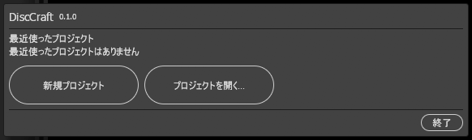
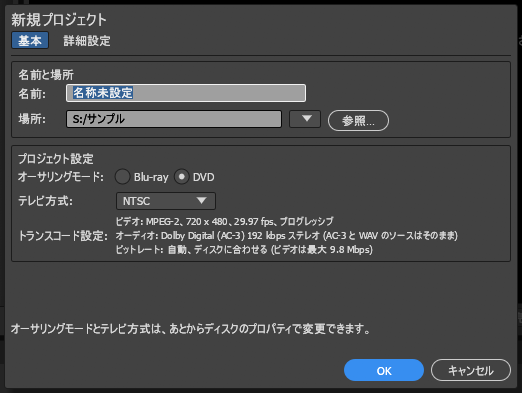

# 2. はじめに

[目次](README.md) ・ 前の章: [1. DiscCraft について](01-about.md#1-disccraft-について) ・ 次の章: [3. はじめての DVD を作る](03-tutorial.md#3-はじめての-dvd-を作る)

> **この章でできること**
>
> - DiscCraft を起動して、新しいプロジェクトを作る
> - プロジェクトを保存する
> - 設定がどこに残るかを知る

## 2.1 ようこそ画面

起動するとようこそ画面が開く。

- **最近使ったプロジェクト**: 開いたことのあるファイル（最大 10 件）。行をクリックすると開く。
  右クリックの **リストから削除** で一覧から外す（ファイルは消えない）。なくなったファイルは灰色になり、開けない
- **新規プロジェクト**: 新規プロジェクトダイアログを開く
- **プロジェクトを開く…**: `.dcproj` を選ぶ
- **終了**: アプリを終了する

ようこそ画面を閉じたあとは、**ファイル ▸ 新規 ▸ プロジェクト**（Ctrl+N）と
**ファイル ▸ プロジェクトを開く…**（Ctrl+O）で同じことができる。

## 2.2 新規プロジェクト

**新規プロジェクト** ダイアログは **基本** と **詳細設定** の 2 タブ。

| タブ | 項目 |
|---|---|
| 基本 | 名前、場所、オーサリングモード（DVD / Blu-ray）、テレビ方式（NTSC / PAL）、Blu-ray のビデオ形式（Blu-ray のみ）、トランスコードの設定の要約 |
| 詳細設定 | 縦横比（4:3 / 16:9）、ディスク容量（DVD5 / DVD9、BD25 / BD50 / BD100 / BD128） |

- 場所を空にすると、保存のときに場所を聞く
- テレビ方式の既定は [環境設定](18-preferences.md#18-環境設定) で変えられる
- 新しい Blu-ray のプロジェクトは HD（NTSC は 1920 x 1080 の 23.976 fps、PAL は H.264 の 1080i の 25 fps。どちらも Encore の
  新規プロジェクトのダイアログと同じ）。形式に合うファイルは
  そのままディスクに入れ、合わないものは変換する（既定では平均 12 Mbps の H.264、1080i は平均 25 Mbps の MPEG-2。ディスクに余裕があれば、それを使うように H.264 は 25 Mbps、
  MPEG-2 は 32 Mbps まで上げ、入りきらなければ下げる）。
  Blu-ray のビデオ形式を **SD (MPEG-2)** にすると、HD の素材は SD に縮めて変換する
- **OK** を押すと `<場所>/<名前>.dcproj` がその場で作られ、編集が始まる

あとから変えられるもの: **ファイル ▸ プロジェクト設定…** でオーサリングモード・Blu-ray のビデオ形式・縦横比・容量、
**ビルド** パネルの **ディスク情報** でディスクの名前と容量、**ディスク** パネルでディスクの設定全般
（Blu-ray の映像の大きさ SD (MPEG-2)/ HD（H.264）と、Blu-ray のコーデック **自動 (SD と 1080i は MPEG-2)**・
**H.264 (すべての形式)**・**MPEG-2 (すべての形式)** もここ）。

## 2.3 保存

- **ファイル ▸ 保存**（Ctrl+S）。ビルドするときも先に保存される
- **ファイル ▸ 別名で保存…**（Shift+Ctrl+S）
- 未保存の変更がある状態でプロジェクトを閉じる・開き直す・終了しようとすると確認が出る

プロジェクト（`.dcproj`）は JSON のテキストファイル。素材はコピーせず、パスで参照する。
素材を別の場所に動かすと「オフライン」になるので、**アセットを置換…** で新しい場所を教える。
プロジェクトの横に `<プロジェクト>.menus` フォルダができることがある（メニューを PhotoCraft などで編集するときの
PSD を入れる場所）。

## 2.4 設定の保存場所

ワークスペースの並び、表示言語、最近使ったプロジェクト、表の列の幅は設定ファイルに保存する。

| 場所 | 内容 |
|---|---|
| Windows: `%APPDATA%\disccraft\workspace.json` ほか: `~/.config/disccraft/workspace.json` | ワークスペース、パネルの並び、表示言語、最近使ったプロジェクト、既定のテレビ方式 |
| 同じフォルダの `library.json` | ライブラリに足した自分のメニュー、ボタン、背景、テキストアイテム、レイヤーセット、置換レイヤー |
