# 3. はじめての DVD を作る

[目次](README.md) ・ 前の章: [2. はじめに](02-getting-started.md#2-はじめに) ・ 次の章: [4. 画面の構成](04-screen.md#4-画面の構成)

> **この章でできること**
>
> - 動画・写真・音楽・字幕から、メニューのある DVD を最初から最後まで 1 枚作る

この章では、動画 3 本、写真 4 枚、音楽 1 曲、字幕 1 本から、メニューのある DVD を 1 枚作る。順にたどれば、DiscCraft の
ひととおりの作業（プロジェクト、素材、タイムライン、チャプター、字幕、スライドショー、メニュー、ナビゲーション、チェック、
プレビュー、ビルド）に一度ずつ触れる。各手順のくわしい説明は、それぞれの章にある。

この章の画面に出てくる素材とプロジェクトは、DiscCraft の作業用に作った合成のサンプル（グラデーションとテストパターンの
動画、和音の音、字幕）で、手元の動画や写真で同じことができる。

| 素材 | 中身 | この章での使い方 |
|---|---|---|
| オープニング.mp4 | 12 秒の題名の動画 | ディスクを入れると最初に流れる |
| 旅の記録.mp4 | 45 秒、15 秒ごとに場面が変わる動画 | 本編。チャプターを 3 つ |
| メイキング.mp4 | 20 秒の動画 | おまけ |
| 写真 1〜4.png | 写真 | スライドショー |
| 音楽.wav | 30 秒の音楽 | スライドショーの音 |
| 旅の記録 字幕.srt | 6 行の字幕 | 本編の字幕 |

できあがるディスクの流れは次のとおり。

1. ディスクを入れるとオープニングが流れ、終わるとメインメニューになる
2. メインメニューに **ムービーを再生**、**チャプター**、**写真**、**メイキング** の 4 つのボタン
3. **チャプター** は、本編のチャプターを選ぶメニュー
4. 本編、写真、メイキングが終わると、メインメニューに戻る

> **ヒント**
>
> 作業の途中は、ときどき **ファイル ▸ 保存**（Ctrl+S）で保存する。まちがえたら **編集 ▸ 取り消し**（Ctrl+Z）で戻せる。

## 3.1 プロジェクトを作る

1. DiscCraft を起動し、ようこそ画面の **新規プロジェクト** を押す。

   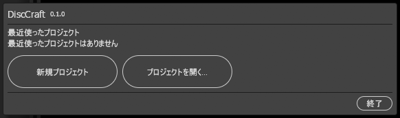

2. **名前** にディスクの名前（ここでは「はじめての DVD」）を入れ、**場所** で保存するフォルダーを選ぶ。
3. オーサリングモードは **DVD**、テレビ方式は日本のテレビなら **NTSC** にする。ワイド（16:9）の動画なら、**詳細設定** の
   タブで縦横比を **16:9** にしておく（あとから **ディスク** パネルでも変えられる）。

   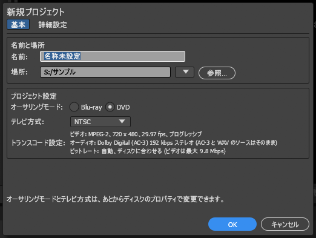

4. **OK** を押す。

**結果**: 選んだ場所に `はじめての DVD.dcproj` ができ、空のプロジェクトの画面になる。

## 3.2 素材を読み込む

1. **ファイル ▸ 読み込み ▸ アセット…**（Ctrl+I）を選ぶ。
2. 素材のファイルを全部選んで **開く** を押す。エクスプローラーからウィンドウにドラッグ＆ドロップしてもよい。

**結果**: 読み込んだ素材が **プロジェクト** パネルに並ぶ。素材はコピーされず、元の場所のまま使われるので、ビルドが
終わるまで動かさない。

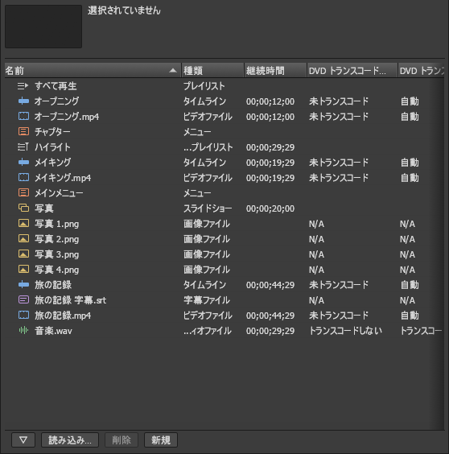

## 3.3 タイムラインを作る

タイムラインは、ディスクの 1 本の映像（タイトル）になる。動画ごとに 1 つ作る。

1. プロジェクトパネルで「オープニング.mp4」を選ぶ。
2. **ファイル ▸ 新規 ▸ タイムライン**（Ctrl+T）を選ぶ。
3. 「旅の記録.mp4」と「メイキング.mp4」でも同じようにする。

**結果**: プロジェクトパネルにタイムラインが 3 つ増え、選んだタイムラインが下のタイムラインパネルに開く。

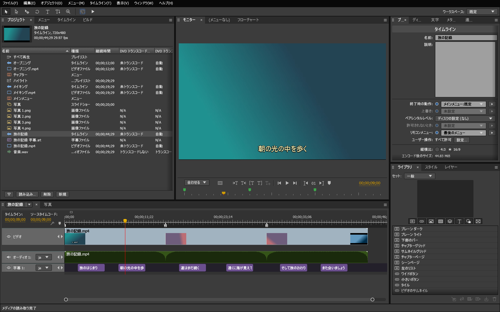

## 3.4 チャプターを付ける

本編の場面の変わり目にチャプターを付けると、リモコンの「次」「前」で飛べ、チャプターのメニューも作れる。

1. 「旅の記録」のタイムラインを開く。
2. 再生ヘッドを 15 秒のところに置き、**タイムライン ▸ チャプターポイントを追加**（テンキーの `*`）を選ぶ。
3. 30 秒のところでも同じようにする。先頭のチャプター 1 は最初からある。
4. チャプターを 1 つずつ選び、プロパティで名前（「はじまり」「みち」「おわり」）を付ける。名前はチャプターのメニューの
   ボタンの文字になる。

**結果**: タイムラインの上に、チャプターの印が 3 つ並ぶ。

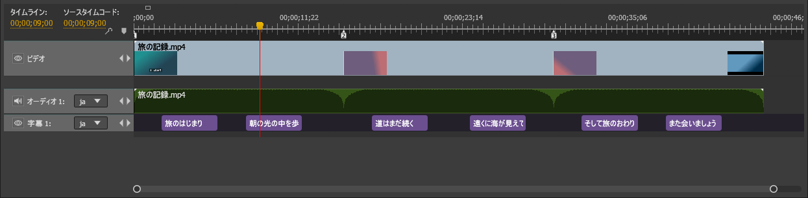

## 3.5 字幕を付ける

1. 「旅の記録」のタイムラインを選んだまま、**タイムライン ▸ 字幕を読み込み ▸ テキストスクリプト…** を選ぶ。
2. 「旅の記録 字幕.srt」を選ぶ。

**結果**: タイムラインに字幕トラックが増え、モニターで再生すると字幕が出る。

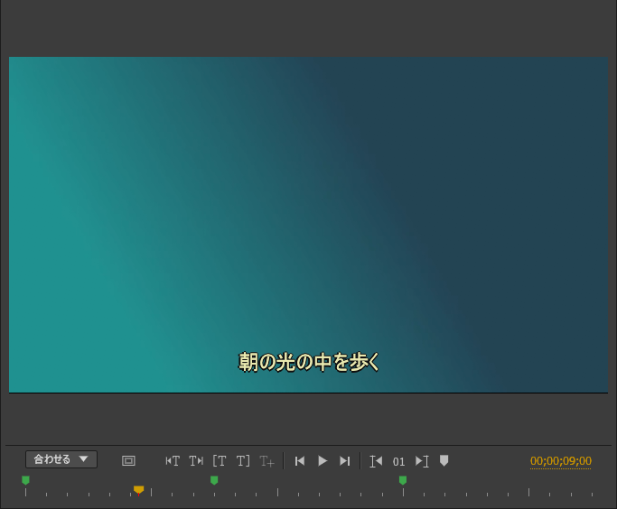

## 3.6 スライドショーを作る

1. **ファイル ▸ 読み込み ▸ スライドショー…**（Shift+Ctrl+G）を選び、写真 4 枚を選ぶ。
2. スライドショービューアーの **オーディオを追加…** の一覧で「音楽.wav」を選ぶ。
3. プロパティでスライドの長さを決める。

**結果**: スライドショービューアーに 4 枚のスライドが並び、音楽が付く。

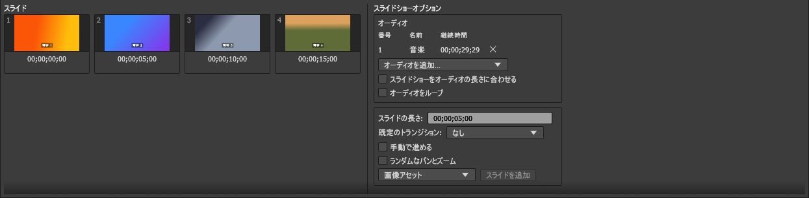

## 3.7 メインメニューを作る

1. **ライブラリ** パネルで **プレーン ダーク** を選び、下の **新規メニュー** を押す。ボタンが 4 つ並んだメニューができる。
2. ボタンをクリックして選び、プロパティの **ボタンのテキスト** で文字を書き換える（「本編を再生」「チャプター」「写真」
   「メイキング」）。ボタンを選んで **編集 ▸ 名前を変更…** でも同じ欄に移る。

   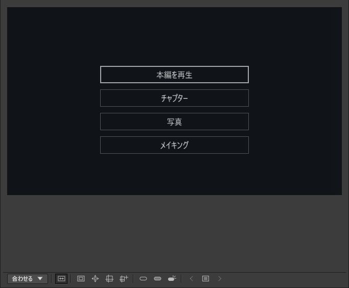

3. ボタンを選び、プロパティの **リンク** で行き先を選ぶ。プロジェクトパネルのタイムラインやスライドショーをボタンの上に
   ドラッグしてもよい（ほかのやり方は [17.7](17-advanced.md#177-ボタンへのリンクの入れ方-5-とおり)）。

   | ボタン | リンク |
   |---|---|
   | 本編を再生 | 旅の記録 |
   | チャプター | チャプターのメニュー（次の 3.8 で作ってからつなぐ） |
   | 写真 | 写真（スライドショー） |
   | メイキング | メイキング |

**結果**: 4 つのボタンの文字が変わり、それぞれに行き先が付く。

## 3.8 チャプターのメニューを作る

1. 「旅の記録」のタイムラインを選ぶ。
2. **メニュー ▸ チャプターインデックスを作成** を選ぶ。
3. メインメニューに戻り、**チャプター** ボタンのリンクを、できたメニューにする。

**結果**: チャプターごとのボタンが並んだメニューができ、ボタンはそれぞれのチャプターにつながっている。

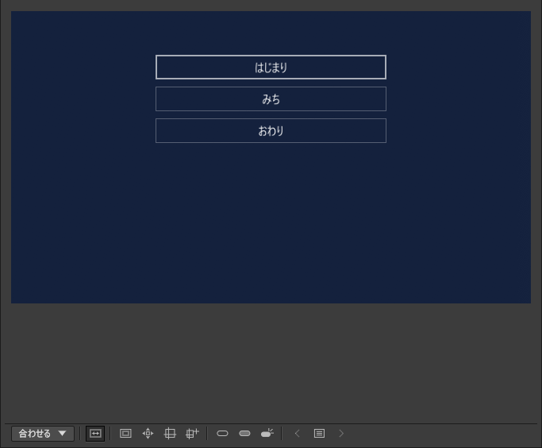

## 3.9 ディスクの流れを決める

1. プロジェクトパネルで「オープニング」のタイムラインを右クリックし、**ファーストプレイに設定** を選ぶ。ディスクを入れると
   最初にこれが流れる。
2. 各タイムラインとスライドショーを選び、プロパティの **終了時の動作** を「メインメニュー」にする。再生が終わると
   メインメニューに戻る。
3. チャプターのメニューの終了時の動作も「メインメニュー」にする。しばらく何も押さなかったときに、メインに戻る。

**結果**: **フローチャート** パネルで、ディスク全体のつながりを図で確かめられる。

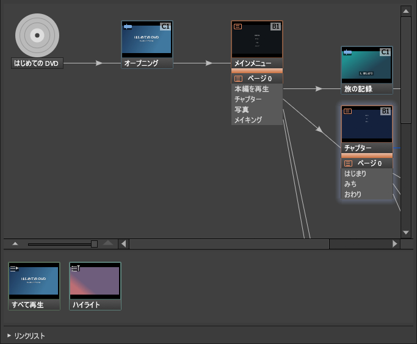

## 3.10 チェックする

1. **ファイル ▸ プロジェクトをチェック…**（Shift+Ctrl+L）を選び、**開始** を押す。
2. 一覧に出たもの（リンクのないボタン、終了時の動作のない項目など）を直す。丸の印はエラー、三角の印は注意。
3. もう一度 **開始** を押す。

**結果**: エラーがなくなれば、ビルドできる。

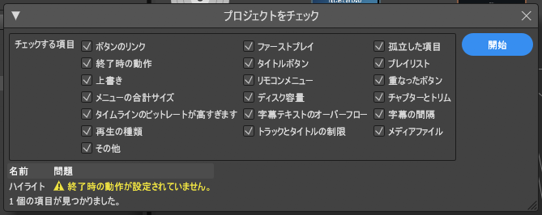

## 3.11 プレビューする

1. **ファイル ▸ プレビュー**（Alt+Ctrl+Space）を選ぶ。
2. 画面の十字キー（またはキーボードの矢印キー）でボタンを移り、真ん中の丸（または Enter）で決定する。

**結果**: ビルドする前に、できあがるディスクと同じように動かして試せる。

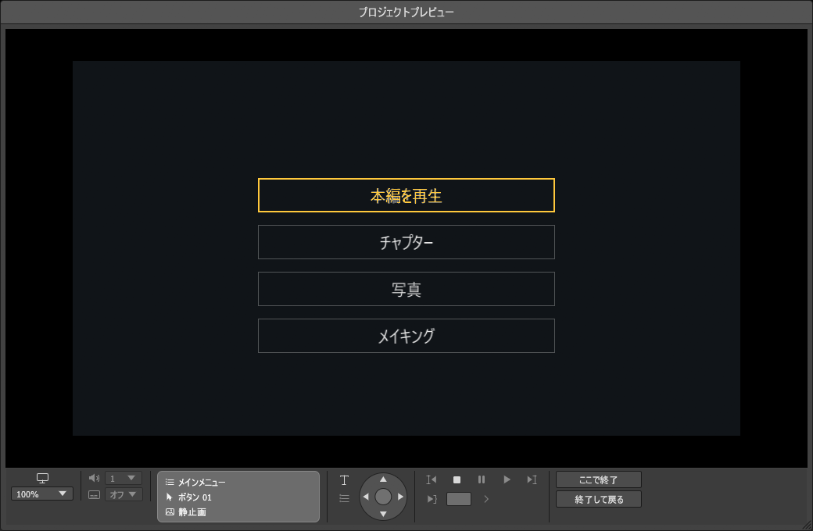

## 3.12 ビルドする

1. **ウィンドウ ▸ ビルド**（F2）でビルドパネルを開く。
2. 形式を **DVD**、出力を **DVD イメージ**（ISO）にする。
3. **保存先** を決め、**ビルド** を押す。ビルドの前に、プロジェクトが保存されてチェックされる。

   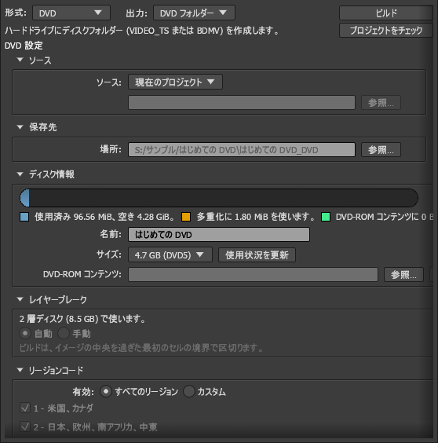

**結果**: ウィンドウの真ん中に進み具合が出て、動画の変換が終わると、ディスクのイメージ（`.iso`）ができる。

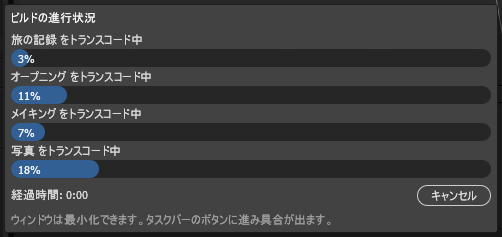

できたイメージは、ビルドパネルの出力を **DVD ディスク** にして書き込むか、ほかのソフトでディスクに書く
（[14 章](14-build.md#14-ビルドする)）。印刷できるディスクなら、レーベルも作れる（[15 章](15-labels.md#15-ディスクのレーベルを作る)）。

> **ヒント**
>
> これでひととおりの作業ができた。次は、使いたい機能の章へ進む。
>
> - 画面の各部分の名前と役割: [4. 画面の構成](04-screen.md#4-画面の構成)
> - メニューのデザインを変える: [9. メニューを作る](09-menus.md#9-メニューを作る)
> - 思ったとおりに動かないとき: [23. うまく動かないとき](23-troubleshooting.md#23-うまく動かないとき)
