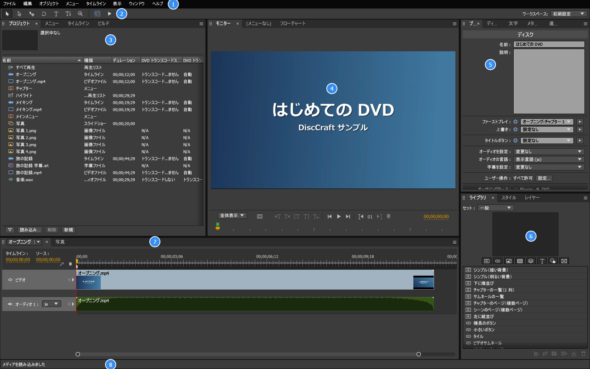
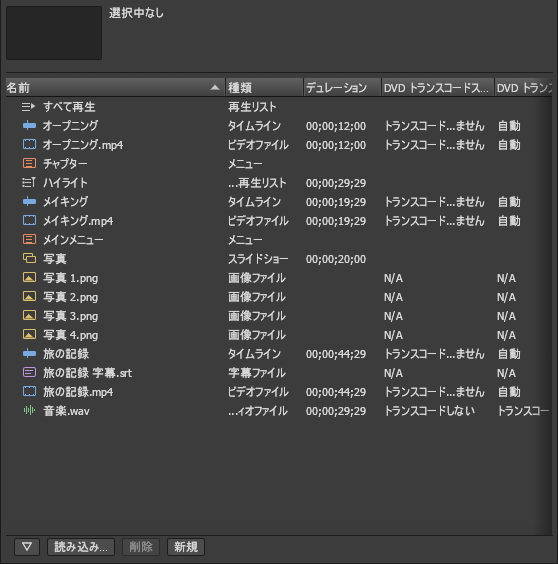
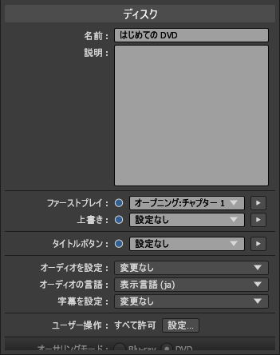
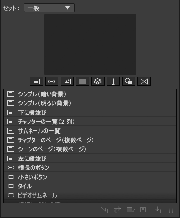

# 4. 画面の構成

[目次](README.md) ・ 前の章: [3. はじめての DVD を作る](03-tutorial.md#3-はじめての-dvd-を作る) ・ 次の章: [5. 素材を読み込む](05-assets.md#5-素材を読み込む)

> **この章でできること**
>
> - 画面の各部分（メニューバー、ツールバー、パネル）の名前と役割を知る
> - パネルの並びを変えて、ワークスペースとして残す

メニューバーの下にツールバー、いちばん下にステータスバー、その間をパネル（ドッキングするタブグループ）が埋める。
ステータスバーには直前の操作の結果と、ビルド中の進み具合が出る（Encore にない DiscCraft だけの部分）。

## 4.1 メニューバー

**ファイル / 編集 / オブジェクト / メニュー / タイムライン / 表示 / ウィンドウ / ヘルプ** の 8 つ。
項目とショートカットは Encore の既定に寄せている。よく使うもの:

- **ファイル ▸ 新規 ▸**（プロジェクト / メニュー / タイムライン / スライドショー / 再生リスト / チャプター再生リスト）
- **ファイル ▸ 読み込み ▸**（アセット… / メニュー… / ポップアップメニュー… / メニューページ… / タイムライン… / スライドショー…）
- **ファイル ▸ プレビュー / プロジェクトをチェック… / ビルド ▸ フォルダー…・イメージ…**
- **編集 ▸ 環境設定…**、**編集 ▸ ヒストリー ▸**（取り消せる操作の一覧からまとめて巻き戻す）
- **オブジェクト ▸**（ボタンに変換 / 置換レイヤーに変換 / オブジェクトに変換、サブピクチャを作成、リンクの指定…、ドロップシャドウ…、反転、回転、アレンジ、整列、均等配置）
- **メニュー ▸**（新規メニュー、チャプターインデックスを作成、メニューを置き換え…、新規ページを追加、カラーセットを編集…、
  ユーザー操作を設定…、メニューをファイルとして保存…、メニューをテンプレートとして保存…、エンドアクションを設定…）
- **タイムライン ▸**（新規タイムライン / 新規スライドショー / 新規チャプター再生リスト、トラックの追加と削除、
  字幕の読み込みと書き出し、チャプターポイントの追加）
- **表示 ▸**（ズーム、サブピクチャの 3 状態、セーフエリア、ボタンルート、ガイド、チャプター名）
- **ウィンドウ ▸**（ワークスペース、パネルの出し入れ、表示言語）
- **ヘルプ ▸**（ArtCraft の Discord に参加… / ArtCraft の Web サイト / GitHub の DiscCraft / 問題を報告… /
  ログファイルを表示… / システム互換性レポート… / アップデートを確認… / DiscCraft について / DiscCraft ヘルプ…（F1））。
  項目にポインターを置くと、開くアドレスか、することが出る。**DiscCraft ヘルプ…** はこのマニュアルを開く

## 4.2 ツールバー

左にメニュー編集のツール、右端にワークスペースの選択。

| ツール | キー |
|---|---|
| 選択ツール | V |
| ダイレクト選択ツール | A |
| 移動ツール | M |
| 回転ツール | R |
| 横書き文字ツール | T |
| 縦書き文字ツール | Y |
| ズームツール | Z |

その右に **メニューを PhotoCraft で編集**（Shift+Ctrl+M）と **プレビュー**（Alt+Ctrl+Space）のボタンがある。
選んでいるツールはくぼんだ見た目で、マウスが乗ったツールは枠で囲まれアイコンが金色になる。

## 4.3 パネル

初期設定では、パネルは次のように並ぶ。

| 場所 | タブ |
|---|---|
| 左 | プロジェクト / メニュー / タイムライン / ビルド |
| 中央 | モニター / メニュービューア / フローチャート |
| 右上 | プロパティ / ディスク / 文字 / メタデータ / 進行状況 |
| 右下 | ライブラリ / レイヤー |
| 下 | タイムラインビューア / スライドショービューア |

- **プロジェクト**: すべての項目（アセット、タイムライン、メニュー、スライドショー、再生リスト、チャプター再生リスト、
  フォルダー）の一覧。列は並べ替え・表示 / 非表示・幅の調整ができる。右クリックに 開く / 名前の変更… /
  ファーストプレイに設定 / アセットを置き換え… / エクスプローラーで表示 / 削除 など
- **メニュー**: メニューの一覧と、選んだメニューのボタン一覧。メニューの右クリックは ファーストプレイに
  設定 / コピー / 消去 / 名前の変更… / メニューを PhotoCraft で編集 / 開く / ここからプレビューする、ボタンの右クリックは
  消去 / メニュービューアで開く / リンクを開く / ここからプレビューする（そのボタンを選んだメニューから）
- **タイムライン**: タイムラインの一覧と、その下に選んだタイムラインのチャプター（番号、名前、タイムライン、チャプター
  イン、ポスター）。クリックでチャプターを選び、ダブルクリックでタイムラインビューアに開く。タイムラインの右クリックは
  ファーストプレイに設定 / コピー / 消去 / 名前の変更… / 開く / ここからプレビューする、チャプターの右クリックは 消去 /
  開く / ここからプレビューする（そのチャプターからタイトルを）。最初のチャプターは消去できない
- **ビルド**: [ビルドパネル](14-build.md#14-ビルドする)
- **モニター**: ビルドしたディスクの再生と、タイムラインのプレビュー。

  > **詳しく**
  >
  > - 下の操作バーのボタンは Encore と同じ並び:左にズームとセーフエリアのボタン、中ほどに 字幕の 5 つのボタン | 1 フレーム戻す / 再生・停止 /1 フレーム進める | 前のチャプター / 今のチャプターの番号 / 次のチャプター / チャプターポイントを追加、右に再生の速さ（0.5×〜8×。J で遅く、L で速く、K で停止。チャプターポイントを置く場所を探すときに便利。2× までは音の高さを変えずに鳴らし、それより速いと音は出ない）と **ビルド結果を開く**、右端にオレンジの今の時刻
  > - モニターが狭いときは速さ、ビルド結果を開く、字幕のボタンの順に隠れる
  > - バーの下にチャプターの旗付きのスクラブバー
  > - Home / End で再生ヘッドが頭 / 終わりへ動く
  > - ポスターフレームはタイムラインメニューで設定する
- **メニュービューア**: メニューのキャンバス。タブの名前は開いているメニューの名前になる。

  > **詳しく**
  >
  > - 下のバーは絵のボタンの並び（マウスを置くと名前が出る）: 拡大率、**テレビ画面に合わせてメニューピクセルを校正**、**セーフエリアの表示 / 非表示**、**ボタンのルートを設定**、**ガイドを表示**、**新規ガイド**、**標準** / **選択時** /**アクティベート時** のサブピクチャ、前 / 次のページとその間のページの印（ヒントにページ番号）
  > - オンのボタンはくぼんで見える（初めは最初の 1 つだけ）
  > - サブピクチャのボタンは 1 つずつで、押したものの状態のサブピクチャがメニューの全部のボタンに重なり、もう一度押すと消える
  > - ボタンは **メニュー ▸ ボタンを追加** で足す
- **フローチャート**: 項目とリンクの図。ノードはドラッグで動かせる
- **プロパティ**: 選んでいる項目のシート。何も選んでいないときはディスクの設定
- **ディスク**: ディスクの名前・説明・縦横比・オーディオ / 字幕・ユーザー操作
- **レイヤー**: メニューの層（目と鍵、`(+)` ボタンセット、`(=1)`〜`(=3)` のハイライト、T のテキスト、% の図形、背景は固定）
- **ライブラリ**: DiscCraft 独自のプリセット（メニュー / ボタン / 画像 / 背景 / レイヤーセット / シェイプ / 置換
  レイヤー）と、自分の項目（テキストアイテムも）。プレビューの下に種類ごとの絵のボタンがあり、
  クリックでその種類だけを表示する（ただ 1 つ表示している種類をもう一度クリックすると全部に戻る）。Ctrl+クリックで
  その種類を足す・外す。一覧は枠で囲まれ、名前の前に種類の絵（行の上にマウスを置くと種類の名前）。その下の右に絵の
  ボタン **配置**、**置換**、**背景を設定**、**新規メニュー**、**項目を追加**、**項目を削除**（ヒントに名前。選んだ
  項目に使えないものは淡い）
- **タイムラインビューア**: FilmCraft と同じ形のタイムライン（波形）で、ルーラーとトラックの見出しは Encore の形。左上に **タイムライン :** と **ソース :**、その下にオレンジの時刻（ソースは、再生ヘッドの位置がクリップのファイルのどこか）。

  > **詳しく**
  >
  > - クリップにはファイル名を拡張子まで出し（00001.m2ts）、その下にクリップの頭と各チャプターポイントの絵を、次の絵の手前まで並べる（黒からフェードインするクリップは、最初に何かが見える絵）
  > - 絵は裏で作り、モニターで再生している間は待ち（再生がなめらかなままになるように）、作った絵は覚えておくので、次にプロジェクトを開いたときはすぐに出る
  > - チャプターポイントは、ルーラーの目盛りの下の帯に並ぶ番号付きの旗（1 から）
  > - 見出しには、ビデオの目、オーディオトラックのスピーカー（モニターで聞くトラック）、字幕トラックの目（モニターに出すトラック）、その右に名前、右端に **◂ ▸**（**前のクリップ** / **次のクリップ**）: 再生ヘッドがそのトラックの前 / 次のクリップの頭へ行き、そのクリップを選ぶ
  > - 最後のクリップからは **▸** でその終わりへ
  > - 行き先のない矢印（タイムラインの頭での ◂）は、薄く出る
  > - 見出しの行はタイムラインより明るい灰色
  > - オレンジの時刻（こことモニター）は Encore のホットテキスト:横にドラッグすると 1 点で 1 フレーム再生ヘッドが動き、押すとタイムコードを打ち込める（Enter でそこへ、Esc でやめる）
- **スライドショービューア**: スライドの一覧と並べ替え、スケールとトランジション

## 4.4 パネルの並べ替えとワークスペース

タブはドラッグで並べ替え、ほかのグループへ移動、分割、フローティングができる。中クリックか × で閉じ、
**ウィンドウ** メニューから開き直すと閉じる前の場所に戻る。並びはワークスペースごとに自動で保存される。

各グループのタブの帯の右端の **≡** でパネルメニューが開く: **パネルのドッキングを解除**、
**フレームのドッキングを解除**（グループごと）、**パネルを閉じる**、**フレームを閉じる**、**フレームを最大化**（その
グループがウィンドウいっぱいになる。もう一度、今度は **フレームのサイズを元に戻す** でほかのグループが戻る）。
フローチャートとライブラリは、その下に自分の項目が付く。

**ウィンドウ ▸ ワークスペース** に組み込みの 4 つと、自分で保存したものが並ぶ。

| 名前 | 前面に出すもの |
|---|---|
| 初期設定 | Encore の既定の配置（すべてのグループ） |
| メニュー | メニューの一覧、メニュービューア、レイヤー |
| ナビゲーション | フローチャート |
| ビルド | ビルドパネルとディスク |

**新規ワークスペース…** で現在の並びに名前を付けて保存する（最大 32 個、名前は 64 文字）。
**ワークスペースを削除**、**「名前」をリセット** もここ。ツールバー右端の **ワークスペース** のコンボでも切り替えられる。
