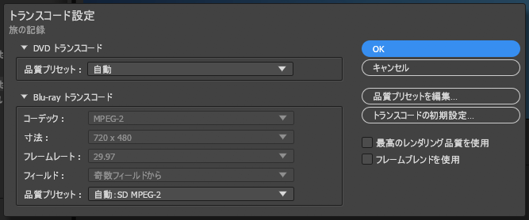
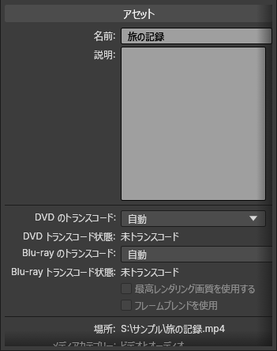

# 5. 素材を読み込む

[目次](README.md) ・ 前の章: [4. 画面の構成](04-screen.md#4-画面の構成) ・ 次の章: [6. タイムラインを作る](06-timelines.md#6-タイムラインを作る)

> **この章でできること**
>
> - 動画・音声・画像・字幕を読み込む
> - どのファイルが読めて、どれが変換されるかを知る
> - 素材ごとの変換の設定を決める

## 5.1 読み込み方

- **ファイル ▸ 読み込み ▸ アセット…**（Ctrl+I）
- ウィンドウにファイルをドラッグ＆ドロップ（フォルダを落とすと中のメディアファイルを取り出す。1 回に最大 500 件）
- **ファイル ▸ 読み込み ▸ タイムライン…**（Shift+Ctrl+T）: 選んだビデオ 1 本ごとにアセットとタイムラインを作る
- **ファイル ▸ 読み込み ▸ スライドショー…**（Shift+Ctrl+G）: 選んだ画像をスライドにしたスライドショーを 1 つ作る
- **ファイル ▸ 読み込み ▸ Blu-ray…**: Blu-ray のプレイリストからタイムラインを作る（Blu-ray を DVD にする、
  メニューを作り直すときなど）。ディスクのドライブ、`BDMV` の入ったフォルダー、マウントしたディスクイメージのどれかを
  選ぶと、プレイリストの一覧が出る。いちばん長いメインのプレイリストが選ばれている

  > **詳しく**
  >
  > - クリップは再生される範囲に切って順に並べ、チャプターポイントと、音声（LPCM、AC-3）ごとのオーディオトラックを
  >   付ける。言語はディスクのもの。DTS と Dolby TrueHD は読み込まず、ステータスバーに名前を出す
  > - 字幕（PG）は、Blu-ray のプロジェクトでは字幕トラックとして読み込む。タイムラインができたあと、作業を続けている
  >   あいだに裏で取り出す（ドライブのディスクは初回に数分かかる）。DVD のプロジェクトではまだ読み込まない
  > - 暗号化されたディスクは読めない。クリップは裏で開くので、絵が出るまで 1 分ほどかかることがある
  > - **ディスクのメニューからもメニューを作る**（最初はオン）: ディスクが最初に出すメニューを、プロジェクトのモーション
  >   メニューの下書きにする。映像と音楽は最初の 30 秒。何かを再生するボタンは同じ位置に置き、ディスクのハイライトの形で
  >   光らせ、そのチャプターにリンクする。設定だけを変えるボタン（字幕、コメンタリー、ページ）は置かない。ディスクは
  >   そのメニューから始まり、タイトルはメニューに戻る。ボタンは手で、または AI エージェント（MCP）と整える
  > - MPEG-2 をそのまま DVD に入れる SD のディスクは、チャプターがクローズド GOP で始まらないことがある。プロジェクトの
  >   チェックに出る（その映像はトランスコードする）
- **ファイル ▸ 読み込み ▸ メニュー… / ポップアップメニュー… / メニューページ…**（Shift+Ctrl+I / Shift+Ctrl+K /
  Shift+Ctrl+U）: 階層 PSD（または PhotoCraft の `.pcraft`）をメニューにする。プロジェクトパネルには
  メニューだけが出る（PSD はメニューの一部で、アセットとしては並ばず、メニューを消すと一緒に消える）。そうした PSD を
  アセットに並べていた以前の版のプロジェクトも、開くとこの形になる

### 大きなファイル

何時間もある大きな動画（数十 GB の mkv や mp4）も、読み込んですぐに作業を続けられる。裏で開いているあいだは、
ステータスバーに「メディアを読み取り中…」と出る。開き終わると、長さ・寸法・サムネイルと容量の見積もりが入る。

> **詳しく**
>
> - 一度開いたファイルの長さ・寸法・サムネイルは覚えておくので、次にそのプロジェクトを開いたときは待たない
>   （ファイルの場所・大きさ・更新日時が同じあいだ）
> - mkv（H.264）の長さ・寸法・フレームレートはファイルの先頭から読むので、容量の見積もりもすぐ出る
> - モニターとメニューの絵、タイムラインのクリップの絵は、開き終わるまで空のまま。モニターの絵は裏でデコードするので、
>   再生ヘッドをドラッグしているあいだも、間に合った絵から順に映る

### インターレースの動画

ビデオカメラやレコーダーのインターレースの動画（1080i、576i / 480i。MPEG-2 でも H.264 でも）も読める。
DVD と同じフレームレートのものは、2 つのフィールドを分けたまま DVD に入るので、元と同じなめらかな動きになる。

> **詳しく**
>
> - H.264 はフィールドピクチャでも MBAFF のフレームでもデコードでき、サムネイルとモニターに絵が出る
> - 同じフレームレート（NTSC は 1080i 59.94 や 480i、PAL は 1080i 50 や 576i）の動画は、フィールドごとに縮め、元の
>   フィールドの順でインターレースとして記録する。符号化も、動きのある部分は 2 つのフィールドを別々に予測する
>   （「最高レンダリング画質を使用する」のときも、こうした動画は通常の縮め方で縮める）
> - Blu-ray のインターレースの形式（1080i 59.94 / 50 と SD）に変換するときも同じ。下のフィールドが先の動画は、
>   そのまま下のフィールドが先として入る
> - 1080i の Blu-ray には、条件に合えば変換せずにそのまま入る（下の「HD の Blu-ray にそのまま収録する H.264」）
> - フィルム（23.976）とほかのフレームレートの動画は、フレームとして縮める

### 絵をデコードできない動画

MPEG-4 Part 2（DivX / Xvid）など、絵をデコードできない動画も取り込める。タイムラインの再生では音が鳴り、
モニターは黒い画面に理由を出すので、音を聞きながらチャプターポイントを置ける。ただし変換が要るディスクでは、
プロジェクトのチェックが「映像をデコードできないため、このディスク用にビデオを変換できません。」とエラーにする
（ビルドを始める前に分かる）。

### トランスポートストリーム（AVCHD、レコーダーの録画）

`.m2ts` / `.mts` / `.ts` のインターレースの H.264 も取り込める。長さ・寸法・フレームレートはファイルの時刻とヘッダーから
読み、Dolby Digital の音はそのままディスクに入る。

> **詳しく**
>
> - 音（Dolby Digital、LPCM、AAC、MPEG オーディオ）は、初めて要るときにファイルから取り出してメディアキャッシュに
>   置く。モニターで鳴り、波形も出る。Dolby Digital 以外の音はビルドで変換される
> - 絵も上のとおり出て変換でき、チャプターのサムネイルも出る

### HD の Blu-ray にそのまま収録する H.264

`.m2ts` / `.ts` / `.mkv` / `.mp4` / `.m4v` / `.mov` の H.264 は、次のすべてに合えば再エンコードせずにディスクに入る
（画質はそのまま、ビルドも速い）。

- ディスクのプロパティの Blu-ray の映像と、大きさ・フレームレート・走査が同じ（1080i 59.94 / 50 にはインターレースの
  1920×1080 29.97 / 25 fps、1080p 23.976 / 24 と 720p にはプログレッシブ）。1080 ラインの形式には、ビデオカメラ
  （HDV / AVCHD）の 1440×1080 も合う
- High か Main プロファイル、レベル 4.1 まで、4:2:0 の 8 ビット、ファイル全体の平均が 40 Mbps 以下
- 色がディスクと同じ（16〜235 の範囲で、HD なら BT.709。フルレンジや、HD で BT.601 と書かれたものは変換する）
- キーフレーム（IDR）から始まる
- 1080i では、そのクリップ 1 本だけのタイムライン

こうしたクリップは、トリムしてもそのまま入る。インポイントはいちばん近い IDR ピクチャへ、アウトポイントはいちばん近い
キーピクチャ（またはファイルの終わり）へ吸着し、ファイル自身の音も同じ範囲に切る。キーピクチャの前に B ピクチャがある
（オープン GOP の）ファイルでは、クリップが数フレーム早く終わる。

### HD の Blu-ray にそのまま収録する HD の MPEG-2

HDV のビデオカメラ（1440×1080i）や放送の録画（1920×1080i、1440×1080i、1280×720p）の MPEG-2 も、条件に合えば
再エンコードせずにディスクに入る。

- ファイル: トランスポートストリーム（`.m2ts` / `.mts` / `.m2t` / `.ts`）、プログラムストリーム（`.mpg` / `.vob`）、
  エレメンタリーストリーム（`.m2v`。ファイルそのものから読み、キャッシュには小さな索引だけを置く）
- 大きさ・フレームレート・走査がディスクの Blu-ray の映像と同じ
- Main プロファイルの High か High-1440 レベル、40 Mbps 以下（フレームピクチャでも、1 フレームを 2 枚のフィールド
  ピクチャにした放送の録画でも）

> **詳しく**
>
> - トリムは GOP 単位（タイムラインのトリムが GOP に吸着する）。GOP の途中から始まる録画は、最初の I ピクチャの前の
>   B ピクチャ（2 枚ほど）が落ちる
> - 1080i のディスクでは、1920 x 1080 のものはタイトルのほかのクリップと並べてもそのまま入る
> - HDV の 1440 x 1080 は、タイトルのそのまま入るクリップのうち 1920 x 1080 のものより多ければそのまま入る。その
>   タイトルは 1440 x 1080（16:9 で表示）で作り、ほかのクリップとすき間はその大きさでエンコードする（4:3 のクリップは
>   左右に黒）。そうでなければ HDV のクリップを 1920 でエンコードする

合うファイルは、プロジェクトパネルの変換の状態が「トランスコードしない」になり、容量の見積もりはファイルの大きさで数える。
音声は今までどおり（AC-3 と WAV 以外は Dolby Digital に変換する）。合わないファイルは変換する。理由は、プロパティパネルで
そのアセットの **Blu-ray トランスコード状態** にポインターを置くと出る（例: 「H.264 のレベルが 5.1（Blu-ray は
4.1 まで）」、HEVC なら「H.264 ではない」、大きさ・フレームレート・走査の違い、平均 40 Mbps 超）。

## 5.2 読めるファイル

素材の種類は、ファイルの先頭のバイトから見分ける。拡張子が違うファイルや拡張子のないファイル（名前が `.dat` の MP4 など）も、
中身の形式が DiscCraft の読めるもの（下の表の映像・音声・画像の形式）なら、その種類として読み込む。中身から分からないとき
（字幕、Craft の書類、AC-3 や DTS のそのままのストリーム、見つからないファイルなど）は拡張子で決める。

| 種類 | 拡張子 |
|---|---|
| 映像 | mp4、mov、m4v、avi、mkv、webm、mxf、m2v、m1v、mpg、mpeg、vob、m2ts、mts、m2t、ts、dv、dif、ogv、3gp、3g2 |
| 音声 | wav、ac3、eac3、ec3、dts、mp3、aac、m4a、mka、mp2、ogg、oga、opus、flac、aif、aiff |
| 画像 | png、jpg、jpeg、bmp、tif、tiff、psd、psb、pcraft、svg |
| 字幕 | srt、vtt、txt、ass、ssa、scc、mcc、stl、ttml、dfxp、smi、sami、idx（VobSub）、sup（PGS） |
| メニューのデザイン | psd、pcraft |
| Craft の書類 | `.scraft`（SoundCraft のセッション → 音声）、`.ecproj`（EffectCraft のプロジェクト → ビデオ）、`.fcproj`（FilmCraft のシーケンス → タイムライン） |

### 音声

WAV は 16 ビット・48 kHz ならそのまま（LPCM）入り、それ以外（44.1 kHz など）は変換して入る。

> **詳しく**
>
> - DVD: 24 ビットと 96 kHz の WAV もそのまま LPCM になる（96 kHz・24 ビットはステレオまで。4.6 Mbps を使うので、そのぶん
>   映像のビットレートが下がる。そのまま使う映像と合わせて上限を超えるときは、プロジェクトのチェックが知らせる）。
>   20 ビットの WAV は 24 ビットとして入る
> - Blu-ray: 16・20・24 ビットで 48・96・192 kHz の WAV を、8 チャンネル・27.648 Mbps まで（24 ビット・192 kHz は
>   5.1 まで）そのまま LPCM にする。スピーカーの配置は、モノラル、ステレオ、前の左右にセンターやサラウンド（後ろの中央
>   1 つ、または後ろか横の左右）を足したもの、5.1、7.0、7.1。Blu-ray に配置のない 2.1・3.1・4.1 などは 5.1 の並びに（ない
>   スピーカーは無音、サラウンドが 1 つなら左右に 3 dB 下げて）、6.1（配置を書いていない 7 チャンネルも）は 7.1 の並びに（後ろの
>   中央を後ろの左右に 3 dB 下げて）入れる。音声が大きいほど、映像のピークのビットレートが下がる（ストリームは 48 Mbps）
> - PAL の DVD では、48 kHz の MPEG-1 Layer II（`.mp2`、`.mpa`）もそのまま入る。NTSC の DVD と Blu-ray では変換する
>   （NTSC のプレーヤーは MPEG オーディオを再生できるとは限らない）

映像ファイルに音声のストリームが複数入っているとき（2 か国語の MKV など）は、そのファイルから作るタイムラインに
ストリームごとのオーディオトラックができる（8 本まで）。トラックが使うストリームの選び方は
[6.4](06-timelines.md#64-トラック)。ファイルがストリームの言語を書いていれば（MKV の Language、MP4 / MOV の各トラックの
言語、TS / M2TS の言語の記述）、トラックはその言語になり、ディスクにもその言語で入る。どのストリームも英語か、言語を
書いていないファイルでは、ファイルの既定の値とみなして言語を付けない（トラックはディスクの言語を使う）。

### ビデオカメラの DV

DV は DiscCraft の自前のデコーダーで読む。パソコンに取り込んだ AVI（タイプ 1 / 2）、そのままの `.dv` / `.dif`、
QuickTime（`.mov`。iMovie や Final Cut が書き出したもの）、Matroska（`.mkv`）のどれでもよい。

> **詳しく**
>
> - 読める形式: NTSC（4:1:1）、PAL（4:2:0）、DVCPRO の PAL（4:1:1）、DVCPRO50（4:2:2、50 Mb/s）。4:3 と 16:9。
>   DVCPRO HD は読めない
> - ディスク用には、フィールドの順のまま変換する。順は DV のフレームの印から読む（ふつうは下のフィールドが先。
>   上のフィールドが先の印やプログレッシブの印があれば、それに従う）
> - 音: タイプ 2 の AVI はその PCM のストリーム。DV のフレームの中の音（タイプ 1 の AVI、そのままの DV のファイル）は、
>   16 ビット（48、44.1、32 kHz）と 12 ビット・32 kHz を読む。12 ビットの音 2（アフレコ用）は、録られていればそのファイルの
>   2 本目の音声のストリームになる。DVCPRO50 は CH3 / CH4 が 2 本目

### そのほかのファイル

- AVI の中の MPEG-1 / MPEG-2 の映像（キャプチャーボードや変換ソフトが書いたもの）も、AVI の音と一緒に読み、ディスク用に変換する
- SVG は表示する大きさで描くのでぼけない
- 字幕のテキストは UTF-8 / UTF-16 / Shift_JIS を読む
- EffectCraft のプロジェクト（`.ecproj`）にコンポジションがいくつもあるときは、アセットのプロパティの **コンポジション** で
  使うものを選ぶ（選ばなければ、EffectCraft で開いていたコンポジション）。同じファイルをもう一度読み込めば、
  アセットごとに別のコンポジションを使える
- DTS のファイル（`.dts`）は、DVD と Blu-ray のオーディオトラックにデコードせずにそのまま入る（48 kHz、1509.75 kbps まで）。
  モニターとプレビューでは鳴らない

## 5.3 素材について

### 一覧と変換

- プロジェクトパネルの行に、寸法・フレームレート・長さ・変換が必要かどうかが出る
- 規格に合わない素材は、ビルドのときに自動で変換する。音声は Dolby Digital（AC-3）192 kbps、ビデオのビットレートは
  容量に合わせて決める（既定では 9.8 Mbps まで）
- すでに DVD に合っている MPEG-2 の映像は変換しない。HD の Blu-ray では DVD 用の変換は走らない

> **詳しく**
>
> - そのまま使う MPEG-2: エレメンタリーストリーム（`.m2v`）、映像と音が一緒のプログラムストリーム（`.mpg` / `.vob`。
>   AC-3 の音もそのまま）、704×480・352×480・352×240（PAL は 576 / 288 ライン）の映像
> - ビデオのプロパティの **フィールドの種類** は Encore と同じ言葉で出る: **フィールドなし (プログレッシブスキャン)**、
>   **奇数フィールド優先**、**偶数フィールド優先**（MPEG-2 と H.264 のヘッダーから読む。H.264 は最初のピクチャの
>   ヘッダーから。MP4 と MKV のインターレースの H.264 は奇数フィールド優先と出す）

### 編集と置き換え

- **編集 ▸ オリジナルを編集**（Ctrl+E）: その素材を作ったアプリで開く（画像は PhotoCraft、音声は SoundCraft、ビデオは
  FilmCraft または EffectCraft）。保存すると自動で読み直す
- プロジェクトパネルの右クリックの **アセットを置換…**: オフラインになった素材の場所を教える。
  **エクスプローラーで表示** もある
- 使用中の素材は削除できない。使っている項目から外すと、その項目へのリンクは未設定に戻る

### 先に変換しておく

**今すぐトランスコード**（右クリック、または **ファイル ▸ トランスコード**）で、その素材の変換をビルドの前に済ませられる。
変換は裏で進み、そのあいだも編集できる。終わると変換の状態が「トランスコード済み」になり、ビルドはその変換を使う。

> **詳しく**
>
> - 変換はビルドパネルの出力先の中に置く。変換が要らない素材と、絵をデコードできない素材では選べない
> - **オリジナルに戻す**: 済ませた変換を捨てて「未トランスコード」に戻す（次のビルドか今すぐトランスコードで
>   作り直す）
> - **ファイル ▸ トランスコード ▸ すべてトランスコード**: プロジェクトのビルドが変換するものを全部、先に済ませる
> - **ファイル ▸ レンダリング ▸ プロジェクト / モーションメニュー / スライドショー**: それぞれの絵をビルドのキャッシュへ先に
>   作っておく。プロジェクトを変えると、モーションメニューは作り直しになる。HD の Blu-ray のモーションメニューは、その
>   HD の大きさで作る
> - **ファイル ▸ トランスコードしたファイルの場所を表示 ▸ DVD… / Blu-ray…**（ビデオの右クリックにもある）: ほかのソフトで
>   変換したファイルをビデオに結び付ける。ビデオ（DVD なら `.m2v` などの MPEG-2）と、続けて音声（`.ac3`、`.wav` など。
>   ないときはキャンセル）を選ぶ。その種類のビルドは元の素材の代わりにそのファイルを使うので、元の素材がなくてもよい。
>   **オリジナルに戻す** で外す。プロジェクトを動かしても、結び付けたファイルは見つけ直す

**ウィンドウ ▸ 進行状況**（F10）に、変換しているものと進み具合、まだ変換するファイルの一覧、裏で読み込んでいるメディアが出る。
**停止** で変換を止められる。済んでいた変換は残り、途中だったものは次に作り直す。

> **詳しく**
>
> - 止まるのは、それぞれ次の絵のところ。音声の変換は区切りごとに止まる
> - ビルドはほかの手順の合間でも終わる: タイトルを多重化している途中（DVD は次の VOBU、Blu-ray は次のユニット）、
>   ROM コンテンツのファイルのあいだ、イメージを書く前と書いている途中（書きかけのイメージは消す）

### トランスコード設定

ビデオの右クリックの **トランスコード設定…** で、そのビデオをどう変換するかを決める。
左に **DVD のトランスコード** と **Blu-ray のトランスコード** の品質プリセット、右に **OK** / **キャンセル** と、絵の作り方の
チェック 2 つ。プロパティパネルの **DVD のトランスコード** / **Blu-ray のトランスコード** の欄でも選べる。

> **詳しく**
>
> - HD の Blu-ray では、**コーデック**・**寸法**・**フレームレート** でこのビデオのタイトルを作る形式を選べ、プロジェクトの
>   形式と違ってよい（たとえば 1080p23.976 のディスクに 720p59.94 のビデオ）。どの形式も MPEG-2 と H.264 のどちらでもよい。
>   **フィールド** は形式で決まり、品質プリセットの一覧はその形式・そのコーデックのものになる
> - **プロジェクト設定を使用**: プロジェクトの形式・コーデックと自動のレートに戻る。選んだ形式にそのまま入るビデオには
>   **トランスコードしない** が出る。SD の Blu-ray ではタイトルはすべてプロジェクトの形式なので灰色（形式は右の
>   **トランスコードの既定値…** で開くプロジェクト設定で選ぶ）
> - **最高レンダリング画質を使用する**: フィルターで大きさを変える。縮めるときは覆う画素を平均するので、細い線や細かい
>   模様がちらつかない。広げるときは画素の中心のあいだで補間する。時間がかかる
> - **フレームブレンドを使用**: ディスクのフレームレートがビデオと違うとき（29.97 の DVD に 24 fps のビデオなど）、2 つの
>   フレームのあいだに来る絵を、それぞれへの近さで混ぜる
> - どちらのチェックも初めは外れていて、変えると変換は作り直しになる。プロパティパネルでは灰色で出る
> - プロパティパネルの **Blu-ray のトランスコード** の一覧は全部の一覧（Blu-ray のプリセットを両方の
>   コーデックで、DVD のプリセット、SD のもの、形式とコーデックごとの **自動：<形式>**、最後に **自動**）。プロジェクトで
>   作れないものは灰色で、理由が出る

### 品質プリセット

品質プリセットは、ビデオのビットレートとその保ち方、音声をまとめて決める。初めは **自動**（ビルドがタイトルをディスクに
収まるレートにする）。プリセットを選んだビデオはそのレートになり、ほかのビデオが残りを分け合う。

| 保ち方 | 内容 |
|---|---|
| VBR 1 パス | レートの平均がビットレートになり、最大値まで上下する |
| VBR 2 パス | まずビデオ全体を一度通して調べ、難しい場面にビットを多く回して変換する。時間は 2 倍 |
| CBR 1 パス | いつも同じレート（最大値もビットレート） |

DVD の音声は **Dolby Digital**（192 kbit/s のステレオ）か **PCM**（48 kHz 16 ビットのステレオ。1.536 Mbit/s を使うので、
そのタイトルのビデオに回るレートが減る）。

> **詳しく**
>
> - DVD のプリセット（Encore のもの）: NTSC では **NTSC DV 23.976 High quality 4Mb VBR 2 Pass**、**7Mb VBR 2 Pass**、
>   **8Mb CBR 1 Pass**、**NTSC DV 23.976 Low quality 4Mb CBR 1 Pass**、**NTSC DV High quality 4Mb VBR 2 Pass**、
>   **7Mb VBR 2 Pass**、**8Mb CBR 1 Pass**、**NTSC DV Low quality 4Mb CBR 1 Pass**、**NTSC Progressive High quality 7Mb VBR
>   2 Pass**。PAL では 23.976 のものを除いた PAL のもの。続いて自分のプリセットと **自動**
> - 23.976 のプリセットはフィルムにする: ビデオを 1 秒 23.976 枚のプログレッシブの絵にし、3:2 プルダウンで見せる（ディスクは
>   29.97 で再生され、絵の数は 5 分の 4 になって 1 枚あたりのビットが増える）
> - High / Low quality は、エンコーダーが動きを探す手間（Encore の品質で 5 と 2）。Low は変換が速く、同じビットレートでは
>   絵が少し粗い
> - 変換した MPEG-2 の映像（DVD と、1080i の HD の Blu-ray）は、I B B P … の GOP で符号化する
> - Blu-ray のプリセット（プロジェクトの形式の Encore のもの）: **High Quality**（25 Mbit/s、最大 30）、**Long Form**
>   （9 Mbit/s、プログレッシブの形式は 8、最大 11）、**Maximum Quality**（35 Mbit/s、最大は H.264 が 35、MPEG-2 が 40）。
>   続いて **自動：<形式>**。MPEG-2 の Long Form は動きを探す手間が少し少ない（品質 3）
> - そのままディスクに入るビデオには **トランスコードしない** が出る。そのビデオにもプリセットを選べ、選ぶと変換し直す。
>   プリセットを変えると、済んでいた変換は作り直しになる
> - **ファイル ▸ トランスコード ▸ 画質プリセットを編集…** で、自分のプリセットを 32 個まで残せる（どのプロジェクトでも使える）:
>   名前、ビデオのビットレート、**DVD** か **Blu-ray** か、保ち方、音声（DVD）、品質（1〜5）、Blu-ray は **最高** のレートも

### ピクセルの形

プロジェクトパネルの右クリックの **素材を解釈…** で、ビデオのピクセルの形を決められる。ファイルがピクセルの形を
間違って（または何も）伝えていて、絵が縦長・横長につぶれて見えるときに使う。

> **詳しく**
>
> - **アセットのピクセル縦横比を使用**（初期値）はファイルの言うとおり。**ピクセル縦横比を指定** は 正方形ピクセル (1.0)、
>   D1/DV NTSC (0.9091)、D1/DV NTSC ワイドスクリーン 16:9 (1.2121)、D1/DV PAL (1.0940)、D1/DV PAL ワイドスクリーン 16:9
>   (1.4587)、アナモルフィック 2:1 (2.0)、HD アナモルフィック 1080 (1.333)、DVCPRO HD (1.5) から選ぶ
> - サムネイル、モニター、変換のすべてが選んだ形に従い、済んでいた変換は作り直しになる。そのビデオから新しく作る
>   タイムラインは、選んだ形で 16:9 か 4:3 になる
> - そのままディスクに入るビデオ（DVD に入る MPEG-2）は変換しないが、タイムラインの形を名乗って入る（ヘッダーの数ビット
>   だけを変えた、ビルドのキャッシュの写しを使う）
> - 静止画では **アルファチャンネルを無視** も選べる（透明なところを使わずにそのままの色で描く。アルファが壊れている絵に）。
>   何も選ばなければ、DVD のフレームの大きさ（720×480、720×486、720×576）の静止画は SD のピクセル、ほかの大きさは正方形
>   ピクセル

### メタデータ

**ウィンドウ ▸ メタデータ** で、選んだアセットのファイル（タイムラインならそのビデオ）の XMP メタデータを見て書き換えられる。
入力欄を離れるか Enter を押すと、その項目だけをすぐ書き込む（空にするとその項目を消す）。

> **詳しく**
>
> - 上に検索欄（名前か値にその文字のある項目だけを残す）と、選んだファイルの名前と **再読み込み**。その下に 12 の分類
>   （Dublin Core、基本、権利管理、メディア管理、基本ジョブチケット、ページテキスト、動的メディア、Adobe PDF、
>   Photoshop、EXIF の 3 つ）。開くと、その分類の標準の項目が、値がなくても全部並ぶ
> - Encore が編集できる項目は入力欄（作成者やサブジェクトのようなリストは ; で区切る。レーティングは選ぶ欄、マーク付きは
>   チェックボックス）、ほかは値だけ、構造の項目は ▸ で中を開く
> - 書く先: サイドカー（メディアの隣の `名前.xmp` か `名前.拡張子.xmp`）があればそこ。PNG・JPEG・MP4 はファイルの中
>   （MP4 は末尾に足すので映像のデータは動かない）。そのほか（MOV、MPEG、PSD など）は新しいサイドカー
> - コマンドは `asset.getMetadata` と `asset.setMetadata`（項目は `dc:title` の形）

### マーカー、コピーと複製

- **編集 ▸ ソースからマーカーを更新 (すべてのマーカーを置換)**（Ctrl+F）: ビューアーのタイムラインのチャプターポイントを、
  そのビデオのファイル（MKV、MP4）に入っているチャプターに置き換える
- プロジェクトパネルの右クリックか **編集** メニューの **コピー** / **貼り付け**（Ctrl+C / Ctrl+V）、**複製**（Ctrl+D）で、
  メニュー（ページごと）、タイムライン、スライドショー、プレイリスト、チャプタープレイリストの複製を作れる。複製は「名前 2」の
  ように番号の付いた名前で、同じフォルダーに入る。ほかの項目へのリンクはそのままで、自分自身へのリンクは複製を指す
