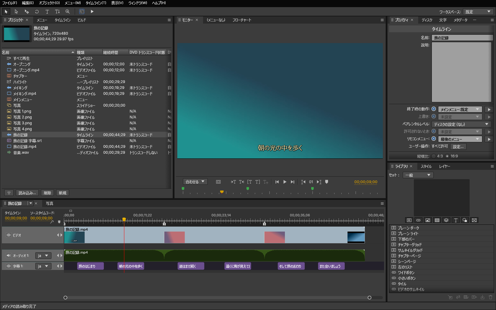
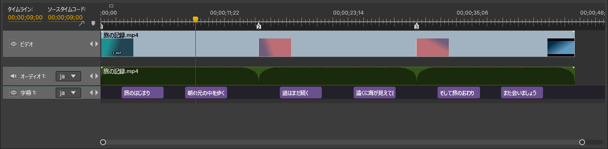
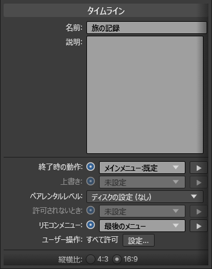
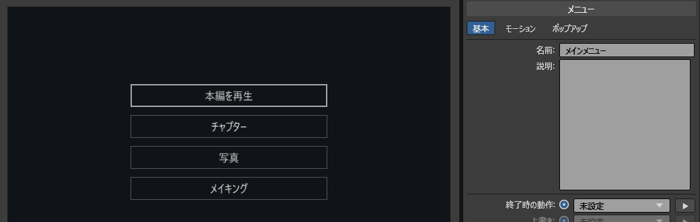

# 6. タイムラインを作る

[目次](README.md) ・ 前の章: [5. 素材を読み込む](05-assets.md#5-素材を読み込む) ・ 次の章: [7. スライドショーを作る](07-slideshows.md#7-スライドショーを作る)

> **この章でできること**
>
> - 動画からタイトル（タイムライン）を作る
> - クリップをつなぎ、チャプターを打つ
> - 音声と字幕のトラックを足し、終わったあとの行き先を決める

## 6.1 作成

ビデオのアセットを選んで **ファイル ▸ 新規 ▸ タイムライン**（Ctrl+T）、または **タイムライン ▸ 新規タイムライン**。
選んでいるビデオがないときは、**新規タイムライン** のサブメニューのビデオの一覧から選ぶ。
DiscCraft のタイムラインは必ずビデオを 1 本目に持つ。

FilmCraft で編集した作品からは **タイムライン ▸ FilmCraft のシーケンスから新規タイムライン…** が使える。
**タイムライン ▸ FilmCraft のマーカーを読み込み…** で、開いているタイムラインにシーケンスのマーカーを
チャプターポイントとして追加することもできる。

## 6.2 複数のビデオクリップ

タイムラインビューアーに別のビデオをドラッグすると、前のクリップの直後に詰めて置かれ、つなぎ目にチャプターができる（1 本のタイトルに最大 99 本のクリップ）。

> **詳しく**
>
> - クリップの音もその横に並ぶ: クリップの音のオーディオトラックに（前のクリップの音はつなぎ目で切る）、タイムラインにオーディオトラックがなければ新しいオーディオ 1 に
> - オーディオトラックのない複数クリップのタイトルは、プレビューでもディスクでも各クリップの音が鳴る
> - クリップと横の音はリンクしていて、クリップをトリム・移動・削除すると音も同じようになり、後ろのクリップの音もクリップと一緒に動く
> - クリップの端をドラッグしてトリムする
> - そのままディスクに入る MPEG-2 では、切り口は GOP の頭へ吸着する

- 変換が要らない MPEG-2 のクリップは、トリムしたままパススルーできる
- 変換が要るクリップ（H.264 など）もつないでビルドでき、DVD（と SD の Blu-ray）でもトリムしたフレームの位置どおりに
  切れる（変換がそこで GOP を始める）。トリムを動かすと、次のビルドでファイルを変換し直す
- HD の Blu-ray では、そのまま収録する H.264（[5.1](05-assets.md#51-読み込み方)）はキーピクチャでトリムされる。ほかのクリップは H.264 に
  エンコードして IDR でつなぐので、指定したフレームどおりにトリムされる
- 1 本目のクリップも消せる（2 本目が新しい 1 本目になる）
- クリップの本体を左右にドラッグすると動かせる。前のクリップとの間にできた空きは、ディスクでは黒で再生される
  （モニターの再生は空きを飛ばす）。となりのクリップには重ねられない
- クリップを右クリック: **ビデオクリップをクリア** は、クリップを消してその場所を空けたままにする（後ろのクリップと
  そのチャプターは動かない）。**リップル削除** は、クリップを消して後ろのクリップをその場所まで詰める。タイトルの
  ただ 1 つのクリップは消せない
- クリップ（ビデオかオーディオ）をクリックすると選ばれ、白い枠が付く。**編集 ▸ クリア**（Delete）でそのクリップを消す
  （ビデオはビデオクリップをクリアと同じ。オーディオはトラックから外し、ただ 1 つのクリップならトラックごと）。
  **編集 ▸ リップル削除**（Shift+Delete）は選んだビデオクリップを消して詰める。選んでいないときは再生ヘッドの下の
  クリップ。クリップのないところやチャプターポイントをクリックすると、選択が外れる
- プログラムストリーム（`.mpg` / `.vob`）のクリップも、チャプターとトリムが GOP の頭に吸着する

音声と字幕の素材をタイムラインビューアーに落とすと、1 つ目のオーディオトラック / 字幕トラックにはいる。

## 6.3 チャプターポイント

- 再生ヘッドの位置に **タイムライン ▸ チャプターポイントを追加**（テンキーの `*`）
- タイムラインビューアーの目盛りの下の旗をドラッグしても動かせる
- **一定間隔でチャプターポイントを追加…**（既定 5 分）でまとめて打つ
- mkv や mp4 にチャプターが入っていれば、そのファイルからタイムラインを作ったときにチャプターポイントになる
  （名前も付く）。あとからは **タイムライン ▸ ソースからチャプターを読み込み**
- 旗を選んで **編集 ▸ クリア**（Delete）でそのチャプターを消す
- ボタン・終了時の動作などのチャプターへのリンク、チャプタープレイリストの項目、視聴制限のチャプターは、前にチャプター
  ポイントを足したり、動かしたり、消したりしても同じチャプターを指したまま。そのチャプター自体を消すと、リンクは未設定に
  なり（プロジェクトの検査に出る）、チャプタープレイリストの項目は消える
- チャプターの名前はプロパティで付ける（空なら「チャプター N」と表示）。**表示 ▸ チャプター名を表示**（Ctrl+8）で
  タイムラインに名前を出す
- ポスターフレームは **タイムライン ▸ ポスターフレームを設定**（Shift+テンキーの *）で、再生ヘッドの絵をセットする

DVD は 1 タイトル 99 チャプターまで。チャプターをボタンにリンクしてシーンを選ぶメニューは
[絵入りのシーン選択メニュー](17-advanced.md#171-絵入りのシーン選択メニュー) に書く。

## 6.4 トラック

**タイムライン ▸ オーディオトラックを追加… / 字幕トラックを追加…** は下から 1 本ずつ、
**オーディオトラックを削除 / 字幕トラックを削除** は一番下のトラックから。**ディスク** パネル（何も選んでいないときの
プロパティと同じ）で、既定で聞くオーディオトラックと表示する字幕を決める。モニターでは見出しのスピーカーボタンで
聞くトラックを選ぶ。

トラックのファイルに音声のストリームが複数あるとき（MKV の各言語、ビデオカメラの 2 組目のステレオ）は、トラックの
右クリック ▸ **音声ストリーム** ▸ **ストリーム 1**、**ストリーム 2**、… で、トラックが使うストリームを選ぶ。ディスクと
モニターはそのストリームを使う。そういうファイルから作るタイムラインは、初めからストリームごとのトラックを持つ。
2 本目以降のストリームを使うトラックは、クリップの名前の後ろに **（ストリーム 2）** のように出る。

オーディオトラックのクリップは、左右にドラッグして始まる位置を動かせる（フレーム単位）。動かした分だけ、トラックの頭は無音になる。Dolby Digital（AC-3）のファイルは同じ形式の無音を前に足すだけで再エンコードせず、WAV は無音を足して PCM のまま、ほかの音声は無音を足して Dolby Digital に変換する。

> **詳しく**
>
> - DTS のトラックは動かせない（ビルドでエラーになるので、頭に戻す）
> - クリップの左右の端をドラッグするとトリムできる（フレーム単位）
> - 残る音は元の位置のままなので、頭をトリムするとクリップの始まりも一緒に動く
> - 端を外へ戻せば、ファイルの頭と終わりまで元に戻せる
> - トリムした Dolby Digital のファイルはそのフレーム（32 ms）の境目で切るだけで再エンコードせず、トリムした WAV は PCM のまま、ほかの音声は切って Dolby Digital に変換する
> - DTS のトラックはトリムできない
> - モニターとプレビューも、トリムした範囲を鳴らす
> - 1 本のトラックに複数のクリップを置ける（99 個まで）: クリップを始めたい位置でトラックを右クリックし、**ここにオーディオクリップを追加 ▸** からプロジェクトの音声ファイルを選ぶか、プロジェクトパネルの音声ファイルをそのトラックの行へドラッグする（クリップが始まる位置に線が出る。トラックの行以外に落とすと新しいトラックになる）
> - クリップにはそれぞれのファイルの波形が出る
> - クリップ同士は重ならない: 重なる追加は断られ、ドラッグしたクリップはとなりのクリップで止まり、端もとなりのクリップを越えない
> - **オーディオクリップをクリア**（複数あるトラックのクリップを右クリック）で 1 つ外せる
> - ディスクではそのトラックは 1 本のストリームになる:各クリップの位置にそのファイルの範囲が入り、あいだは無音
> - クリップが全部 WAV なら PCM
> - 全部が同じ形（ビットレートとチャンネル）の Dolby Digital なら、それぞれのフレームのままつなぐ（再エンコードしない。位置は 32 ms 単位）
> - それ以外の組み合わせはデコードして Dolby Digital に作り直す（DTS のファイルは複数クリップの 1 つにできない）
> - モニターとプレビューも、クリップをそれぞれの位置で鳴らす

上限はオーディオ 8 本、字幕 32 本。

## 6.5 終了時の動作、上書き、リモコンメニュー

プロパティのタイムラインのシートに、3 つのリンク欄がある。

| 欄 | 意味 |
|---|---|
| 終了時の動作 | 最後まで再生したあとに行く先（メニュー、別のタイムライン、スライドショー、プレイリスト、何もしない） |
| 上書き | 終了時の動作の先が終わったあとに行く先（警告 → 本編 → 特典メニューのような流れ） |
| リモコンメニュー | リモコンのメニューボタンで出るメニュー（Blu-ray ではポップアップメニュー） |

リンクの入れ方は 5 とおりある（[ボタンへのリンクの入れ方 5 とおり](17-advanced.md#177-ボタンへのリンクの入れ方-5-とおり)）。速い 3 つ:

- 欄の左の丸（ピックウィップ）を、プロジェクトパネルの項目、フローチャートの箱、タイムラインパネルのチャプターマーカー
  （そのチャプター）、メニュービューアーのボタン（そのボタン）へドラッグする。ドラッグ中は丸からポインターまで金色の線が伸び、
  落とすとリンクする行き先は金色の印で示され、リンクできない所の上では線が赤になる（Esc でやめる）。一覧やフローチャートの端に寄せるとスクロールする
- **オブジェクト ▸ リンクを指定…**（Ctrl+L）でダイアログから選ぶ
- フローチャートでノードからノードへドラッグする

