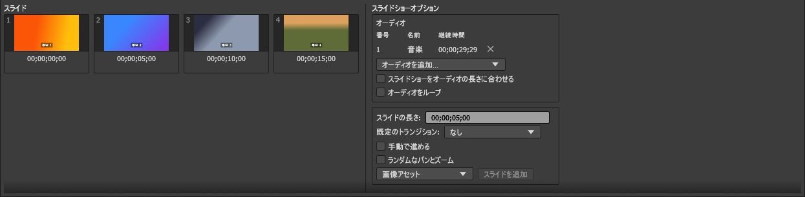
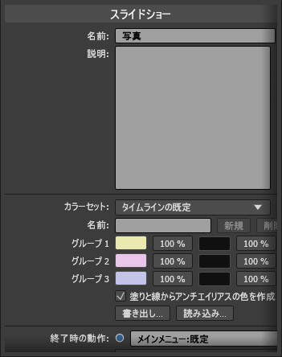

# 7. スライドショーを作る

[目次](README.md) ・ 前の章: [6. タイムラインを作る](06-timelines.md#6-タイムラインを作る) ・ 次の章: [8. プレイリストとチャプタープレイリスト](08-playlists.md#8-プレイリストとチャプタープレイリスト)

> **この章でできること**
>
> - 写真を並べたスライドショーを作る
> - スライドの長さ、切り替え、音を決める

**ファイル ▸ 新規 ▸ スライドショー**（Ctrl+G）で空のスライドショーを作り、スライドショービューアーに画像をドラッグする。
画像を複数選んで **ファイル ▸ 読み込み ▸ スライドショー…**（Shift+Ctrl+G）でも作れる（名前は最初の画像の名前、
スライドの長さは既定の 6 秒）。

| 設定 | 内容 |
|---|---|
| スライドの継続時間 | 既定 6 秒。タイムコードで入力する（NTSC の 00;00;06;00） |
| スケール | 全体表示 / はみ出し / 拡大縮小なし |
| トランジション | なし / クロスディゾルブ / 黒にディップ / ワイプ。長さは 0.1〜10 秒（既定 2 秒）。スライドごとに上書きできる |
| 手動で進める | オンにすると、リモコンで進むまで各スライドで止まる。スライドを選んだときのシートの同じチェックは、そのスライドだけを止める |
| パンとズーム | スライドのプロパティの **パンとズーム** をオンにすると、スライド表示中に画像がゆっくり移動します（パン: なし / 左へ / 右へ / 上へ / 下へ、ズーム: ズームイン / ズームアウト / なし）。スライドショーの **ランダムなパンとズーム** は、自分の設定のないスライドすべてに動きを付ける |
| 字幕を作成 | 各スライドの名前と説明を字幕にする（**含めるもの** で次のスライドの名前も入れる）。スライドごとにハイライト（グループ）・線・整列を選べ、色はスライドショーのカラーセットで決める |

スライドはドラッグで並べ替え、**編集 ▸ クリア**（Delete）で消す。オーディオを足すと長さを合わせられる。
スライドの名前と説明はプロパティで書く（字幕にするとディスクのチャプター名にもなる）。

