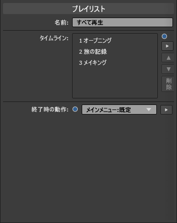
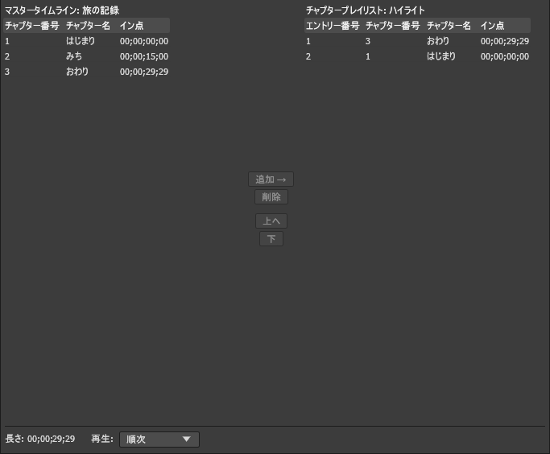
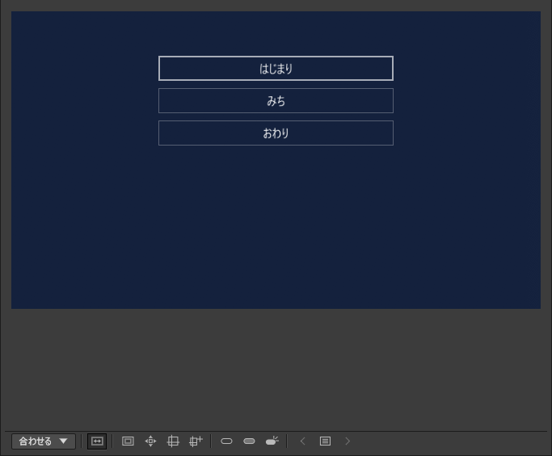

# 8. プレイリストとチャプタープレイリスト

[目次](README.md) ・ 前の章: [7. スライドショーを作る](07-slideshows.md#7-スライドショーを作る) ・ 次の章: [9. メニューを作る](09-menus.md#9-メニューを作る)

> **この章でできること**
>
> - いくつかのタイトルを続けて再生する（プレイリスト）
> - チャプターを好きな順に再生する（チャプタープレイリスト）
> - チャプターを選ぶメニューを作る

## 8.1 プレイリスト

**ファイル ▸ 新規 ▸ プレイリスト…** で名前を付けて作り、プロパティに項目（タイムライン、スライドショー）を
ドラッグして入れる。上へ / 下へ、削除、ダブルクリックで開ける。メニューのボタンからプレイリストへリンクできる。

## 8.2 チャプタープレイリスト

タイムラインを選んで **タイムライン ▸ 新規チャプタープレイリスト**。選んだタイムラインのチャプターを、
再生する順のリストにする（おまけを好きな順で観られる）。

- **順次 / ランダム / シャッフル** を選べる（Blu-ray のランダム / シャッフルも対応）
- チャプタープレイリストビューアーの左の表（マスタータイムラインのチャプター）で選んで **追加 →**（ダブルクリックでも 1 つ入る）。
  **Shift+クリック** で範囲、**Ctrl+クリック** で 1 つずつ足して・外して選べ、表の上で **Ctrl+A** ですべて選ぶ。まとめて
  チャプターの番号順に入り、取り消しは 1 回で戻る。右の表で選んで **削除**（ダブルクリックでも外れる）、**上へ / 下へ** で並べ替え
- 項目のリンク先を変えたり、別のタイムラインのチャプターも入れられる
- チャプタープレイリストビューアーでプレビューできる

## 8.3 チャプターインデックス

**メニュー ▸ チャプターインデックスを作成** は、チャプターごとにボタンを並べたメニューを作る。

- ビューアーに開いているメニューにチャプターボタンがあるときは、リンク済みのボタンに続けて残りのチャプターを割り当てる
  （この場合、少なくとも 1 つのチャプターボタンがタイムラインにリンクしていないと作れない）
- そうでないときは、選んでいるタイムラインのチャプターごとにボタンを並べたメニューを作る（DiscCraft 独自）
- **複数ページのチャプターインデックスを作成** は 1 ページ 6 ボタンで分割し、**前へ / 次へ** ボタンを付ける
- ライブラリの **チャプターのページ**（文字のボタン）と **シーンのページ**（ビデオのサムネイルのボタン）は、チャプター
  ボタン 6 つと **前へ / メインメニュー / 次へ** のボタンを持つ、複数ページのチャプターインデックスのテンプレート
  （DiscCraft 独自）。新規メニューにして最初のチャプターボタンをタイムラインにリンクし、**複数ページのチャプター
  インデックスを作成** でページになる。配置はディスクの画面に合わせて伸び縮みするので、SD（4:3 / 16:9）でも HD でも使える
- ビューアーに開いているメニューにチャプターボタンがあるときは、**複数ページのチャプターインデックスを作成** がその
  メニューを全ページのテンプレートにする。メニューを上と同じように埋め、ボタンが足りない分だけ、
  同じメニューのページを足して（メニュー自身がページ 0、続いてページ 1、ページ 2…）、前のページの続きのチャプターを
  割り当てる。種類が **次へ** のボタンは次のページ、
  **前へ** のボタンは前のページにリンクする。そのページで使わないものは消す: 最後のチャプターより後ろの
  チャプターボタン、最後のページの 次へ、最初のページの 前へ（すでに別のところ、たとえばメインメニューへ
  リンクしている 前へ / 次へ は残す）
- 1 ページに置けるチャプターボタンは最大 18 個
