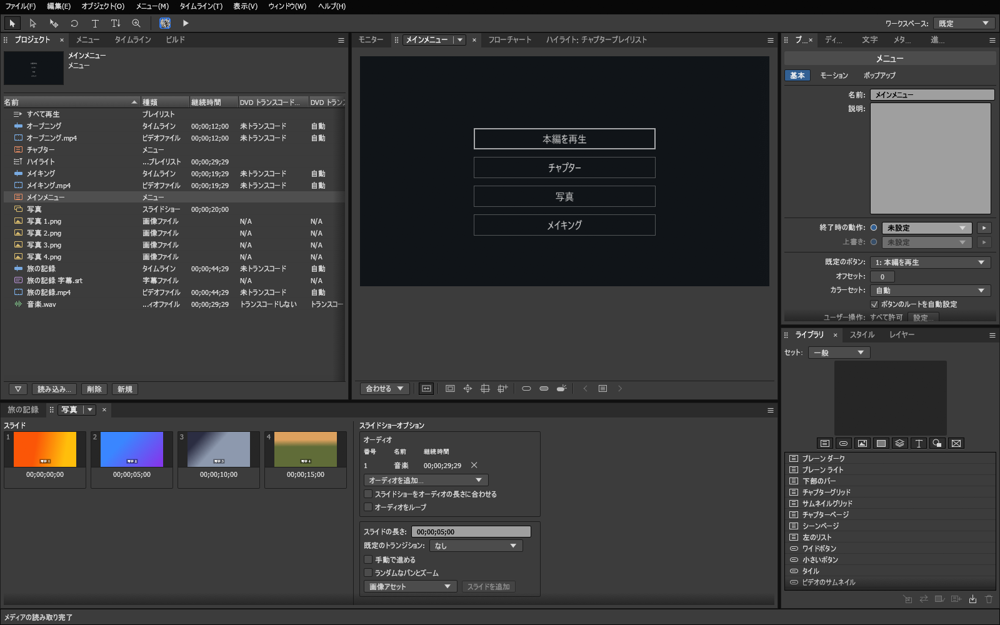
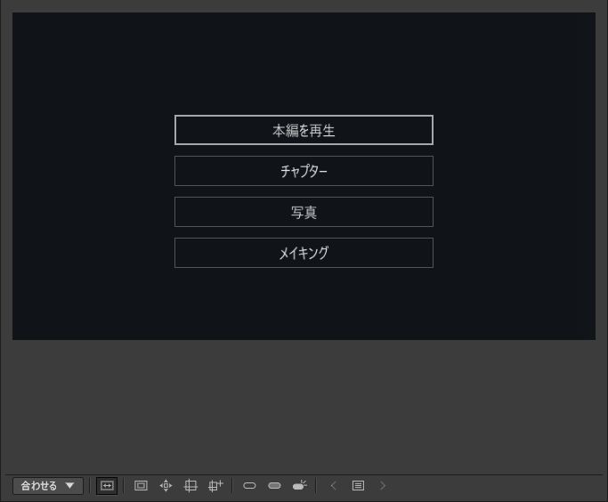
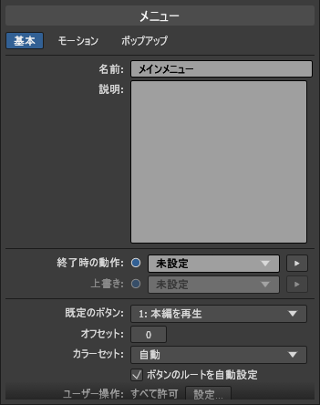
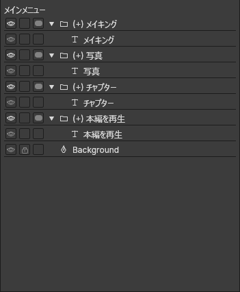

# 9. メニューを作る

[目次](README.md) ・ 前の章: [8. プレイリストとチャプタープレイリスト](08-playlists.md#8-プレイリストとチャプタープレイリスト) ・ 次の章: [10. ナビゲーションを組み立てる](10-navigation.md#10-ナビゲーションを組み立てる)

> **この章でできること**
>
> - メニューを作り、ボタン・文字・図形を置く
> - ボタンのハイライトの色や、動くメニューを作る
> - PSD でメニューを作り直す

## 9.1 作り方

| 方法 | 結果 |
|---|---|
| **ファイル ▸ 新規 ▸ メニュー**（Ctrl+M） | 空のメニュー。ガイドが入る |
| **ファイル ▸ 読み込み ▸ メニュー…**（Shift+Ctrl+I） | PSD / `.pcraft` をメニューにする。`(+)` で始まるグループがボタンになる |
| **ライブラリ** のプリセットで **新規メニュー** | DiscCraft 独自のテンプレートから作る |
| **メニュー ▸ 新規ページを追加** | 開いているメニューの次のページ（背景と設定は同じ。下の「メニューのページ」） |

最初に作ったメニューは、自動的に **ファーストプレイ** と **タイトルボタン** になる。

DiscCraft が書き出す PSD や PhotoCraft のファイルのレイヤー名（背景、ハイライト、ビデオのサムネイル、テキスト、ページ）と、
プロジェクトの中で DiscCraft が付ける名前（文字なしで足したボタン、名前のないチャプター、チャプターインデックスの
前へ / 次へ）は、表示言語になる。

PSD のレイヤー名の決まり: `(+)` で始まるグループがボタン（Encore が作ったチャプターインデックスの `(+#)` チャプター、`(+>)` 次のページ、`(+<)` 前のページのボタンも。種類もそのとおりになる）、`(=1)` / `(=2)` / `(=3)` がボタンのハイライト（サブピクチャ）で、メニューのカラーセットの色 1 / 2 / 3 で描かれる。

> **詳しく**
>
> - `(%)` がビデオのサムネイルのボタン、`(^)` が自動で決定
> - カラーセットが **自動** のときは、色をレイヤーから取る: 最初のボタンのレイヤーの色（それぞれのレイヤーの最後の不透明な画素）がハイライトグループ 1、色の違う次のボタンがグループ 2 になり、同じ色のボタンはそのグループ、ほかはグループ 1 を使う
> - レイヤーのない色は、淡い色の 47 %
> - ボタンの範囲はレイヤーセットの全レイヤー（非表示のものも）で、選んだときに出るのはそのボタン自身のハイライトのレイヤーだけ
> - ハイライトのレイヤーのないセット（ボタンにした絵）は、選んでもハイライトが出ない（DiscCraft で作った、サブピクチャも文字のハイライトもないボタンには、代わりに枠が出る）

いちばん上の階層の、名前が `(#)` で始まるグループは、メニューのページになる。そうしたグループごとにページができ（下にあるものが先。`(#)` のあとの名前は関係しない）、グループの中のボタンがそのページのボタン。

> **詳しく**
>
> - 非表示のページのグループは、ページにならない
> - ページに出るのはグループの中のボタンだけで、グループのそのほかのレイヤー（ボタンのセットに入っていない絵や文字）は、Encore が Blu-ray のメニューで出さないのと同じく出ない
> - そうした絵はボタンのセットに入れるか、すべてのページに出すならページのグループの外に置く
> - ページのグループの外の `(+)` グループが最初のページのボタンで、その外のボタンでないレイヤーはすべてのページに出る
> - ページのグループの外にボタンがなければ、いちばん下のページのグループが最初のページ（Encore はそこに空の最初のページを作る）
> - Blu-ray では、これらのページは背景を止めずに移る

PSD のレイヤースタイル（境界線、光彩、シャドウなど）は、PSD で見えるとおりにメニューの絵に入る。

**ハイライトをリッチカラーで書き出す**（メニューのプロパティの **基本**）をオンにすると、Blu-ray ではこれらのレイヤーをそのままの色（グラデーションもぼかした縁もそのまま）で見せる。

> **詳しく**
>
> - `(=1)` レイヤーだけのボタンは、選択時と決定時にそれを見せる
> - `(=2)` か `(=3)` のレイヤーがあるボタンは、標準で `(=1)`、選択時に `(=2)`、決定時に `(=3)` を見せる（そのレイヤーのない状態では何も見せない）
> - メニュービューアーの **通常** / **選択時** / **決定時** のボタンも同じように見せる
> - プロジェクトプレビューは Encore のプレビューと同じくカラーセットの色のまま
> - DVD のハイライトはカラーセットの色のまま

### メニューのページ

**メニュー ▸ 新規ページを追加** で、開いているメニューの次のページを作る（背景と設定は同じ）。ページは中身が空の
1 つのメニューなので、ボタンはそのページに置く。ページはメニューパネルでメニューの下に **ページ 1**、**ページ 2**… と並び、
ビューアーのタブにどのページかが出る。ビューアーの下の矢印でもページを移れる。

> **詳しく**
>
> - レイヤーパネルでは最初のページのレイヤーの上に `(#) ページ n` のグループとして並ぶ（最後のページが
>   いちばん上）。グループを押すとそのページを表示し、矢印で開くとそのページのレイヤーが出る
> - PSD から作ったメニューでは、PSD のレイヤーをそのまま並べる（名前、グループの入れ子、非表示のレイヤーの目、`(+)` の
>   ボタンのセットの印）。最初は表示中のページの `(#)` グループだけが開いている。開け閉めしたグループは、ページを移っても
>   そのまま
> - ボタンのセットやその中のレイヤーを押すとそのボタンを選び、セットの目でそのボタンを隠せる。DiscCraft で足した
>   テキスト・画像・ボタンは PSD のレイヤーの上に並ぶ
> - リンクの一覧では、メニューの名前 ▸ **ページ n** からそのページを選ぶ
> - Blu-ray ではページを 1 つのメニューにまとめるので、ページを移ってもボタンとそのページの絵が替わるだけで、
>   背景の映像とメニューの音は止まらずに続く。そのためには、ページが最初のページと同じ背景・音・長さ・ループ（**新規ページを
>   追加** で作ったまま）で、ページが 254 までであること（絵の多さは問わない）。そうでなければページごとに別のメニューとして
>   作り、ページを移ると頭から再生し直す
> - ポップアップメニューのページは、タイトルの上にまとめて出る（[Blu-ray](16-bluray.md#16-blu-ray-を作る)）。DVD では
>   いつもページごとに別のメニュー

## 9.2 ボタン

- **メニュー ▸ ボタンを追加**、または既存のテキスト / 画像 / シェイプを選んで **オブジェクト ▸ ボタンに変換**（Ctrl+B）
- ドラッグで移動、ハンドルで大きさ変更、Shift で複数選択
- **オブジェクト ▸ 整列 / 分布 / 重ね順**（前面へ Ctrl+]、最前面へ Shift+Ctrl+]、背面へ Ctrl+[、
  最背面へ Shift+Ctrl+[）。**セーフエリアに対して整列** をオンにすると、キャンバスではなくセーフエリアの枠を基準にする
- **切り取り / コピー / 貼り付け / 複製**（Ctrl+X / Ctrl+C / Ctrl+V / Ctrl+D）、**クリア**（Delete）
- ボタンは 1 メニューに最大 36 個。**既定のボタン**（リモコンの矢印で最初にハイライトされるボタン）は
  プロパティか右クリックで決める
- 16:9 の DVD のメニューは、ボタンが 18 個までなら、メニューをレターボックスで映す 4:3 のテレビのためのハイライトも
  入る。それより多いと、16:9 のテレビでは動くが、4:3 のテレビではハイライトがボタンに重ならず、
  チェックが警告する（Encore は 18 個を超えたボタンをオブジェクトに変える）
- ボタンを重ねて編集できるが、**ディスクに載せるときハイライトは重ならない**（重なると赤枠が出て、チェックに
  「ボタンが重なっています。」が出る）
- **オブジェクト ▸ オブジェクトに変換** でボタンをテキストに戻す
- **オブジェクト ▸ 置換レイヤーに変換**（Ctrl+J）で、選んだ画像やシェイプを置換レイヤーにする（レイヤーパネルでは
  **(!)** が付く）。プロジェクトパネルから静止画をその上にドラッグすると、静止画がレイヤーの代わりになる（形を保って
  レイヤーに収まる大きさで中央に。レイヤーの不透明度・シャドウ・回転はそのまま）。ほかの場所に落とすと新しい
  レイヤーになる。**オブジェクトに変換** で普通のレイヤーに戻す
- **ウィンドウ ▸ 文字**（F3）に、選んだテキストかボタンの文字の設定だけが出る（プロパティと同じ行）。何も選んでいないときは、次に入力するテキストの設定が出る: サイズ・色・フォント・スタイル・書式。

  > **詳しく**
  >
  > - テキストツールで作るテキストはその設定になる（足す操作と同じ 1 回の取り消しで消える）
  > - **リセット** で既定に戻る
  > - **カーニング** は **メトリクス**（フォントのペア）か、一覧の数（−100〜200）または入力した数（−1000〜1000、1/1000 em）で、すべての文字のあいだの空きをその分だけ変える
  > - **詰め**（0〜100 %）は、日本語の文字のまわりの空きを、フォントの字形ごとの空き（輪郭から測る）のその割合だけ詰める: かな・漢字のあいだは前の字のあとと次の字の前の空き、全角の約物は空いている側
  > - **文字組み** は全角の約物（、。「」（）など）の幅を決める: **なし**、**半角句読点**（すべて）、**行末の半角句読点**（行の終わりの約物だけ）、全角の 2 つ（フォントのまま）
  > - 縦書きの詰めは日本語フォントのふつうの空き（全角の 1 割ほど）による
  > - **禁則処理** は、段落テキストの行を分けてはいけない場所を決める: **なし**、**強い禁則**（閉じ括弧・約物・小さいかな・長音で行を始めない。開き括弧で行を終えない）、**弱い禁則**（小さいかなと長音は行頭に来てもよい）
  > - **禁則処理方法** は、行頭に来られない文字の避け方を決める: **追い込み優先**（初期値。全角の約物の空き半分に収まるなら前の行に入れる。句点・読点・閉じ括弧が行末から少しはみ出す。収まらなければ前の 1 文字を連れて次の行に送る）、**追い出し優先**（前の 1 文字を連れて次の行に送る。行に分けられる場所がないときだけ前の行に入れる）、**追い出しのみ**（いつも前の 1 文字を連れて次の行に送る）
  > - **ぶら下がり句読点** をオンにすると、入りきらない全角の句読点（、。，．）が行末の外にぶら下がる
  > - DiscCraft は行を詰めて場所を空けることはせず、ぶら下がった句読点も行揃えの幅に数える
- **段落テキスト**: テキストツール（縦書きテキストツール）でクリックの代わりにドラッグすると、ドラッグした幅（縦書きは高さ）の枠を持つテキストになり、その中で行が折り返す。

  > **詳しく**
  >
  > - プロパティの **折り返し: 幅を指定** でも同じで、幅もそこで決める
  > - 行は空白と日本語の文字のあいだで、禁則処理の設定に従って分かれる
  > - 自分で改行したところはそのまま
  > - 枠は中身にかかわらず決めた幅で描かれ、行揃えはその中で効く
  > - テキストを選んで枠の右の辺（縦書きは下の辺）の白いハンドルをドラッグすると、枠の幅が変わる
  > - プロパティの幅でも変えられる
  > - その下の **ボックスの高さ** か、横書きの枠の下の辺の真ん中（縦書きの枠は右の辺の真ん中。列が広がれる幅になる）の白いハンドルのドラッグで、枠に高さも付けられる
  > - 枠はその高さで描かれ、はみ出した行は描かれない（ディスクでも。縦書きは枠がその幅で描かれ、列は枠の右の辺から並び、その幅を超えた列は描かれない）
  > - はみ出した行があると、プロパティに「テキストの一部がボックスに収まりません」と出て、枠の角に赤い + が付く（Encore のオーバーセットテキスト）
  > - 枠を高くするか、テキストを短くする
- 行揃えの 4 つ目のボタン **≡**（**最終行左揃えの両端揃え**）は、段落テキストの各段落の最後の行を除いて、行を枠の
  端から端まで広げる。日本語は文字と文字のあいだ、日本語のない単語の行は空白で広げる。最後の行と、枠のないテキストは
  左揃え。縦書きのテキストも同じように列をボックスの高さまで広げる（最後の列は上から始まる）
- **ウィンドウ ▸ スタイル**（Ctrl+F2）で、文字に決まった見た目を付けられる。セット（組み込みの **一般**、自分の **ユーザー**）を選び、メニュービューアーでテキストかボタンを選んで **適用**（またはスタイルをダブルクリック）。

  > **詳しく**
  >
  > - スタイルはフォント・サイズ・色・文字の書式・ドロップシャドウの組み合わせで、ボタンでは文字の書式と影が変わる（ボタンの文字のサイズ・色・フォントはメニューのもの）
  > - **新規** は選んだテキストかボタンの見た目をユーザーのセットのスタイルとして残し、**削除** で消す
  > - **画像** / **テキスト** / **形状** のボタンで並べるスタイルを選ぶ
  > - 画像とシェイプのスタイルはレイヤー効果とドロップシャドウ（DiscCraft 独自の **効果なし**、**白い縁**、**暗い縁**、**柔らかい光彩**、**浮き出し**、**影付きの浮き出し**、**ゴールド**、**内側の光**）で、選んだ画像かシェイプに付く
  > - **新規** は選んだものの効果を残す
- 画像とシェイプの **レイヤー効果**: プロパティの **レイヤー効果…**（横に付いている効果の名前が出る）で、**線**（外側の
  線）、**光彩 (外側)** と **光彩 (内側)**（周りや内側の縁の柔らかい光彩）、**ベベル**（指定した角度から光が当たる浮き
  出した縁）、**カラーオーバーレイ** を付けて調整する。メニュービューアーでその場で確かめられる。ディスクのメニューと書き出す
  PSD に、見えるとおりに描かれる。テキストのプロパティにも同じ **レイヤー効果…** があり、ボタンの文字はボタンの **文字**
  タブにある。テキストをボタンに変換したとき（**ボタンに変換**）とその逆でも、効果は文字に付いたまま
- **オブジェクト ▸ サブピクチャを作成**（Alt+Ctrl+B）は、選んだボタンに自分のサブピクチャ（レイヤーパネルでは **(=1) サブピクチャ**）を付け、文字や枠の代わりにカラーセットの色 1 でハイライトする。

  > **詳しく**
  >
  > - PSD から作ったメニューのボタンは、ボタンの絵（ボタンの `(+)` レイヤーセットが見せているもの）の形になる
  > - レイヤーセットは位置で、動かしたり大きさを変えたりしたボタンは名前で探し、今のボタンに合わせて伸ばす
  > - ほかのボタン（DiscCraft で作ったもの、絵のないもの）は、Encore が文字のボタンに `(=1)` レイヤーを作るのと同じく、自分の文字とビデオのサムネイルの形になる
  > - どちらもないボタンはそのまま
  > - メニューを PhotoCraft で開くと（**PhotoCraft でメニューを編集**）、サブピクチャはボタンのレイヤーセットの非表示の `(=1)` レイヤーとして PSD に入る
- **編集 ▸ サブピクチャとして貼り付け**（Shift+Ctrl+V）はどのボタンにも使える。画像かシェイプのレイヤーを選んで **コピー**（か **切り取り**）し、ボタンを 1 つ選んで貼り付ける。

  > **詳しく**
  >
  > - レイヤーの形が、そのボタンのサブピクチャの色 1 になる（レイヤーパネルでは **(=1) サブピクチャ**。前からあったものに足される）
  > - ボタンは文字や枠の代わりにその形でハイライトされる
  > - レイヤーの色と不透明度は関係なく、形だけを使う
  > - ボタンからはみ出たレイヤーは、ボタンを広げて取り込む（文字とビデオのサムネイルは元の場所のまま。画面の外に出たところは使わない）
  > - ハイライトとリモコンの移動は広がったボタンで働く
  > - 回転したボタンも同じように、回転したまま広がる
  > - サブピクチャを外すと、ボタンは中身に合わせた大きさに戻る

ボタンのプロパティ:

| 項目 | 内容 |
|---|---|
| リンク | 押したときに行く先 |
| 上書き | リンク先が終わったあとに行く先 |
| 種類 | 通常 / チャプター / 次へ / 前へ |
| 自動で決定 | カーソルが乗ったボタンが Enter なしで決定される |
| オーディオ / 字幕 | そのボタンに切り替わる音声・字幕 |
| ルート | 矢印キーでどこへ動くか（自動 / 手動） |
| トランジション | ボタンを押したとき、リンク先の前に再生するビデオ（ディスクでは専用のタイトルになり、そのビデオの音声も入る） |

**表示 ▸ ボタンのルートを表示**（Ctrl+7）で十字のルート図が出る。ルートの既定（上下左右の動き、折り返し方、
「次へ」「前へ」ボタンを除外するか）とボタンの名前の同期は [環境設定 ▸ メニュー](18-preferences.md#18-環境設定) で決める
（プロジェクトに保存される）。自分で引くときは **ボタンのルートを自動設定** を外して矢印をドラッグする:
[ルートと番号を手で決める](17-advanced.md#173-ルートと番号を手で決める)。

## 9.3 文字と図形

- **テキストツール**（T）または **縦書きテキストツール**（Y）でクリックして入力。フォント、フォントスタイル、大きさ、
  行送り、字送り、ベースライン、上付き / 下付き、色、アンチエイリアスを設定できる。**行送り** は Encore と同じで、
  **自動** は大きさの 120 %、数値（入力するか **▾** の 6〜72 から選ぶ）は行のベースラインの間隔（縦書きでは列の間隔）の
  ピクセル数
- **一部の文字の書式**: プロパティのテキストの **テキスト** 欄で文字を選ぶと、そこと文字パネル（F3）の文字の行は、
  選んだ文字だけの値を映して設定する（大きさ、色、フォント、フォントスタイル、太字、斜体、下線、取り消し線、大文字、
  トラッキング、ベースライン）。Encore で文字ツールで文字を選んで文字パネルで変えるのと同じ。**文字** の行に選んで
  いる文字が出て、**テキスト全体** で選択をやめると、設定はすべての文字にかかる。行揃え・行送りなど段落の設定は
  いつもテキスト全体のもの。大きい文字は行を高くし、段落テキストは設定どおりの文字の幅を指定（縦書きは列を
  文字の長さで）。入力した文字は前の文字の書式になる
- **ライブラリ** の **画像** と **形状**（長方形 / 角丸長方形 / 楕円）を **配置** でメニューに置く。ライブラリから
  メニュービューアーへドラッグしても置ける: ボタンは落とした位置を中心に、画像とシェイプは落とした位置を角に（画面から
  はみ出すときは内側へ寄せて）、背景はメニューの背景になる。**レイヤー** パネルで重なり順と目 / 鍵を扱う（背景は動かせない）
- **テキストアイテム**: メニュービューアーでテキストを選んでライブラリの **項目を追加** を押すと、文字・
  見た目・枠ごと **ユーザー** セットに入る（名前は 1 行目）。**テキストアイテム** の表示で並ぶ。**配置** で元の位置に
  複製を置き、メニュービューアーへドラッグすると落とした位置が左上になる
- **レイヤーセット** と **置換レイヤー**（Encore のライブラリの種類。それぞれの表示の切り替えがある）: レイヤーセットはいくつかの画像・シェイプのレイヤーをまとめて置くもの（DiscCraft 独自の **タイトルの帯**、**下の帯**、**細い枠**、**横のパネル**）、置換レイヤーは静止画をドロップすると置き換わる場所取り（**写真 4:3**、**写真 16:9**、**丸い写真**。レイヤーパネルでは **(!)**）。

  > **詳しく**
  >
  > - **配置** で描かれた位置に（HD の画面では中央に）、ドラッグで落とした位置を左上にして（画面に収めて）、1 回で置く
  > - 自分のものを残すには、メニュービューアーで画像かシェイプを選んで **項目を追加**（置換レイヤーは置換レイヤーとして、ほかはレイヤーセットとして）、またはライブラリのパネルメニュー（**≡**）の **メニューのレイヤーをレイヤーセットとして追加** で開いているメニューの画像とシェイプのレイヤーをまとめて
  > - 画像はファイルを覚えているので、別のプロジェクトではそのアセットを使い、なければ読み込む
- **自分のセット**: ライブラリのパネルメニュー（**≡**）に **新規セット…**（名前を付ける。そのセットが表示され、
  **項目を追加** はそこに入る）、**セットを削除**（中の項目は **ユーザー** セットに移るのでなくならない）、
  **セットの名前を変更…**。セットは項目と一緒に `library.json` に保存される
- **ファイルの項目**: パネルメニューの **ファイルから項目を追加…**（Encore の 項目を追加…）で、PSD・PSB・.pcraft と画像（PNG・JPEG・BMP・GIF・TIFF）を表示中のセットに足す（ファイルはライブラリのフォルダーの `items/` にコピーする）。

  > **詳しく**
  >
  > - ファイルの中身で種類が決まる: ボタンのセット（`(+)`）とほかのレイヤーがある PSD はメニュー、ボタンのセット 1 つだけの PSD はボタン、グループ 1 つだけの PSD はレイヤーセット、`(!)` のレイヤー 1 つだけの PSD は置換レイヤー、それ以外の PSD と画像は画像（大きさや名前は関係しない）
  > - メニューは **新規メニュー** と **置き換え** で **ファイル ▸ 読み込み ▸ メニュー…** と同じに（`(#)` のページもそのまま）、画像は画像のレイヤーとして置く
  > - ボタンは、PSD の絵の上に、そのセットの場所のボタンを重ねて置き、セットの `(=1)`〜`(=3)` のレイヤーがボタンのハイライトになる
  > - レイヤーセットは中のレイヤーを 1 枚ずつ画像のレイヤーにして、セットの中の位置のまま置く（置換レイヤーは 1 枚の置換レイヤー）
  > - どれも PSD の大きさのまま（画面より大きい PSD は画面に合わせて縮める）、落とした位置か画面の中央に置く
  > - 使うときにファイルを `<プロジェクト>.menus/` にコピーするので、ライブラリから消してもプロジェクトのメニューと画像は残る
- **フォルダーを読み込み…**（DiscCraft だけ）: 選んだフォルダーと、その下の PSD や画像のあるフォルダーごとに、
  フォルダーの名前のセットを作ってファイルの項目を足す（同じ名前のセットがあればそこに）。たくさんあっても裏で
  コピーし、ステータスバーに進み具合が出る。メニューやボタンの PSD を集めたフォルダーを、まとめてライブラリに
  できる
- **オブジェクト ▸ ドロップシャドウ…**（Shift+Ctrl+O）、**左右反転 / 上下反転**（Alt+Ctrl+H /
  Alt+Ctrl+V）、**回転 ▸**（180°、90° 時計回り / 反時計回り）。自由な角度は回転ツール（R）
- **ガイド**: **表示 ▸ 新規ガイド…**（Shift+Alt+Ctrl+:）で位置を入力して打ち、**ガイドを表示**（Ctrl+:）、
  **ガイドにスナップ**（Shift+Ctrl+:）、**ガイドをロック**（Alt+Ctrl+:）、**ガイドを消去** で扱う

## 9.4 色とハイライト

**メニュー ▸ メニューのカラーセットを編集…** で、標準 / 選択時 / 決定時の色を決める（ハイライトの枠・文字・サブピクチャ）。

> **詳しく**
>
> - **ハイライトグループ** を使うと複数のボタンがまとめて光る
> - **名前** を入れて **新規** を押すと、そのセットをプロジェクトに持ち、どのメニューでも **カラーセット** の一覧から選べる
> - **削除** で選んでいるセットを消す（取り込んだメニューの色はそのまま）
> - **書き出し…** でセットをファイル（`.dcmenucolors`）に書き、**読み込み…** でファイルのセットをダイアログに読み込む（ほかのメニューやプロジェクトに）
> - **表示 ▸ 通常のサブピクチャを表示 / 選択時のサブピクチャを表示 / 決定時のサブピクチャを表示**（Ctrl+3 / Ctrl+4 / Ctrl+5）で、キャンバスで見比べられる
> - ボタンごとグループを選ぶのと、透明なハイライトは [ハイライトの色をボタンごとに決める](17-advanced.md#175-ハイライトの色をボタンごとに決める) に書く

## 9.5 背景とモーションメニュー

プロパティのメニューのシート（**基本 / モーション / ポップアップ**）で決める。

- 背景は色 / 画像 / 動画のアセット（タイムラインではない）。動画にするとモーションメニューになる
- PSD から作ったメニューに動画を付けると、動画は PSD の一番下のレイヤー（背景）の代わりになり、
  ほかのレイヤー（ボタン・文字・飾り）は動画の上に残る。モーション タブのビデオを **なし** に戻すと PSD の背景に戻る。
  PhotoCraft での編集やファイルへの書き出しでは PSD をそのまま使い、読み直しても動画はそのまま。
  複数ページのメニューでは、同じ背景のページ全部に動画が付く（Encore のページは背景が 1 つの 1 つのメニュー）
- ループ回数とループポイント、継続時間（メニューは最大 254 秒）
- **終了時の動作**（時間切れで進む先。メニュー ▸ 終了時の動作を設定… でも開ける）と **上書き**
- **ポップアップ** のシートでポップアップメニューに設定し（そのメニューの全ページが設定される）、背景のタイムライン / 背景フレームを決める（Blu-ray）

**メニュー ▸ EffectCraft のコンポジションを作成…** でメニューのレイヤーから EffectCraft のプロジェクトを作り、
レンダーされたムービーをメニューの背景（モーションメニュー）にできる。ループと音声、あとで隠す層まで含めた
一通りは [モーションメニューに音と動きを](17-advanced.md#176-モーションメニューに音と動きを) に書く。

## 9.6 PSD で作り直す

- **編集 ▸ PhotoCraft でメニューを編集**（Shift+Ctrl+M）: メニューをレイヤー付き PSD にして PhotoCraft（なければ既定のアプリ）で開く（PSD から作ったメニューで、テキストを足していなければ、その PSD をそのまま開く）。

  > **詳しく**
  >
  > - 保存すると自動で読み直す
  > - PSD は `<プロジェクト>.menus/` に置かれる
  > - 反映では、`(+)` のグループをボタンの名前で探し（名前を変えたグループは、Photoshop が変えずに持つレイヤー ID で。レイヤー ID のない PSD では、ボタンに重なっているグループ。複製したグループは新しいボタン）、ボタンを PSD の重なりの順に並べ直す
  > - 見つかったボタンはリンクと設定をそのまま持ち（既定のボタンとそのボタンへのリンクもついていく）、増えたグループはボタンを足し、なくなったグループのボタンは消す
  > - `(#)` のページのある PSD のメニューは、全部のページを読み直す
- **メニュー ▸ メニューをファイルとして保存…**: メニューを PSD で書き出す
- 上の 2 つの PSD では、テキストとボタンの文字を編集できる文字のレイヤーにする。Photoshop の
  文字ツールで打ち直せ、フォント・サイズ・色・行揃え・段落の枠・角度はそのまま、ドロップシャドウはレイヤースタイル。
  打ち直すまでは DiscCraft の描いた文字を表示する（Photoshop は文字をテキスト用のガンマで重ねるので、ふちが少し明るく
  見える）。ほかのレイヤー効果（境界線・光彩・ベベル・オーバーレイ）の付いたテキストはピクセルで書き出す
- PSD から作ったメニューや、PhotoCraft などの画像エディターで編集したメニューは、上の 2 つの PSD で元の PSD の
  レイヤーをそのまま残す（1 枚の絵に平らにしない）。そのあと DiscCraft で足したものはその上に重なり、ボタンの新しい
  文字はそのボタンの `(+)` のセットに、新しいボタンは新しいセットになる。`(#)` のページのあるメニューでは、足したものは
  そのページのグループに入る。元の PSD がディスクの画面と違う大きさ（PAL の DVD のプロジェクトの 1920x1080 の PSD
  など）でも、PSD はその大きさとレイヤーのまま書き出し、DiscCraft で足したものをその大きさに合わせる
- ページのあるメニューは、どのページから書き出しても全部のページを 1 つの PSD にする。最初のページは一番上の階層、
  2 ページ目からは `(#) ページ 1`、`(#) ページ 2`… のグループ（そのページのボタンのセット）。読み直すと、各ページが
  自分のグループに従い、エディターで足した `(#)` のグループは新しいページになる。ページのあるメニューのテキストと
  図形は PSD に書かず、DiscCraft に残る（PSD の一番上の階層の絵は全部のページに出て、`(#)` の中のボタンでない絵は
  出ないため）
- **メニュー ▸ メニューを置換…**: 開いているメニューを PSD のデザインに置き換え、リンクは番号で残す
- **メニュー ▸ メニューをテンプレートとして保存…**（Ctrl+Alt+M）: ライブラリの **ユーザー** セットに保存する

## 9.7 ユーザー操作

**メニュー ▸ メニューのユーザー操作を設定…** と **ファイル ▸ ディスクのユーザー操作を設定…** で、
再生中にリモコンでできる操作 / できない操作を決める（DVD は 25 種類のユーザー操作、Blu-ray は UO マスク）。
