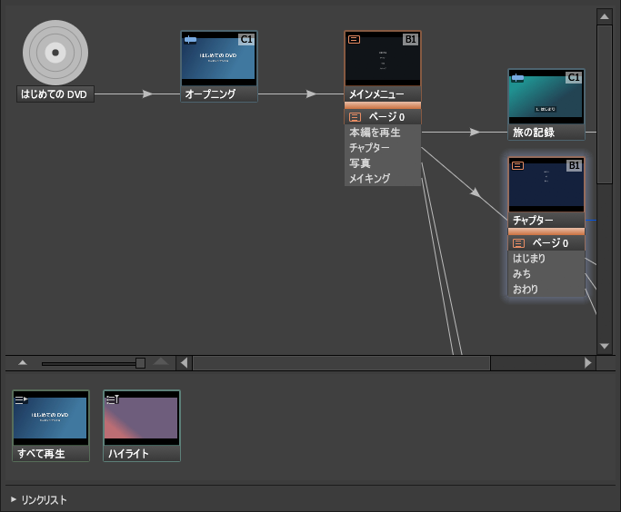

# 10. ナビゲーションを組み立てる

[目次](README.md) ・ 前の章: [9. メニューを作る](09-menus.md#9-メニューを作る) ・ 次の章: [11. 字幕](11-subtitles.md#11-字幕)

> **この章でできること**
>
> - ディスクを入れたときに最初に再生されるものを決める
> - ボタンや終わったあとの行き先をつなぎ、フローチャートで全体を見る

## 10.1 ファーストプレイとタイトルボタン

ディスクを入れると最初に動くのが **ファーストプレイ**、タイトルボタンを押したときに行く先が **タイトルボタン**。
最初のタイムラインまたはメニューを作ったときに自動で設定される。変えたいときは、プロジェクトパネルかフローチャートの
項目を右クリックして **ファーストプレイに設定**（タイトルボタンはプロパティで決める）。

## 10.2 フローチャート

**ウィンドウ ▸ フローチャート**（F5）。Encore と同じ並びと見た目で、ディスクから右へ木のように広がる。

- 左にディスク。**ファーストプレイ** が最初の項目へ、各項目のリンクはその右の列へ、ボタンの順に並ぶ。**リンク 1 本ごとに
  箱が 1 つ**: もう出ている項目へのリンク（同じタイムラインへの 2 つ目のボタン、メニューに戻るタイトル）はその項目の薄い
  写しへ入るので、線が折り返さない。箱は、リンクが出るボタンや終了時の動作と同じ高さに入るように置かれ、場所がなければ
  前の箱の下になる
- 箱は項目の絵（タイムラインはチャプター 1 のポスターフレーム、チャプタープレイリストは最初の項目の、プレイリストは最初の
  項目の絵）で、種類の色の枠に入り、左上に種類の印、右上に **リンクがどこに入るか**: **C** チャプター（絵もそのチャプターのフレーム）、**B**
  メニューに入るボタン（リンクがボタンを決めていなければ既定のボタン）、**A** / **S** リンクが選ぶオーディオトラックと字幕。メニューは下にボタンをページごとに並べる
  （**ページ 0**、**ページ 1**…）。ボタンは文字、文字がなければ名前で出る（Blu-ray から読み込んだメニューのボタンは、
  再生するものの名前）
- リンクの矢印は線の 3 分の 2 ほどのところ。箱をクリックするとその項目を、ボタンの行をクリックするとそのボタンを選ぶ
  （行が暗くなり、リンクが青くなる）。ダブルクリックでビューアーに開く（メニューは、リンクが入るボタンを選んだ状態で開く）
- ボタンの行をクリックするとそのリンク先の箱が行と同じ高さに並び直し（前の箱は上へ、後ろの箱は下へ）、
  箱をクリックするとリンク元の行がその箱と同じ高さに来る。クリックしたものは画面上で動かない。ほかをクリックするまで
  その並びのまま
- ディスクからたどれない項目（どこからもリンクされていない、またはタイトルボタンからだけ）は下の **トレイ** に、種類ごとに
  名前の順で並ぶ。
  タイムライン・スライドショー・プレイリストへドラッグするとその項目の終了時の動作に、ディスクへドラッグすると
  ファーストプレイになる
- フローチャートとトレイの間のスライダーで、100 %（開いたときの大きさ）から 10 % まで縮める。両端の小さい印と大きい印は
  1 回で 10 % ずつ縮小・拡大する。手で動かした箱もほかと一緒に縮み、トレイは大きさが変わらない
- **移動ツール** では箱をドラッグで動かせる。**自動レイアウト** / **すべて自動レイアウト** で元の並びに戻る
- ほかのツールでは、箱をほかの箱へドラッグすると、ドラッグした項目の終了時の動作がその項目になる（メニューを
  タイムラインへ落とすとタイムラインの終了時の動作に、ディスクへ落とすとファーストプレイに）。タイムラインを
  メニューのボタンの行へ落とすと、そのボタンで終わる。トレイの項目を何もない所へ落とすと、自分のリンクとともにそこに
  置かれる（その箱の **自動レイアウト** でトレイへ戻る）。どこかからリンクされると、そのリンクの横に並んで木に入る
- ボタンの行、または箱の名前の右端から、メニュー・タイムライン・スライドショー・プレイリスト（その薄い写しでもよい）へ
  ドラッグするとリンクする（落とすとリンクする箱は枠が金色になる）。プロパティパネルのピックウィップも箱へ落とせる
- 右クリックに 開く / リンクを指定 / 名前の変更 / ファーストプレイに設定 など
- 箱にポインターを乗せると、名前の全体と、線で見えない終了時の動作の行き先（停止、最後のメニュー）が出る
- **表示 ▸ すべてのサムネイルを表示** で箱に絵を出す。外すと箱は名前だけになる（トレイの絵は残る）。
  フローチャートの右クリックにもあり、**すべて自動レイアウト**、**新規**、**読み込み**、**プレビュー** が並ぶ

ディスク全体をページで読む（ファーストプレイ、上の階層へ戻るメニュー、何もリンクしていない項目）のは
[フローチャートをディスクの地図として使う](17-advanced.md#178-フローチャートをディスクの地図として使う) に書く。

## 10.3 リンクの種類

| 場所 | 決まるもの |
|---|---|
| ボタン | リンク（押した先）、上書き（リンク先が終わった先）、ルート（矢印キーの動き） |
| タイムライン | 終了時の動作、上書き、リモコンメニュー |
| メニュー | 終了時の動作（時間切れの先）、上書き、継続時間 |
| ディスク | 上書き（ディスクの既定の行き先） |
