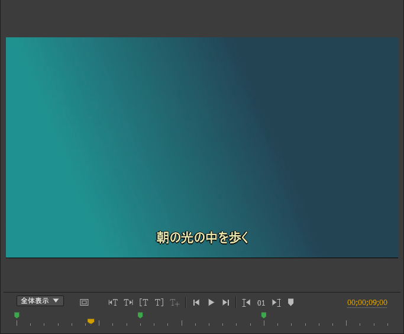

# 11. 字幕

[目次](README.md) ・ 前の章: [10. ナビゲーションを組み立てる](10-navigation.md#10-ナビゲーションを組み立てる) ・ 次の章: [12. プロジェクトをチェックする](12-check.md#12-プロジェクトをチェックする)

> **この章でできること**
>
> - 字幕のファイルを読み込む
> - 字幕を直し、色や位置を決める

## 11.1 読み込み

- **タイムライン ▸ 字幕の読み込み ▸ テキストスクリプト…**（SRT / WebVTT / タイムコード付きテキスト。UTF-8 /
  UTF-16 / Shift_JIS）を選ぶと、選んでいるタイムラインに字幕トラックが 1 本増える
- **タイムライン ▸ 字幕の読み込み ▸ FAB 画像スクリプト… / 画像スクリプト…** で、画像（JPG、GIF、PNG、TIF、BMP）の字幕を読み込める。

  > **詳しく**
  >
  > - FAB 画像スクリプトは 1 行に 1 枚（`ファイル 開始 終了 左 上 右 下`）で、画像のフォルダーを聞かれる
  > - 画像スクリプトは `Display_Area (左 上 右 下)` と `Directory <フォルダー>` のあとに `番号 開始 終了 ファイル`
  > - **カラーをマップ** で 1 枚目の画像をクリックして **背景**（透明）、**塗り / カラー 1**（カラーグループの塗りで描く）、**輪郭 / カラー 2**（グループのストローク）の色を選ぶ
  > - そのほかの色は透明になるので、縁のくっきりした 3 色の画像がきれいに出る
  > - **相対** にすると、すべての字幕を入れたタイムコードだけずらす（前にずらすときは頭に `-`）
  > - 画像の字幕はタイムラインにファイル名で出て、文字は直せない
  > - 移動とトリムはほかの字幕と同じ
- 字幕ファイルをアセットとして読み込んでから、タイムラインビューアに落としてクリップにする
- **動画の中の字幕**（MKV の字幕トラック）: そういう動画からタイムラインを作ると、中の字幕が字幕トラックになる（32 本まで）。

  > **詳しく**
  >
  > - テキストの字幕（SRT、WebVTT、ASS / SSA）は `.srt` に、Blu-ray の PGS は `.sup` に取り出して、プロジェクトの横の `<プロジェクト名>.subtitles` フォルダー（保存前のプロジェクトでは一時フォルダー）に置き、ふつうの字幕のアセットになる（編集もできる）
  > - ASS の飾り（文字の位置や色の指定、図形）は外れ、文字だけが残る
  > - 言語はファイルに書いてあるもの
  > - PGS は DVD には使えないので、DVD のプロジェクトでは取り出さない
  > - あとから足すときは **タイムライン ▸ 字幕の読み込み ▸動画の中の字幕**（DiscCraft だけの項目）
- Encore が書き出した字幕のテキストスクリプト（UTF-16 LE）も読める。**タイムライン ▸ 字幕を書き出し ▸
  字幕トラック** で SRT / テキストスクリプトとして書き出せる
- **ファイル ▸ 新規 ▸ スライドショー** の **字幕を作成** で、スライドの名前と説明から字幕を作ることもできる

## 11.2 編集

タイムラインビューアの字幕トラックで、クリップの端をドラッグしてトリムし、ダブルクリックで文字を直せる
（Enter / Shift+Enter で改行、Esc で確定）。トリムは最短 0.4 秒（NTSC 13 フレーム、PAL 11 フレーム）。

モニターの字幕のボタンでも作れる（**前の字幕 / 次の字幕 / 字幕インポイントをここまでトリム /
字幕アウトポイントをここまでトリム / 字幕を追加**）。**字幕を追加** は再生ヘッドの位置に既定 2 秒のクリップを置く
（次の字幕まで 2 秒空いていないと置けない）。

タイムラインでは、字幕クリップをドラッグするとトラックに沿って動き、左右の端をドラッグするとトリムになる。
フレーム単位で動き、隣のクリップと先頭で止まり、13 フレームより短くはならない（もとから短いクリップはその長さのまま）。
動かす先は枠で示され、Ctrl+Z で戻る。**字幕クリップをスナップ**（環境設定 ▸ タイムライン。初期値は
オフ）をオンにすると、動かす端が近くの字幕クリップの端、チャプターポイント、再生ヘッドに吸い付く。チャプターポイントの
線の上を押したときは、これまでどおりチャプターが動く。

## 11.3 見た目

字幕クリップを選ぶと、プロパティに **字幕クリップ** のシートが出る。

| 項目 | 内容 |
|---|---|
| テキスト / デュレーション / インポイント / アウトポイント | 文字と時刻 |
| ハイライト | グループ 1〜3（色の組）。**トラックの設定** にするとトラックのグループに従う |
| ストローク | なし / 細 / 中 / 太 / 極太 |
| 整列 | 上下の位置（100 % で下） |
| 揃え | 左 / 中央 / 右（初期値は中央。左と右はタイトルセーフの端に揃う） |

色はタイムライン（スライドの字幕はスライドショー）のプロパティの **カラーセット** で決める。

- グループ 1〜3 のそれぞれに、塗り・ストローク・アンチエイリアスのカラーと不透明度がある（初めは初期設定の色）
- **塗りおよびストロークからアンチエイリアスカラーを作成** を入れると、アンチエイリアス（文字の縁のなじませる色）は
  塗りとストロークの中間になる。外すと自分で決められる
- **名前** を入れて **新規** で、今の色をプロジェクトのカラーセットとして保存する。保存したセットは **カラーセット** の
  一覧から選べ、**削除** で消せる（タイムラインは色のコピーを持つので、後からセットを変えても変わらない）
- **書き出し… / 読み込み…** でカラーセットをファイル（`.dccolors`）にやり取りできる。**初期設定に戻す** で元の色に戻す

字幕の文字はタイトルセーフ（フレームの 80 %）の中に収める。**表示 ▸ セーフエリアを表示**（Ctrl+6）で範囲を確認できる。
収まらない字幕は [プロジェクトのチェック](12-check.md#12-プロジェクトをチェックする) に出る。
