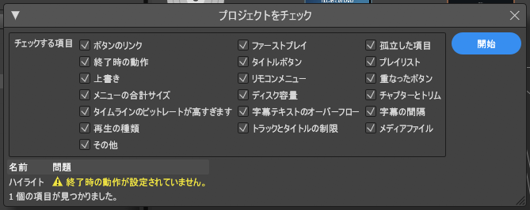

# 12. プロジェクトをチェックする

[目次](README.md) ・ 前の章: [11. 字幕](11-subtitles.md#11-字幕) ・ 次の章: [13. プレビューする](13-preview.md#13-プレビューする)

> **この章でできること**
>
> - ビルドの前に、リンクの抜けや容量の問題を見つける

**ファイル ▸ プロジェクトをチェック…**（Shift+Ctrl+L）、**ビルド** パネルの右の **プロジェクトをチェック** ボタン、
または F4。チェックウィンドウは **チェックする項目** に印を付けて **開始** を押すと走り、結果は **名前** と **問題** の
2 列に項目ごとにまとまって出る（1 項目に問題が複数あると「{n} 個のエラー」に折りたたまれる）。
エラーの前には丸に ×、注意の前には三角に ! の印が付き、色が見分けにくくても形で分かる。色そのものも、どの色覚でも
離れて見える色にしてある。ビルドパネルのチェックの一覧と結果、レイヤーの区切りの確認（よい場所は丸に ✓）も同じ印で示す。

| 分類 | 見るもの |
|---|---|
| ボタンのリンク | リンク先がない・リンクが設定されていないボタン、枠の外に出たボタン、存在しない既定のボタン |
| ファーストプレイ | ファーストプレイが設定されているか |
| 孤立 | どの項目からも辿れないタイムラインとメニュー |
| 終了時の動作 | 終了時の動作が未設定の項目 |
| タイトルボタン | タイトルボタンがメニューになっているか |
| プレイリスト | 空のプレイリストとスライドショー、エントリのないチャプタープレイリスト、継続時間不正なスライド |
| 上書き | 上書きの設定 |
| リモコンメニュー | リモコンメニューがメニューになっているか |
| 重なったボタン | ハイライトが重なるボタン、ボタンが多すぎるメニュー |
| メニューの合計サイズ | ボタンのないメニュー、継続時間、4:3 と 16:9 の混在 |
| ディスク容量 | 容量を超えていないか、ビットレートが低すぎないか |
| チャプターとトリム | 99 チャプター超、最初のチャプターが先頭にない、順序が不正 |
| タイムラインのビットレートが高すぎます | DVD で、そのまま使うビデオとオーディオトラックの合計が 9.8 Mbps を超えるタイムライン |
| 字幕テキストのオーバーフロー | 文字がタイトルセーフの枠に収まらない字幕（NTSC の標準の大きさで 11 行以上、または折り返せない長い行）。字幕トラックとイン / アウトの時刻が出る |
| 字幕の間隔 | Blu-ray（HD か PAL）で、同じトラックの前の字幕とのすき間が 5 フレーム未満の字幕。DVD では見ない |
| 再生の種類 | DVD で、**ランダム** か **シャッフル** にしたチャプタープレイリストのエントリが 65 以上のもの: DVD は最初の 64 個からしか選ばない。（Encore は DVD ではランダムとシャッフルのチャプタープレイリストを順番どおりに再生させる。DiscCraft は設定どおりに書く） |
| トラックとタイトルの制限 | オーディオ 8 本、字幕 32 本、DVD のタイトル 99 本など |
| メディアファイル | オフライン・存在しない・扱えない形式の素材 |
| その他 | 上のどれにも入らないもの |

**ビルド** ボタンはビルドの前に必ずチェックを走らせ、問題があると **表示**（チェックウィンドウを開く）／
**無視して続行** ／ **取り消し** のダイアログが出る。
