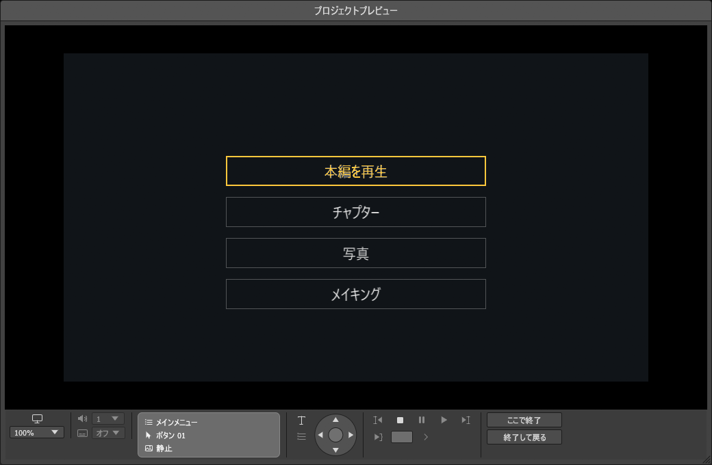
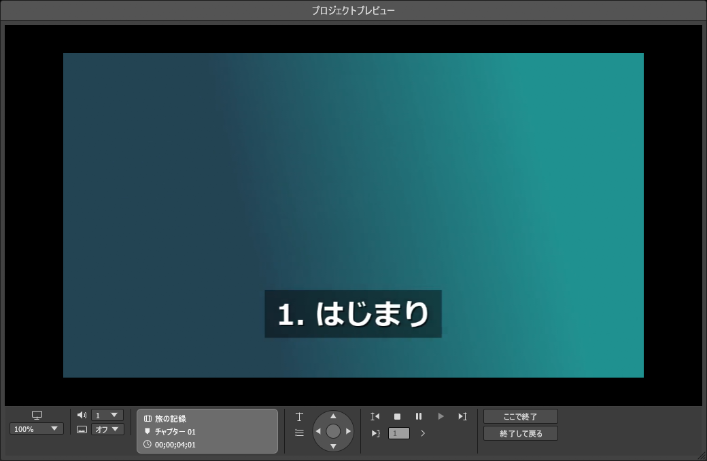

# 13. プレビューする

[目次](README.md) ・ 前の章: [12. プロジェクトをチェックする](12-check.md#12-プロジェクトをチェックする) ・ 次の章: [14. ビルドする](14-build.md#14-ビルドする)

> **この章でできること**
>
> - ビルドせずにディスクを試す（プロジェクトプレビュー）
> - ビルドしたディスクを再生して確かめる（モニター）

## 13.1 プロジェクトプレビュー（ビルドしないプレビュー）

**ファイル ▸ プレビュー**（Alt+Ctrl+Space）、ツールバーの再生ボタン。ビルドせずに、今のプロジェクトを
自前の VM で再生する窓が開く。ファーストプレイから始まる。メニューやタイムラインの右クリックの **ここからプレビューする**
なら、そこから始まる。ボタンが重なったメニューも試せる（ビルドは重なりを直すまで断る）。

下の操作バーは左から順に次のとおり。

| 部分 | 内容 |
|---|---|
| 拡大率 | 画面のアイコンの下。初めは **100%**（実寸で真ん中）。**全体表示** で窓に合わせる |
| オーディオ / 字幕 | スピーカーと字幕のアイコンの横で、再生するトラックを選ぶ（タイトルの再生中だけ） |
| 今の項目 | 3 行で、メニューなら メニューの名前 / 選んでいるボタン / 静止画かモーション、タイトルなら タイトルの名前 / チャプター / 再生時刻 |
| タイトル / メニュー | T のボタンがリモコンのタイトルボタン、一覧のボタンがメニューボタン（Blu-ray ではその下にポップアップメニュー） |
| 十字キー | 丸い十字キーの上下左右でボタンを移り、真ん中の丸が決定 |
| 再生 | 前のチャプター / 停止 / 一時停止 / 再生 / 次のチャプター、その下に **エンドアクションを実行** とチャプター番号の欄（**チャプターへ移動**） |
| 終了 | **ここで終了**（見ている項目を開いて終了）と **終了して戻る**（開く前に戻る） |

- 窓を × で閉じるのは **終了して戻る** と同じ
- タイトルは映像と音つきで再生し、終わるとエンドアクションへ進む。矢印キーと Enter でリモコン、Space で一時停止
- チャプター再生リストは、エントリーを順に再生する（タイムラインの各チャプターを次のチャプターポイントまで）。スライドショーは、スライドをそれぞれの長さだけ、オーディオクリップを鳴らしながら映す。

  > **詳しく**
  >
  > - チャプター番号は画面に出ているものに付いていくので、前 / 次のチャプターはそこから動く
  > - 「手動で進める」のスライドは、次のチャプター（または Enter）まで出たままになる
  > - 出たままの間はディスクと同じく音も止まり、次のチャプターで止まったところから続く
  > - スライドはディスクと同じくパンとズームで動き、「スケールしてクロップ」は画面いっぱいに映る
  > - スライドの間のトランジション（クロスディゾルブ、黒へのディップ、ワイプ）も、ビルドと同じく切れ目をまたいでかかる
  > - 字幕ストリームをオンにすると、**字幕を作成** のスライドは名前（と説明）がディスクと同じく字幕で出る
  > - **シャッフル** のチャプター再生リストは全部の項目を 1 回ずつランダムな順に、**ランダム** は毎回ランダムな項目を（ここでは 99 回まで）、プレーヤーと同じように再生する
- レンダリングしたモーションメニュー（**ファイル ▸ レンダリング ▸ モーションメニュー**）は、ディスクと同じく
  背景の動画とモーションボタンが動き、ループポイントからくり返す。レンダリングする前と、プロジェクトを変えた
  あとは、そのままのメニュー（背景の最初のフレーム）を映す。HD の Blu-ray のモーションメニューも、
  レンダリングしたあと（または同じキャッシュでディスクをビルドしたあと）はここで動く

## 13.2 モニター（ビルド結果の再生）

**ウィンドウ ▸ モニター**（F9）。モニターの **ビルド結果を開く** で、書き出したフォルダの `VIDEO_TS` / `BDMV` を
読んで再生できる。リモコンの十字キー、タイトル / メニュー、チャプター、オーディオ / 字幕が使える。
ビルドしていないときは、選んでいるタイムラインの映像と音をそのまま映す（Space で再生、音つき。字幕もカラーセットの色で出る）。
DTS のトラックは鳴らない。
