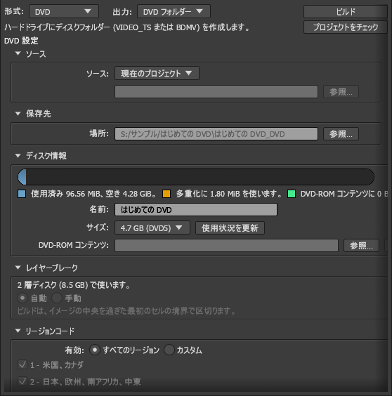
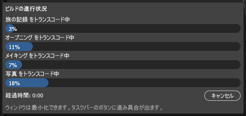

# 14. ビルドする

[目次](README.md) ・ 前の章: [13. プレビューする](13-preview.md#13-プレビューする) ・ 次の章: [15. ディスクのレーベルを作る](15-labels.md#15-ディスクのレーベルを作る)

> **この章でできること**
>
> - ディスクのフォルダーやイメージ（ISO）を作る
> - ディスクに書き込む
> - 容量と 2 層のディスク（レイヤーブレーク）を扱う

## 14.1 ビルドパネル

**ウィンドウ ▸ ビルド**（F2）、または **ファイル ▸ ビルド ▸ フォルダー…** / **画像…**。

| 欄 | 内容 |
|---|---|
| 形式 / 出力 | DVD / Blu-ray、**ディスク**（レコーダーのディスクに書き込む）、フォルダー（`VIDEO_TS` / `BDMV`）、ISO イメージ、DVD では **DDP イメージ**（プレス用）も |
| ビルド | ビルドを開始する。押すと先にプロジェクトを保存し、チェックする |
| ソース | 現在のプロジェクト。出力が **DVD ディスク** / **Blu-ray ディスク** のときは、前に作った **ディスクイメージ** も選べる（そのファイルは一覧の下の欄に入れるか **参照…** で選ぶ） |
| 保存先 | 書き出す場所。空だと薄い文字の場所（プロジェクトの横）に作る（[14.2](#142-保存先)） |
| ディスク情報 | 使用量のバー、ディスクの名前、サイズ、DVD-ROM / BD-ROM コンテンツ（[14.3](#143-ディスク情報)） |
| レイヤーブレーク | DVD-9 のときだけ。自動 / 手動。手動はタイムラインと位置（タイムコード / フレーム / 秒、**再生ヘッド**）で決める |
| リージョンコード | DVD のときだけ。すべてのリージョン / カスタム（1〜8）と、**ペアレンタルレベル**（[14.4](#144-リージョンと視聴制限)） |
| プロジェクトのチェック | チェック結果（チェックウィンドウと同じ行） |
| 結果 | エラー、タイトル数 / チャプター数 / サイズ、**シミュレート**（フォルダーにビルドした後で VM を走らせる） |

## 14.2 保存先

空だと薄い文字で示す場所に作る: プロジェクトの横の `<プロジェクト名>_DVD` / `_BD`、イメージは `<プロジェクト名>.iso`、
DDP イメージは `<プロジェクト名>_DDP`。

> **詳しく**
>
> - フォルダーと DDP イメージは、既存のフォルダーを指定するとその中の `<ディスク名>` フォルダーに作る（すでに `VIDEO_TS` /
>   `BDMV`、DDP イメージの `DDPID` がある場所ならそこを再ビルド）
> - イメージはフォルダーを指定できない

## 14.3 ディスク情報

使用量のバー（**使用状況を更新** で計算）で、ディスクの残りが分かる。ディスクの名前は ISO のボリュームラベルにもなる。
サイズは一覧から選び、最後の **カスタム** では横の欄に GiB で入れる。

> **詳しく**
>
> - カスタムのサイズは 0.001 GiB から、1 層の DVD の 4.7 GB（4.38 GiB）まで、Blu-ray は BDXL の 128 GB（119.21 GiB）まで
>   （1 GiB = 1,073,741,824 バイト）。それより大きな DVD は DVD9
> - 大きさは 2 進の MiB と GiB で出す（1 MiB = 1,048,576 バイト）。ディスクの種類の名前の 4.7 GB などは、メーカーの表記
>   （10 億バイト単位）のまま
> - 使用量には、映像と音声に多重化で足される分（約 2 %）も入る。バーでは橙、行でも別の項目として出る（行にポインターを
>   置くと内訳が全部出る）
> - DVD9 で手動のレイヤーブレークがあるときは、レイヤーごとの行が出る。レイヤー 0 はブレークまでで最大 2,086,912 セクター
>   （4,076 MiB）、レイヤー 1 はレイヤー 0 以下まで。入りきらないときはプロジェクトのチェックが警告する
> - **DVD-ROM コンテンツ** / **BD-ROM コンテンツ**: **参照…** でフォルダーを選ぶと、その中のファイルとフォルダーが
>   ディスクのルートに、`VIDEO_TS` / `BDMV` と並んで入る（パソコンで読むための説明書や写真など）。その分だけ映像に使える
>   容量が減る。**クリア** で外す。1 つのファイルは 4 GB 未満、フォルダーは 7 段まで

## 14.4 リージョンと視聴制限

DVD では、再生できる地域（リージョンコード）と、**ペアレンタルレベル**（なし、または 1〜8。8 がもっとも厳しい）を決められる。
ペアレンタルレベルをこれより低く設定したプレーヤーは、再生の前にパスワードを求め、入力されなければ止まる。

> **詳しく**
>
> - パスワードを求めるのは、ディスクの始まりと、リモコンからタイトルを始めたとき。レベルを設定していないプレーヤーは
>   今までどおり再生する
> - タイムライン・スライドショー・チャプタープレイリストは、プロパティの **ペアレンタルレベル** で自分のレベルを持てる（ディスクの
>   レベル、なし、1〜8）。タイムラインは、レベルが上げられなかったときに代わりに再生するもの（**許可されないとき**: 別の
>   タイトルかメニュー。未設定なら止まる）も指定できる
> - タイムラインのチャプターには、あるレベルより低いプレーヤーが代わりに見るビデオを持たせられる（DVD 規格のパレンタル
>   ブロック。チャプターのプロパティの **ペアレンタルの代替** と **これより低いレベル**（2〜8）。コマンドは
>   `timeline.setParentalChapter`）。タイトルはレベルごとの版になり、プレーヤーが自分のレベルで選ぶ（パスワードは求めない）
> - プロジェクトプレビューは、環境設定 ▸ プレビューのプレーヤーのペアレンタルレベルの版を映す。モニターは元のタイムラインを映す
> - どの国にも同じレベルを書く。実機のプレーヤーでは未確認

## 14.5 ビルドの進み具合

ビルド中は、ウィンドウの真ん中に **ビルドの進行状況** のダイアログが出て、ビルドが終わるまでほかの部分は操作できない（キーの操作と、ファイルのドロップも）。

> **詳しく**
>
> - クリップは並べて変換するので、していることごとにバーが 1 本ずつ出て、経過時間も出る（ステータスバーと進行状況パネルにも進み具合が出る）
> - **キャンセル** で、次のピクチャのところでビルドを止める
> - 変換が終わったものは次のビルドのために残る
> - ウィンドウは最小化できる: Windows ではタスクバーのボタンに、ビルド中は動くバーが、失敗したときは赤いバーが出て、ウィンドウが前にないときにビルドが終わるとボタンが光る
> - ビルドが失敗したときは、そのわけをダイアログで知らせる（**コピー** でエラーをクリップボードに）
> - エラーは「結果」にも残る

## 14.6 出力について

- 変換した素材は出力先の `disccraft-cache` に残る（2 回目から変換を飛ばす）。コマンドラインの `--cache` で
  別の場所に置いて共有できる
- ISO は UDF + ISO 9660。Windows ではエクスプローラーでダブルクリックするとマウントできる
- DVD-9 のイメージでレイヤーブレークを指定すると、同じ場所に `<名前>.layerbreak.txt` に記録が残る。2 層のディスクに
  合わせて、ブレークは 16 セクターのブロックの頭に置く: ブレークのセルがそれ以外で始まるときは、そのタイトルセットを
  イメージの中で数セクター後ろへずらす（VIDEO_TS フォルダーのビルドはずらさない）。最後にビルドした DVD-9 のイメージの
  レイヤーブレークはプロジェクトにも記録し、プロジェクトと一緒に保存する（イメージのパスはプロジェクトのファイルからの
  相対パスも）。プロジェクトを開き直してもビルド パネルのレイヤーブレークの欄に出て、そのイメージを 2 層のディスクに書く
  ときは横の記録がなくてもそれを使う
- **DDP イメージ**（DVD だけ）は、プレス工場にマスターディスクの代わりに渡すもの。フォルダーの中に
  `MAIN.DAT`（ディスクのイメージ）、`CONTROL.DAT`（ディスクの制御データ: 大きさと構成）、`DDPID`（2 つのファイルが
  何で、ディスクのどこに入るか）ができる。同じイメージから Encore CS6 が書くものと同じファイル。`VIDEO_TS` の
  フォルダーは横（`<名前>.files`）に作る。2 層（DVD-9）のディスクの DDP イメージは、層ごとのフォルダーに
  分かれる: `Layer 1`（イメージの層 0 の分、`CONTROL.DAT`、`DDPID`）と `Layer 2`（イメージの残りとその `DDPID`）
## 14.7 ディスクに書き込む

- 出力を **DVD ディスク** / **Blu-ray ディスク** にすると、保存先の代わりに **レコーダー**（書き込めるドライブ。**更新** で探し直す）、**書き込み速度**（入っているディスクで使える速度。**最高** は一番速いもの）、**コピー**（1〜99）、**書き換えできるディスクを自動で消去**（DVD-RW などは消去してから、DVD+RW・BD-RE は上書きして書く。オフなら空きのディスクだけ）、**書き込んだあとにディスクを検証する**（最初はオン。DiscCraft だけの項目: 取り出す前にディスクを読み戻し、イメージとセクターごとに比べる）が出て、その下に入っているディスクの種類と空きが出る。

  > **詳しく**
  >
  > - **ビルド** でプロジェクトの横にイメージを作り、それをディスクに書き込んで閉じ、検証してからトレイを開ける
  > - イメージと違うディスクは、違う最初のセクターとともに知らせる
  > - 2 枚目からは空きのディスクを入れて **書き込み** を押す
  > - 書き込めなかったときは **再試行** で同じイメージをもう一度書ける
  > - 終わるか **キャンセル** でイメージは消える
  > - 書き込み中はビルドの進行状況のダイアログに、していること（書き込み、ディスクを閉じる、検証）、経過時間、それまでのペースでの残り時間、**停止** が出る（途中で止めた 1 回だけ書き込めるディスクは使えない）
  > - タスクバーのボタンには書き込んだ分と検証した分が出る
  > - 書き込み中はウィンドウを閉じられない
  > - Windows の書き込みの機能（IMAPI2）を使い、レコーダーのない PC では「見つかりません」になる
  > - Encore の **書き込む前にテストする** は、IMAPI2 にテストの書き込みがないので使えない
  > - コマンドラインでは `disccraft-cli recorders` でレコーダーと入っているディスクを、`disccraft-cli burn <イメージ>`（`--recorder E:`、`--speed 8`、`--erase`、`--no-verify`）でイメージを書き込んで検証し、`disccraft-cli verify <イメージ>`（`--recorder E:`）で書き込み済みのディスクをイメージと比べられる
  > - macOS と Linux はまだ書き込めない
- DVD-9 のイメージは、空の **DVD+R DL** にレイヤーブレークどおりに書く: 書き込む前に、1 層目をイメージのレイヤーブレーク（イメージの横の `<名前>.layerbreak.txt`）で終えるようドライブに伝え、書いたあとにディスクの層の切れ目を確かめる。

  > **詳しく**
  >
  > - 伝えないと、ドライブは 1 層目がいっぱいになった所で層を変え、たいていセルの頭ではない
  > - 1 層目がほかの位置に決まっているディスク（DVD-R DL、前に層を決めた DVD+R DL）には書かず、書いたあと切れ目がずれていたら知らせる
  > - `disccraft-cli recorders` で 2 層ディスクの 1 層目（セクター数と、まだ決められるか）が出る
  > - DVD+R DL は、Windows の書き込みの機能（ディスクの 1 層目を勝手にイメージの半分にした）ではなく、DiscCraft がドライブに自分で命令を出して書く: ドライブを専有し、1 層目を決め、書き込みの速さを伝え、イメージを書き（ドライブのバッファーがいっぱいの間は待ち、ドライブが答えないときは、次に書く位置を聞いてそこから続ける）、バッファーを書き出し、トラックを閉じ、DVD プレーヤー向けにディスクを閉じ、ドライブの速さをドライブの既定に戻す（書き込みのために伝えた速さは読む速さにもなり、戻さないと検証が書いたときより速く読めず、層の内側ではその半分ほどだった）
  > - 各手順の時刻、出た速さ、ドライブの答えは、イメージの横の `<名前>.burnlog.txt` に残る
  > - ドライブの名前とディスクのメディア ID（`MKM-003-00` のような製造元のコード）、ドライブが忙しい間に言うこと、書き込みが失敗したときにドライブがそれについて言うことも残る
  > - 書き込みが途中で止まった DVD+R DL は空と答えるが、1 層目は決まったまま残る
  > - DiscCraft はそれには書かず（一部が書かれている可能性がある）、ビルドパネルのディスクの行もそう出す
- ソースを **ディスクイメージ** にすると、**ビルド** はそのイメージをそのまま書き込む: プロジェクトのビルドも
  チェックもせず、イメージは書いたあとも残る。前に確かめたイメージ（一度焼いたものも）を、変えずにディスクにできる。DVD-9 の
  イメージは、プロジェクトがそのイメージのビルドで記録したレイヤーブレーク、なければ横の `<名前>.layerbreak.txt` のレイヤー
  ブレークで書く。それがなく 1 層より大きいイメージは、2 層のディスクには
  書かない（ドライブがどこででも層を変えてしまうため）
- 印刷できるディスクの面に刷るレーベルは [15 章](15-labels.md#15-ディスクのレーベルを作る) で作る
- 残り容量の読み方と、収まらないときの手当ては
  [作業しながらディスクの大きさを読む](17-advanced.md#179-作業しながらディスクの大きさを読む)
