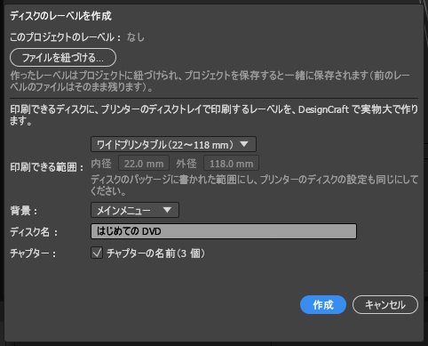

# 15. ディスクのレーベルを作る

[目次](README.md) ・ 前の章: [14. ビルドする](14-build.md#14-ビルドする) ・ 次の章: [16. Blu-ray を作る](16-bluray.md#16-blu-ray-を作る)

> **この章でできること**
>
> - 印刷できるディスクに刷るレーベルを作り、プリンターで刷る

印刷できるディスク（プリンタブルディスク）の面に、プリンターのディスクトレイで直接印刷するレーベルを作る。
DiscCraft だけの機能で、Encore にはない。レーベルは DesignCraft（Craft ファミリーのレイアウトのアプリ）の文書として作り、
文字はあとから自由に直せる。DesignCraft が入っていないときは、PhotoCraft で開ける PSD にする。

## 15.1 作る

**ファイル ▸ ディスクのレーベルを作成…** でダイアログが開く。



| 項目 | 内容 |
|---|---|
| このプロジェクトのレーベル | プロジェクトに紐づいているレーベル（[15.3](#153-プロジェクトとの紐づけ)） |
| 印刷できる範囲 | ディスクのパッケージに書かれた範囲。**ワイドプリンタブル**（内径 22 mm から外径 118 mm）、**標準**（内径 43 mm から 118 mm）、**カスタム**（内径と外径を入れる） |
| 背景 | 輪を埋める絵にするメニュー。メニューの背景だけを使う（モーションメニューは最初のフレーム）。**なし（白）** なら文字だけを印刷する |
| ディスク名 | 上半分に入れる題名。初めはディスクの名前 |
| チャプター | 名前を付けたチャプターの一覧を下半分に入れるか |

**作成** を押すと、プロジェクトの横に `<プロジェクト名> ディスクのレーベル.designcraft` を書いて DesignCraft で開く。
プロジェクトをまだ保存していないときは、ホームの Craft のフォルダーに書く。

## 15.2 レーベルの中身

ページはディスクと同じ 120 mm の正方形。

- **ディスクの面**（最初の層）: 印刷できる輪を 2 つの円の 1 つのパス（内側の円は穴）にして、その中に背景の絵を置く。
  穴やディスクの縁の外には印刷されない。絵は輪の中で動かしたり差し替えたりできる
- **ディスク名**: 上半分に、円に沿わない横書きで
- **チャプター**: 下半分に、項目を途中で切らずに、入るいちばん大きな文字で。入りきらないときはステータスバーに出る
- **ガイド**（印刷しない層。ロックしてある）: ディスクの縁、印刷できる範囲、穴

文字は DiscCraft がメニューに使う書体を、ポイントで指定した文字にしてあるので、どのプリンターの解像度でもくっきり出る。
文書を開いたときに使う層は **ディスクの面** の層なので、あとから貼り付けたロゴや曲目の一覧もそのまま印刷される
（輪では切り抜かれないので、輪の中に置く）。

## 15.3 プロジェクトとの紐づけ

作ったレーベルはプロジェクトに紐づき、プロジェクトを保存すると一緒に保存される。プロジェクトのファイルからの相対パスも
書くので、レーベルと一緒にフォルダーごと移したりコピーしたりしても見つかる。

- **ファイル ▸ ディスクのレーベルを開く**: 紐づいたレーベルを DesignCraft で開く（PSD は PhotoCraft で）
- ダイアログの上の **このプロジェクトのレーベル** の欄で、**開く**、**ファイルを紐づける…**（ほかで作ったレーベルを選ぶ）、
  **紐づけを外す**（ファイルはそのまま残る）
- 紐づける機能より前にプロジェクトの横に作ったレーベルは、その欄に出る（**このファイルを紐づける**）
- もう一度レーベルを作ると新しいほうを紐づけ、前のファイルは残る

## 15.4 印刷する

印刷は DesignCraft の **ファイル ▸ プリント**（Ctrl+P）で、ディスクを載せたトレイをプリンターに入れてから行う。

1. プリンターの設定で、用紙の種類をディスクのレーベル（光沢のディスクなら、それに合った種類）、給紙をディスクトレイにする
2. プリンターのディスクの設定（内径・外径）があれば、ディスクのパッケージと同じにする
3. プリンターに印刷プレビューがあれば、レーベルがディスクの円の中に収まっているかを確かめてから印刷する

プリンターによって、ディスクトレイへの印刷の扱いが違う。

- **CD/DVD の用紙の大きさがあるプリンター**: その用紙を選び、拡大・縮小せずに 100 % で、中央に置く
- **ディスクトレイを A4 のページとして印刷するプリンター**（エプソンの一部の機種など）: ディスクは A4 のページの決まった
  場所に来る。DesignCraft で A4 のページを作り、レーベルをその場所に置く。DesignCraft の印刷はページをプリンターの
  印刷できる範囲に合わせて少し縮めるので、その分だけ大きく置く。場所と縮み方は、方眼を描いた A4 のページを
  プリンターの印刷プレビューで見ると分かる

印刷した面は乾くまで時間がかかる。しばらく触らず、平らに置いて乾かしてから、ケースやドライブに入れる。

## 15.5 DesignCraft がないとき

DesignCraft が見つからないときは、PhotoCraft 用の PSD（300 / 600 dpi）を書いて PhotoCraft で開く。絵と文字のグループに
輪のレイヤーマスクが付き、ガイドは隠したレイヤーになる。DesignCraft は環境変数 `DISCCRAFT_DESIGNCRAFT`（アプリ）か
`DISCCRAFT_DESIGNCRAFT_CLI`（コマンドライン）で場所を教えることもできる。

## 15.6 コマンドラインで作る

```text
disccraft-cli disc-label <プロジェクト> --out <名前>.designcraft
```

| オプション | 内容 |
|---|---|
| `--out <名前>.psd` | DesignCraft ではなく PSD に |
| `--inner 43`、`--outer 118` | 印刷できる範囲（mm） |
| `--menu <メニューの名前>` / `--menu none` | 背景にするメニュー / 背景なし |
| `--title <題名>` | 上半分の題名 |
| `--no-chapters` | チャプターの一覧を入れない |
| `--dpi 600` | PSD の解像度 |
| `--link` | プロジェクトに紐づけて、プロジェクトを保存する |
