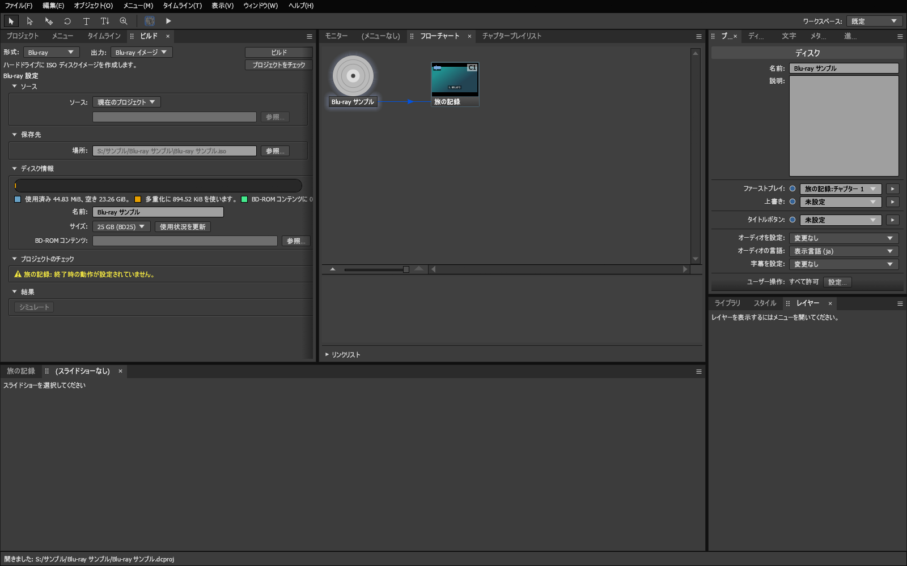
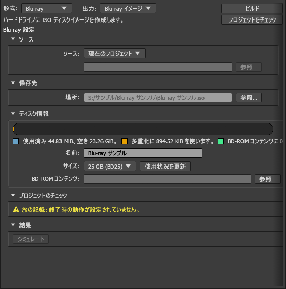

# 16. Blu-ray を作る

[目次](README.md) ・ 前の章: [15. ディスクのレーベルを作る](15-labels.md#15-ディスクのレーベルを作る) ・ 次の章: [17. 上級テクニック](17-advanced.md#17-上級テクニック)

> **この章でできること**
>
> - Blu-ray のディスクを作る
> - Blu-ray だけの機能（HD の映像、ポップアップメニューなど）を使う

同じプロジェクトを Blu-ray としてもビルドできる。**ファイル ▸ プロジェクト設定…** か
**ディスク** パネルでオーサリングモードを切り替え、**ディスク** パネルで映像の大きさ SD (MPEG-2)/
HD（H.264）も決める。

- Blu-ray の映像は SD（720×480 / 720×576）か、HD。HD は 1080p（23.976 / 24）と 720p が H.264、1080i（59.94 / 50）が MPEG-2。

  > **詳しく**
  >
  > - ディスクの **Blu-ray コーデック** を **H.264 (すべての形式)** にすると、1080i も H.264（インターレースのフレームとして、上のフィールドを先に。ビットレートは H.264 のもの）
  > - SD は DVD と同じ MPEG-2 か、**H.264 (すべての形式)** なら 720×480 / 720×576 の H.264（インターレースのフレームとして。画素の形はタイトルの 4:3 / 16:9 に合わせる。ビットレートは HD の H.264 と同じく決める。メニューは MPEG-2 のまま）
  > - **MPEG-2 (すべての形式)** にすると、1080p と 720p も MPEG-2（その形式のフレームレートのプログレッシブの絵として。ビットレートは MPEG-2 のもの）
  > - ビデオごとにコーデックを選ぶこともできる（**トランスコード設定…**。[5.1](05-assets.md#51-読み込み方) を参照）
  > - 1080 の形式には 1440×1080 の幅のものもある（1440x1080 の 59.94i / 50i / 23.976p / 24p。HDV や AVCHD の大きさで、画素が 4:3 の横長なので 16:9 に見える）
  > - 映像は 1440 の幅で作り、メニューと字幕は Blu-ray の規格の描き方どおり 1920×1080 のまま
  > - 29.97 fps や 25 fps で撮った素材は、1080i 59.94 / 50 を選ぶとそのままの速さで HD になる（Blu-ray の規格には 1920×1080 の 29.97p / 25p がないので、1 コマを 2 フィールドに分けた 1080i で入れる）
  > - HD の映像のビットレートは、H.264 が平均 12 Mbps、1080i の MPEG-2 が平均 25 Mbps
  > - タイトルが長くてディスクに収まらないときは、収まるところまで自動で下げる（H.264 は 3 Mbps、MPEG-2 は 8 Mbps まで。それでも収まらなければビルドできない）
  > - 容量メーターとプロジェクトのチェックも、このビットレートで見積もる
  > - Blu-ray にそのまま載る H.264 が入った `.m2ts` / `.mkv` / `.mp4` / `.mov` は、変換せずにそのまま収録する（[5.1](05-assets.md#51-読み込み方) を参照）
- Blu-ray は HDMV のみ（BD-J なし）で、メニューの作り方は DVD と同じ。
- **ポップアップメニュー** は Blu-ray のリモコンメニュー。メニューの **ポップアップ** タブで作り、タイムラインの **リモコンメニュー** に設定する。

  > **詳しく**
  >
  > - 再生の最中にリモコンで呼び出せる
  > - メニューが描くもの（文字、画像、デザインどおりのボタン）が映像の上に出る（メニューの背景は出ない）
  > - PSD から作ったポップアップメニューは、ボタンのセットと `(#)` のページのボタンだけが出て、その外のボタンでないレイヤー（白い Background など）は出ない
  > - メニューのビューアーも、背景タイムラインを決めていなければ透明（市松模様）の上に、ディスクで出るものだけを表示する
  > - ページのあるポップアップメニュー（**メニュー ▸ 新規ページを追加**）は、全ページがまとめて出て、最初のページから始まる
  > - 別のページへのボタンは、タイトルの再生を続けたままページを替える（ページは 254 まで、ボタンは 1 ページに 254 まで。それを超えると、そのボタンは今までどおりタイトルを離れてそのページのメニューへ行く）
- HD（1080p、720p）は H.264 で、クリップは IDR 画像でつながるので、トリムした位置どおりに
  出る（DVD で変換するクリップも同じ。そのまま入る MPEG-2 は GOP の頭で切れる）。
- DTS のファイルは、DVD と同じく Blu-ray にもそのまま（コアを）入れられる。
- HD か PAL の Blu-ray の字幕は、同じトラックで前の字幕から 5 フレーム以上空ける
  必要がある。チェックに出る（**字幕の間隔**）。
- ビルドは同じ（**ファイル ▸ ビルド ▸ フォルダー…** / **画像…**）。フォルダーは `VIDEO_TS`
  ではなく `BDMV` になる。プロジェクトプレビューとモニターは、ビルドした Blu-ray
  をポップアップメニュー込みで再生する。
