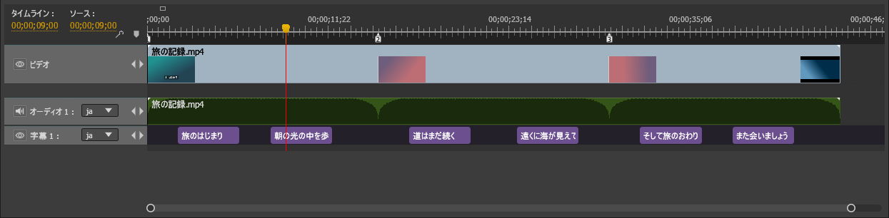
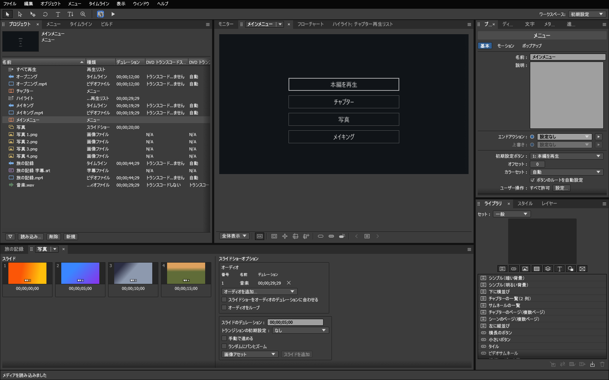
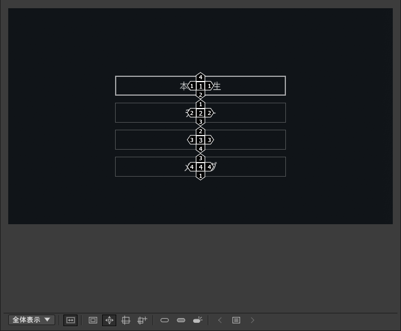
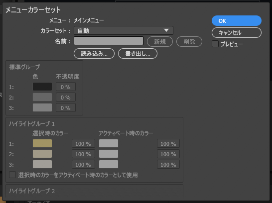
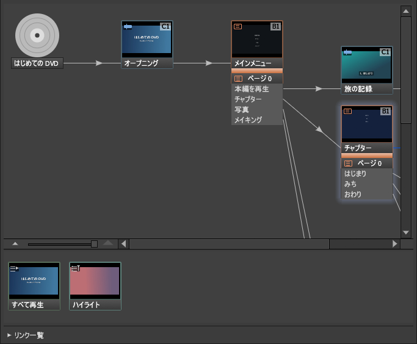

# 17. 上級テクニック

[目次](README.md) ・ 前の章: [16. Blu-ray を作る](16-bluray.md#16-blu-ray-を作る) ・ 次の章: [18. 環境設定](18-preferences.md#18-環境設定)

> **この章でできること**
>
> - 絵入りのシーン選択メニュー、隠しボタン、手で引くルートなど、一歩進んだメニューを作る
> - 作業しながらディスクの大きさを読む

これまでの章は作業の流れどおりに書いた。この章は、ディスクを「オーサリングした」ものにする部分:
絵入りのシーン選択メニュー、ライブラリから組み立てるメニュー、手で引くルート、
隠しボタン、ボタンごとに決めるハイライトの色、音つきのモーションメニュー、
作業しながらディスクの大きさを読む。それぞれ手順どおりにたどれるように書き、上限はそばに添えた。

## 17.1 絵入りのシーン選択メニュー

チャプターポイントは、シーンの始まる所に置く印。ボタンにリンクすれば、観る人はスクラブせずに
目当てのシーンへ飛べて、リモコンの次・前のチャプターキーでチャプターを順にたどれる。

1. **ファイル ▸ 読み込み ▸ タイムライン…**（Shift+Ctrl+T）で、選んだビデオ 1 本ごとに
   アセットとタイムラインをまとめて作れる（1 本ずつ作らなくていい）。1 本目のビデオが
   **ファーストプレイ** になる。
2. プロジェクトパネルのタイムラインをダブルクリックしてタイムラインビューアに開き、
   モニターも出しておく（**ウィンドウ ▸ モニター**、F9）。
3. はっきり場面が変わる所に再生ヘッドを置いて **タイムライン ▸ チャプターポイントを追加**
   （テンキーの `*`）。チャプターは順に番号が付くので、間に 1 つ足しても番号は自動で
   振り直される。
4. プロパティでチャプターに名前を付ける。チャプターの名前は、通常はその先へ導くボタンの
   名前と同じにする。**表示 ▸ チャプター名を表示**（Ctrl+8）でタイムラインに名前が出る。
5. これを映像の最後まで繰り返す。シーンが等間隔なら **一定間隔でチャプターポイントを追加…**
   （既定 5 分）。
6. ボタンには、シーンの 1 フレーム目よりそのシーンらしい絵を置く。その絵のフレームへ
   再生ヘッドを動かして **タイムライン ▸ ポスターフレームを設定** を選ぶか、チャプターのプロパティの
   **ポスターフレーム** にタイムコードを打つ。ポスターフレームにはチャプターと同じ番号の
   旗が立ち、ドラッグで動かせる。欄を空にするとチャプター自身のフレームに戻る。
7. メニューを作る。チャプターごとにボタンを並べるなら **メニュー ▸ チャプターインデックスを
   作成**、絵のボタンを並べるならライブラリの **サムネールの一覧** プリセット。チャプターに
   リンクしたボタンは、そのチャプターのポスターフレーム（なければチャプター自身のフレーム）を
   出す。

知っておくこと:

- チャプター 1 は常にタイムラインの 1 フレーム目。動かすことも消すこともできず、
  新しいタイムラインには必ず付いてくる。ビデオが黒から始まる（フェードイン）ときは、何かが
  見え始める最初の 0.5 秒刻みの位置がポスターフレームになる（1 秒ほどのフェードなら 1.5 秒）。
- そのままディスクに載る MPEG-2 では、チャプターポイントは GOP の頭にしか置けない。
  置きたい所に置けば DiscCraft が近くの空いている GOP の頭へ寄せるので、GOP の中に
  置いたポイントはそこには残らない。トリムも同じ吸着をする。
- ポスターフレームのない静止のサムネールは、チャプターの最初の明るい（黒でない）フレームを出す。
  黒からフェードインするシーンでも、ボタンに何も映らないでいることはない。
- DVD は 1 タイトル 99 チャプター。チャプターインデックスの 1 ページにはチャプターボタンを 18 個
  （複数ページで作る場合は 1 ページ 6 個）置ける。
- **モーションボタン** を入れると、サムネールのボタンは 1 枚の絵ではなく動画を再生する。
  動きの始まりは、リンクしたチャプターの頭（またはポスターフレーム）。

## 17.2 ライブラリからメニューを組み立てる

ライブラリには DiscCraft 独自のメニュー・ボタン・画像・背景・シェイプのプリセットと、
自分で保存した項目が入っている。この方法で作ったメニューも、完成してしまえば普通のメニューで、
どこから来たかの印は残らない。

1. **ライブラリ** パネルでメニューの種類の切り替え（最初の絵）をクリックし、セット（**一般**、
   自分のものは **ユーザー**）を選び、プリセットを選んで **新規メニュー**（一覧の下の **+** の付いた
   絵のボタン）を押す。メニュービューアに開き、
   プロジェクトパネルとメニューパネルにも出る。
2. 名前は **Alt+Ctrl+R** で付ける（「メニュー #1」「シーン選択」など、後で分かる名前に）。
3. ボタンの種類の切り替え（2 番目の絵）をクリックし、ボタンを選んで、メニューに入れる数だけ
   **配置**（枠に入る矢印）を押す。ボタンはキャンバスに
   置かれる。
4. **選択ツール**（V）で大まかな位置へ動かす。複数選んで（Shift+クリック、または囲って）
   **オブジェクト ▸ 均等配置** と **オブジェクト ▸ 整列** で間隔と揃えを直す。
   **セーフエリアに相対的に整列** を入れると、キャンバスではなくセーフエリアの枠が基準になる。
5. ボタンと同じ書式の見出し文字はこう作る。ボタンを選んで **Ctrl+C** → **Ctrl+V** →
   **オブジェクト ▸ オブジェクトに変換**。ボタンは消えて、文字だけが同じ場所に同じ大きさ・
   同じ書体で残るので、**横書き文字ツール**（T）で打ち替える。メニュー間でも同じように
   コピー＆ペーストすれば、見た目をそのまま持ち込める。
6. 見出しを選んで **オブジェクト ▸ ドロップシャドウ…**（Shift+Ctrl+O）。**ドロップシャドウ** と
   **プレビュー** に印を付け、色・不透明度・角度・距離・サイズ・スプレッドを決めて **OK**。
   同じダイアログはボタン・画像・シェイプにも使える。
7. 戻るボタンも作る。文字をもう一度貼り付けて「メインメニュー」に直し、**Ctrl+B**
   （**オブジェクト ▸ ボタンに変換**）。これがボタンの一番素直な作り方。
8. 各ボタンをリンクし（[17.7](#177-ボタンへのリンクの入れ方-5-とおり)）、メニューの
   **エンドアクション** と **初期設定ボタン** も決める。
9. 残しておきたいメニューなら、**メニュー ▸ メニューをテンプレートとして保存…**（Ctrl+Alt+M）
   でライブラリの **ユーザー** セットに入れておき、次のプロジェクトでも使う。

背景はいつでも変えられる。ライブラリで背景を選んで **配置** か **背景を設定**。**置き換え** は、
開いているメニューのデザインを別のプリセットに差し替え、リンクは番号のまま残す。

## 17.3 ルートと番号を手で決める

ルートは、観る人が矢印キーを押したときにハイライトがたどる道。DiscCraft はそれらしい道を自動で引く
（規則は [環境設定 ▸ メニュー](18-preferences.md#18-環境設定) にあり、プロジェクトに保存されるので、
どのパソコンでビルドしても同じルートになる）。ボタンの並びが変なとき、行を折り返したくないとき、
誰も思いつかない道へ導きたいときは手で引く。

自動のルートは Adobe Encore CS6 と同じ規則で引く。左（上）の端か中心が 9 px 以内にそろったボタンは列（行）になり、
上下（左右）はその中を進んで端で折り返す。少しだけずれたボタン（行と重なって 10〜18 px ずれたもの）があると
その行は全体が行でなくなり、ボタンどうしが一部だけ重なっているとき、行のボタンから 10〜18 px 離れたボタン（すぐ下の帯など）が
あるときも同じ。ほかのボタンを中に含むボタン
（項目の並びの後ろの帯など）は行にも列にも入らず、中のボタンへ進む。行も列もない向きは、その向きの一番近い
ボタンへ（上下はまっすぐから約 68° まで、または横に 400 px 未満）、なければ横のボタンへ（同じ高さのものを先に、すき間の近いもの、
同じなら時計回りの側: 上は右、下は左）。「次へ」「前へ」を除くときは、一番左のボタンの
上と左が「前へ」、一番右のボタンの下と右が「次へ」になる。

1. メニューの背景をクリックして（ボタンでも文字でもない所）プロパティにメニューのシートを
   出し、**基本** タブの **ボタンのルートを自動設定** を外す。
2. **表示 ▸ ボタンルートを表示**（Ctrl+7）すると、ボタンごとに十字の図が出る。
   真ん中の数字がボタンの番号、矢印の数字はその矢印キーで行き着くボタン（0 は行き先なし）。
3. 先に番号を決める。ボタンのシートの **番号** は一覧での位置を入れ替える欄で、
   矢印は番号を指すので、左から右・上から下に振っておくと後の作業が楽になる。メニューの
   **オフセット** は、リモコンの数字キーがどこから数え始めるか。
4. 十字の矢印を、導きたいボタンへドラッグする。キャンバスの何もない所で離すとそのルートは消える。
   触っていない向きは自動のまま。
5. ルートの表示を消して試す。**ファイル ▸ プレビュー**（Alt+Ctrl+Space）で矢印キーを押す。

## 17.4 隠しボタンとイースターエッグ

イースターエッグは、偶然には見付からない場所にある項目のこと。ディスクでは、
描かれないボタン（またはハイライトが乗るまで描かれないボタン）と、
ふつう誰も歩かないルートでできている。型は 2 つあって、違いはどちらのハイライトを見せるかだけ。

- カーソルが乗ったときにハイライトが出るもの。ていねいにたどる人なら見付けられる。
- ハイライトも透明なもの。見付けたかどうかは Enter を押すまで分からない。

作り方は次のとおり。

1. メニューを作る（**ファイル ▸ 新規 ▸ メニュー**、Ctrl+M、またはライブラリのプリセット）。
   普通のボタンを 2〜3 個と、画像を 1 つ置く（**ライブラリ ▸ 画像 ▸ 配置**）。重ねないで置く。
2. 画像を選んで **Ctrl+B**。これが隠しボタンになる。リンクは先に付けておく（タイムライン、
   再生リスト、スライドショー）。リンクのないボタンはチェックに出る。
3. 背景をクリックして **ボタンのルートを自動設定** を外し、ルートは自分で引く。
4. **レイヤー** パネルで、通り道に使う 2 つのボタンのセットを開いて、目のアイコンをクリックして
   非表示にする。文字と絵は消えるが、ボタンとしては残るので、ハイライトもリンクも効いたまま。
5. その 2 つのボタンを選んで **ハイライト** を **グループ 2** にする。見えるボタンと画像のボタンは
   **グループ 1** のままにする。
6. **メニュー ▸ メニューカラーセットを編集…** で **メニューの初期設定** を選び、**プレビュー** に
   印を付けて、ハイライトグループ 2 の不透明度を 0 % にする（色 1・2・3、選択時とアクティベート時の
   両方）。グループ 2 のボタンは完全に消える。
7. 同じダイアログで、ハイライトグループ 1 には気づく色を付ける（定番は明るい緑）。
   観る人が辿り着けた合図になる。見付かっても暗いままでいいなら、そちらの不透明度も 0 にして、
   選択されても透明にしておく。
8. ルートの表示を入れて番号を振る。見えるボタンが 1、透明なボタンが 2 と 3、隠しボタンが最後。
   それから矢印をドラッグして、隠しボタンへ行く道だけ変な順（左、上、左）にしておき、
   間違ったキーは全部ボタン 1 に戻すようにする。
9. マウスではなく矢印キーでプレビューする。

注意:

- 隠したボタンもボタンには違いない。場所は取り、ハイライトはほかと重なってはいけないし、
  1 メニュー 36 個にも数えられる。
- 枠の中に収める。枠の外に出たボタンはチェックに出て、リモコンで辿り着けない。
- リンクのない透明なボタンは、画面では決して見えないエラー。ビルドの前に
  **プロジェクトをチェック…**（Shift+Ctrl+L）を通す。
- エッグのあと観る人に元のメニューへ戻ってもらうには、リンク先を
  **エンドアクションが 前のメニューに戻る** のタイムラインにするか、来たメニューを
  エンドアクションに設定する。
- ほかにも覚えておくと便利な技: ボタンはメニューの**ボタンまで指定して**リンクできる。
  メニューを開いた時点で、そのボタンがハイライトされた状態になる。

## 17.5 ハイライトの色をボタンごとに決める

メニューのハイライトはサブピクチャ、つまりボタンにカーソルが乗ったとき（選択時）と押したとき
（アクティベート時）に、ボタンの上かそばに重ねて描かれる絵。メニューはカラーセットを持つ
（標準グループとハイライトグループ 1〜3）。グループには色が 3 つずつあり、それぞれに選択時と
アクティベート時のカラーと不透明度がある。ボタンはどのグループを使うかを選ぶ。

1. メニューを選んで **カラーセット** を **自動** ではなく **メニューの初期設定** にする。
   自動はメニューごとに色を作るので、メニューが 1 つならそれでもいいが、6 個並ぶとバラバラになる。
2. **表示 ▸ 標準サブピクチャを表示 / 選択時のサブピクチャを表示 /
   アクティベート時のサブピクチャを表示**（Ctrl+3 / Ctrl+4 / Ctrl+5）で、キャンバスの全部のボタンに
   各状態が重なる（同じものをもう一度で消える）。
3. ボタンを選んで（枠の中、十字の図以外をクリック）、**ハイライト** を別のグループに変える。
   同じグループのボタンはまとめてハイライトされるので、「チャプター 1 / 2 / 3」の列が
   ひとつのまとまりに見える。
4. 色を決めるのは **メニュー ▸ メニューカラーセットを編集…**。**プレビュー** に印を付けて、
   ボタンが見える部分を残すようにダイアログを横にどけると、色や不透明度を変えた瞬間にメニューが
   変化する。**選択時のカラーをアクティベート時のカラーとして使用** を入れると、押したときの
   見た目が乗ったときと同じになる。
5. たいていのディスクでは全体で 1 つの配色を使う。メニューの初期設定を 1 回変えれば、
   それを使っているメニューは全部ついてくる。

色を別のプロジェクトへ持ち込むには、メニューをテンプレートに保存して（Ctrl+Alt+M）
そちらで開く。メニューのカラーセットにはファイルがない。字幕のカラーセットにはある
（`.dccolors`、[11.3](11-subtitles.md#113-見た目)）。

## 17.6 モーションメニューに音と動きを

メニューは、背景が動画になった瞬間にモーションメニューになる。作り方は手間が少ない順に 3 とおり。

**普通のメニューの後ろに動画を置く**

1. 動画をアセットとして読み込む（**ファイル ▸ 読み込み ▸ アセット…**、Ctrl+I）。
   メニューの後ろに置くのはタイムラインではなく動画。
2. メニューを選んでシートの **モーション** タブを開き、**背景** で動画を選ぶ。
   ボタンのうしろに最初のフレームが映り、ボタンも図形もそのまま残る。PSD から作ったメニューでは、
   動画は PSD の一番下のレイヤーの代わりになり、ほかのレイヤーは動画の上に残る。
3. **ループ**（メニューに使う動画の秒数）、**ループ回数**（1 回だけにする **なし**、数字、または
   **無限**）、最初から回したくないときは **ループポイント** を決める。
4. **デュレーション**（メニューは最大 254 秒）と、時間切れの行き先である **エンドアクション**
   を決める。エンドアクションがないとモーションメニューはくり返し、静止メニューは最後の絵で止まる。
5. **オーディオ** は、メニューが出ている間に鳴り続ける音。静止メニューは音声の長さで
   くり返す。

**EffectCraft で動きを付ける**

**メニュー ▸ EffectCraft コンポジションを作成…** は、メニューをレイヤー付きの PSD に
書き出し、ディスクのフレームレートと画素の形で EffectCraft のプロジェクトを作り、
`<メニュー名> モーション.mp4` のレンダーをキューに入れて開く。そこでレイヤーを動かす
（タイトルを滑り込ませる、背景をゆっくり揺らす）と、レンダーされたムービーを
DiscCraft が読み取って、自動的にメニューの背景に設定する。そのあと:

- 動かしたレイヤーは **レイヤー** パネルで非表示にする。ディスクではレイヤーが空の状態で
  始まり、ムービーと一緒に現れるので、二重に描かれない。
- **ループ回数** を **なし** にする。メニューを開いたときに 1 回流れて、最後の絵で止まる
  （くり返さない）。
- **ファイル ▸ レンダリング ▸ モーションメニュー** のあとプロジェクトプレビューで見るか、ビルドしてから見る
  （**ウィンドウ ▸ モニター**、F9、**ビルド結果を開く**）。レンダリングするまでと、メニュービューアでは
  いつも、モーションメニューは背景の最初のフレームを映す。

**ボタンを動かす**

**モーション** タブの **モーションボタン** を入れると、メニューのサムネールボタンが動画を
再生する。ビットレートがかかる上、古いプレーヤーがいちばん嫌がる種類のモーションメニューなので、
量産する前に実機のプレーヤーで確かめる。**ファイル ▸ レンダリング ▸ モーションメニュー** のあとは
プロジェクトプレビューでボタンの動画が動く。スライドショーにリンクしたボタンは、
最初のスライドのまま止まっている。

## 17.7 ボタンへのリンクの入れ方 5 とおり

| 入れ方 | やり方 | 向いている場面 |
|---|---|---|
| プロジェクトパネルからドラッグ | タイムライン・スライドショー・再生リスト・チャプター再生リストをキャンバスに落とすと、その場にボタンが増え、名前とリンクが付く | メニューを作りながら、項目が手近にあるとき |
| **リンク** 欄 | ボタンを選んでシートで行き先を選ぶ。ボタンの一覧にはタイムラインそのものと、そのチャプターが並ぶ | 複数のボタンを順に決めていくとき |
| ピックウィップ | 欄の左の丸を、プロジェクトパネルの項目、フローチャートの箱、チャプターマーカー、メニューのボタンへドラッグ | 長い一覧のずいぶん下に行き先があるとき |
| **オブジェクト ▸ リンクの指定…**（Ctrl+L） | 種類の順に並んだ全項目のダイアログ。ボタンのときは、切り替わるオーディオと字幕も決められる | プロジェクト全体を 1 つの一覧で見たいとき、トラックも一緒に決めたいとき |
| フローチャート | ボタンのポートから別のノードへドラッグ、またはノードの右クリックの **リンクの指定…** | ナビゲーションを描きながら、行き先を見たいとき |

エンドアクション・上書き・リモートメニューも同じ 5 とおりで入れられる。行き先のうち
2 つは覚えておくといい: **停止** は再生を終え、**前のメニューに戻る** は観てきたメニューへ
戻る。「全編再生」らしく動くのは後者。

## 17.8 フローチャートをディスクの地図として使う

フローチャート（**ウィンドウ ▸ フローチャート**、F5）は、ナビゲーションを探すのではなく読む場所。
左にディスクがあり、その **ファーストプレイ** からたどれるメニュー・タイムライン・スライドショー・
再生リストが、右へ木のように箱となって広がり、リンクは 1 本ずつ自分の箱へ入る線になる。

- 下の **トレイ** から箱をドラッグして、ディスクに落とすと、ディスクを入れると最初に再生されるものに
  なる。タイムラインに落とすと、そのタイムラインのあとに再生されるものになる。
- ボタンの行からメニュー・タイムライン・スライドショー・再生リストへドラッグするとリンクする。
  タイトルの名前の右端から引けば、そのタイトルが終わったあとの行き先になる。木にもう出ている項目への
  リンクはその薄い写しへ入るので、上の階層のメニューへ戻るメニューもループとして読め、写しには
  リンクが入るチャプターやボタンが出る。トレイにあるものは孤立。
- **自動レイアウト** / **すべて自動レイアウト** で箱の並びを整えられる。手で置いた箱は、その箱の
  **自動レイアウト** を押すまで動かした場所に留まる。
- ノードの右クリックに **開く** / **リンクの指定…** / **名前の変更…** / **ファーストプレイに設定** /
  **ここからプレビューする**（その項目からプレビューが始まる）。
- **表示 ▸ すべてのサムネールを表示** で箱に絵を出す。どれがどのメニューだったか分かる
  いちばん早い方法。

再生がおかしくなるディスクは、たいていエンドアクションの抜けか孤立が原因。両方ともチェックに出る
（[12 章](12-check.md#12-プロジェクトをチェックする)）し、フローチャートでは線の入っていない箱として見える。

## 17.9 作業しながらディスクの大きさを読む

ビットバジェッティングとは、ディスクに収まる画質を決めること。ディスクの容量は決まっていて、
動かせるのは映像のビットレートだけ。

- **ビルド** パネルの **ディスク情報** のバーが今の合計（**容量を更新** で計算し直す）。
  小さいプロジェクトなら、ときどき見るだけで十分。
- DVD は全部いっしょに数える: ビデオ、オーディオ、字幕、モーションメニューの動画。
  1 本のタイトルの上限は 9.8 Mbps で、ビデオをそのまま使うタイムラインが超えると
  チェックに出る（**高すぎるタイムラインビットレート**）。
- 変換する映像は、既定ではディスクの容量に合わせて 9.8 Mbps まででビットレートを決める。
  長いと低くなり、低くなった影響はまず動きの速い所とフィルムの粒子に出る。
- 収まらないときの選択肢は昔から 3 つしかない: 内容を減らす、レートを下げる、大きいディスクに
  する（DVD9、BD50…）。DVD-9 はレイヤーブレークが加わるので、場面変わりに置くのがいちばん
  自然。**レイヤーブレーク** でタイムラインとタイムコードを決める（[14 章](14-build.md#14-ビルドする)）。
- 音声の分もきちんと数える。変換すると AC-3 192 kbps だが、AC-3・WAV・DTS はそのまま載るので、
  1.5 Mbps の WAV や DTS のトラックは、その分だけ映像から減る。
- DVD5 のざっくりした目安: 上限のレートで 1 時間弱、多くの人が文句を言わないレートで 2 時間くらい。
  動きの激しい映像を 1 枚に 2 時間入れると、画質の劣化が目立ち始める。

## 17.10 まだないもの

探して見つからなくて困らないように、書いておく。

| Encore にあるもの | DiscCraft |
|---|---|
| macOS と Linux でのディスクへの書き込み | ない（Windows はレコーダーのディスクに書き込める）。フォルダー、ISO、DVD の DDP イメージを書く |
| コピーガード（CSS、AACS） | ない。リージョンコードのフラグだけ |
| BD-J メニュー | ない。Blu-ray は HDMV |
| 目盛りに出る GOP ヘッダーの印と、Alt での GOP 送り | ない。そのまま入る MPEG-2 では、チャプターポイントとトリムは自動的に GOP の頭へ吸着する（変換する映像はどのフレームでも切れる） |
