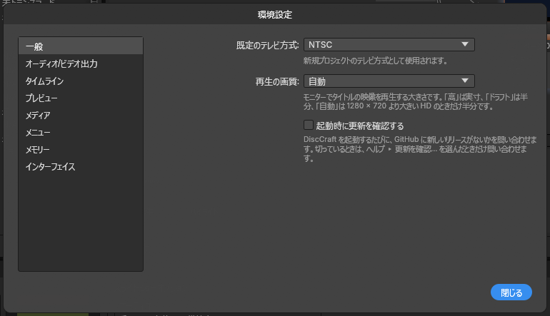
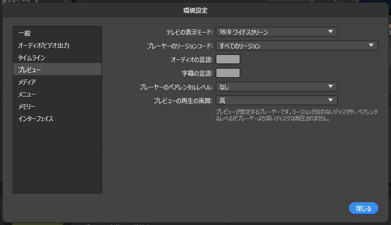
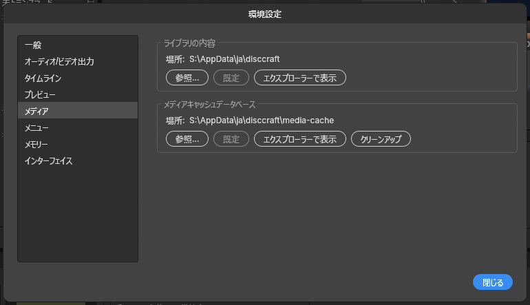
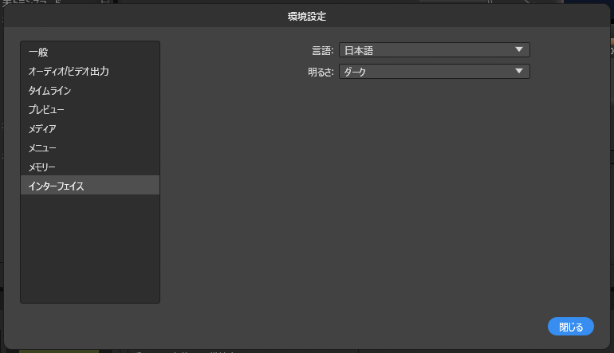

# 18. 環境設定

[目次](README.md) ・ 前の章: [17. 上級テクニック](17-advanced.md#17-上級テクニック) ・ 次の章: [19. キーボードショートカット](19-shortcuts.md#19-キーボードショートカット)

> **この章でできること**
>
> - 環境設定の各ページで、何を決められるかを知る

**編集 ▸ 環境設定…**（Ctrl+K）。左の一覧で分類を選ぶと、右にその設定が出る。設定は変えたときに効き、**閉じる**（Esc、外側のクリック）で閉じる。項目のラベルは右寄せの列にそろい、説明は入力欄の下に小さく出る。

メニュー以外の設定はこのパソコンの設定（`config.toml`）に残り、どのプロジェクトにも効く。メニューの設定はプロジェクトに
保存される。

## 18.1 一般

- **既定のテレビ方式**: 新規プロジェクトの既定（NTSC / PAL）
- **再生の画質**（高 / ドラフト / 自動）: モニターでタイトルを再生するときの絵の大きさ。高はディスクの
  フレームの大きさ、ドラフトは半分、自動（初期値）は 1280 × 720 より大きい HD だけ半分（1080 ラインのタイトルが
  なめらかに再生される）
- **起動時に更新を確認する**（初期値オフ）: 起動するたびに GitHub に新しいリリースがないかを問い合わせる。オフのときは、
  **ヘルプ ▸ 更新を確認…** を選んだときだけ問い合わせる（[23. うまく動かないとき](23-troubleshooting.md#23-うまく動かないとき)）

## 18.2 オーディオ/ビデオ出力

- **オーディオ出力デバイス**: モニターとプレビューの音を出すデバイス。システムの既定か、出力デバイスのどれか
  （次に再生を始めたときから。なくなったデバイスのときは既定のデバイスで鳴る）
- **ビデオ出力**: モニターやプレビューが再生しているタイトルの絵を、ほかのディスプレイに全画面で、または
  **専用のウィンドウ** にも映す（オフ / 専用のウィンドウ / つないであるディスプレイ）。そのウィンドウで Esc を押すとオフになる
- **バックグラウンド時はビデオ出力を無効にする**（初期値オン）: DiscCraft のウィンドウがどれも前面にないあいだ、出力の
  ウィンドウを消す

> **詳しく**
>
> - 別のディスプレイに全画面で映すときは、DiscCraft のウィンドウで作業しているあいだも、ほかのウィンドウとそのディスプレイの
>   タスクバーより前に出たまま（DiscCraft のウィンドウが同じディスプレイにあるときは除く）
> - メニューは出さず、タイトルの絵だけを映す

## 18.3 タイムライン

- **静止画の長さ**: 新しいスライドショーのスライドの長さ（初期値 6 秒）
- **字幕の長さ**: モニターで足す字幕の長さ（初期値 2 秒）
- **オーディオの言語** / **字幕の言語**: 新しいトラックの言語（空ならディスクのオーディオの言語）
- **字幕クリップをスナップ**（初期値オフ）: ドラッグした字幕クリップが、近くの字幕クリップの端、チャプターポイント、
  再生ヘッドに吸い付く

## 18.4 プレビュー

プロジェクトプレビューとモニターが再現するプレーヤーの設定。初期値（ワイドスクリーン、すべてのリージョン、言語なし、
レベルなし）では、どのディスクもそのまま再生される。

- **テレビの表示モード**: 16:9 ワイドスクリーン、4:3 レターボックス（16:9 のタイトルを 4:3 の画面に上下の帯つきで映す）、
  4:3 パン&スキャン（16:9 のタイトルの真ん中を 4:3 の画面いっぱいに映し、左右は切れる）
- **プレーヤーのリージョンコード**: すべてのリージョン、または 1〜8 のどれか。ほかのリージョンに限った DVD はプレビューで
  開かない（理由はステータスバーに出る）
- **オーディオの言語** / **字幕の言語**: ディスクがトラックを選ばないとき、タイトルのこの言語の最初の音声・字幕を選ぶ
  （プレビューで開いたビルド済みの Blu-ray も同じ）
- **プレーヤーのペアレンタルレベル**: なし、または 1〜8。ペアレンタルレベル（ビルドパネル）がこれより高いディスクは、ロックされた
  プレーヤーと同じく再生されない
- **プレビューの再生の画質**: プロジェクトプレビューのタイトルでの、一般の **再生の画質** と同じ選択（初期値は高）

## 18.5 メディア

**ライブラリの内容**（自分のライブラリの項目）と **メディアキャッシュデータベース**（メディアファイルについて覚えておいた
長さ・寸法・サムネイルと、大きなファイルの索引）の場所。それぞれ **参照…**（別のフォルダーに置く）、**既定**（設定の
隣に戻す）、**エクスプローラーで表示** がある。**クリーンアップ** はメディアキャッシュを空にする。

> **詳しく**
>
> - 索引を持つのは MKV とトランスポートストリーム（`.m2ts` / `.ts` / `.mpg` / `.vob`）。大きなファイルも次に起動したときは
>   すぐ開く
> - ライブラリのあるフォルダーを選ぶとそのライブラリを開き、空のフォルダーなら今の項目をそこに書く
> - キャッシュは選んだときから新しいフォルダーを使い、前のフォルダーはそのまま残る
> - **クリーンアップ** のあと、ファイルは次に必要になったときに読み直す（ビルドの変換はビルドの出力先にあり、消えない）
> - 素材のファイルの中にも隣にも、何も書かない

## 18.6 メニュー

ボタンのルート（上下左右の動き、折り返しと折り返しの方式、「次へ」「前へ」ボタンを除外）と、ボタンの名前の同期の既定。
**プロジェクトに保存される**（どのパソコンでビルドしても同じルートになる）。

## 18.7 メモリー

- **搭載メモリー**
- **同時にトランスコードする数**: 自動（プロセッサーのコアの数）、または数。ビルドと「今すぐトランスコード」は複数の
  タイトルを同時に変換し、変換ごとにメモリを使うので、ほかのアプリケーションに残したいときは数を減らす
- **HD の H.264 にハードウェアエンコーダーを使う**（Windows。グラフィックスカードのエンコーダーが見つかったときだけ
  選べる。初期値はオフ）: Blu-ray の 1080p と 720p の H.264 を、プロセッサーの代わりにハードウェアで符号化する。
  1080i の H.264 は、フィールドを符号化できる NVIDIA のグラフィックスカード（Blackwell 世代、RTX 50 シリーズなど）
  のときだけハードウェアで符号化する

> **詳しく**
>
> - 1 パス（VBR か CBR）はそのまま。2 パスは 1 パスで作り、大きさが目標から 2 % を超えてずれたときだけ平均を直して
>   もう一度作る（プロセッサーの 2 パスの 4〜6 倍の速さで、画質は同じかそれ以上）
> - ディスクと同じ大きさと色のビデオは、デコードした絵をそのままエンコーダーに渡す
> - 1080i（1440 × 1080 も）の H.264 は、NVIDIA のエンコーダーで各フレームを 2 つのフィールドとして符号化する
>   （プロセッサーの約 2.6 倍の速さで、画質は同じ）。フィールドを符号化できないカードではプロセッサーで変換する
> - SD と、エンコーダーが開けない・途中で失敗したビデオはプロセッサーで変換する
> - コマンドラインでは環境変数 `DISCCRAFT_HARDWARE_ENCODER=1`

## 18.8 インターフェイス

- **言語**: 日本語 / English。macOS ではアプリのメニューの **言語** でも切り替えられる。自分で選ぶまでは、起動のたびに OS の表示言語に
  従う（日本語の OS は日本語、それ以外は英語）
- **明るさ**: **ダーク**（既定）か **ライト**（明るい灰色のパネルに濃い文字）。すぐに切り替わり、次の
  起動にも残る

